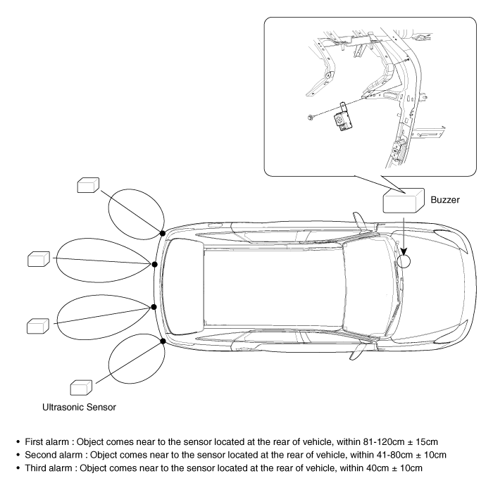

# Sistema de Ajuda de Aferição Traseira: Unidade de Controle — Componentes e localização

[Home](../../index.md) / [Manual de Serviço e Reparo](../sportage-482.md) / [Sistema Elétrico do Corpo](sportage-984.md) / [Sistema de Ajuda de Aferição Traseira](sportage-1160.md) / Componentes e localização

## Diagrama

