# Kia Sportage: Sistema de Ajuda de Aparcar Traseira: Unidade de Controle: Descrição e Operação

[Início](../../index.md) / [Manual de Serviço e Reparo do Kia Sportage SL](../sportage-482.md) / [Sistema Elétrico do Corpo](sportage-984.md) / [Sistema de Ajuda de Aparcar Traseira](sportage-1160.md) / Unidade de Controle do Sistema de Ajuda de Aparcar Traseira: Descrição e Operação

## Descrição

Ao reverter, o condutor não é fácil de encontrar objetos nos pontos c�mbios e determinar a distância do objeto. Para fornecer segurança e conveniência ao condutor, o sistema de advertência de trás será ativado ao engatar a "R". Um sensor ultrassônico emitirá ondas ultrassônicas para trás e detectará a onda refletida.

A unidade de controle (BCM) calculará a distância ao objeto usando a entrada de sinal do sensor e emitirá um alarme com três etapas (primeira, segunda e terceira).

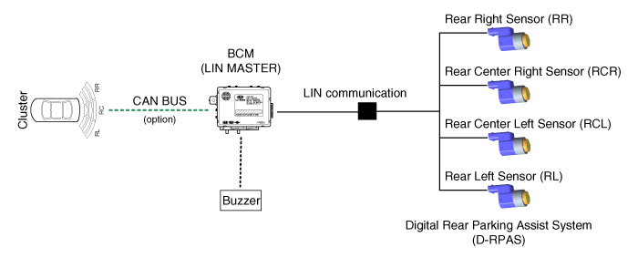

Bloco Diagramático

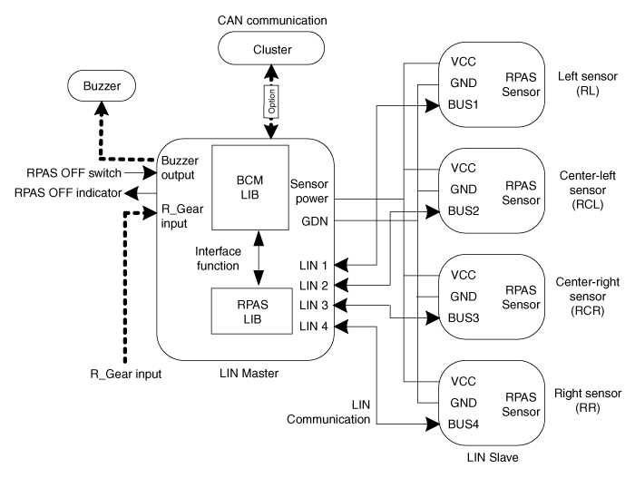

## Operação

Operação do Sistema

Modo Inicial

1. O RPAS verifica o ID e a Referência (tabela de modelagem) durante a inicialização usando a comunicação LIN.

2. Se o ID do sensor ou o parâmetro do sensor for igual ao valor esperado,
   o sistema RPAS será inicializado dentro de 500ms após ligar o IGN1 e engrenar a R.

3. Se o ID do sensor ou o parâmetro do sensor for diferente do valor esperado,
   o modo inicial pode levar cerca de 1,2 segundo após ligar o IGN1 e engrenar a R devido à instrução de ID ou parâmetro do sensor.

4. O RPAS executa a diagnóstico de cada sensor durante a inicialização.

   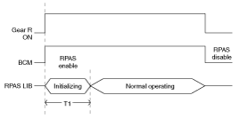

   T1 : Tempo de inicialização do RPAS

   | (1) | No caso de instrução de sensor, T1 : dentro de 1,2 segundo |
   | --- | --- |

   | (2) | No caso de condição normal, T1 : 500ms ± 10% |
   | --- | --- |

Modo Normal

O modo normal do RPAS pode ser dividido em dois passos.

O primeiro passo é um modo para informar ao motorista que o sistema RPAS está ON e os resultados da diagnóstico, que são executados durante a inicialização.

O segundo passo é o modo de detecção de obstáculos para fornecer uma advertência ao motorista quando detectar um obstáculo.

1. Modo de informação do motorista para RPAS ON

   | (1) | Se não houver mensagens de diagnóstico dos sensores, o som normal de RPAS ON com período de ON de 300ms será emitido após o tempo de inicialização desde que a R seja engrenada. A advertência de detecção de obstáculos começa após um atraso de 100ms desde o fim do som de RPAS ON normal. |
   | --- | --- |

   | (2) | Se houver algum sensor com falha, "Aviso de falha do sensor" será emitido durante um período fixo e, se houver algum dispositivo de exibição, ele exibirá a diagnóstico. Consulte o Som do buzzer de diagnóstico para informações mais detalhadas. T1 : Tempo de inicialização do RPAS (1) No caso de instrução de sensor, T1 : dentro de 1,2 segundo (2) No caso de condição normal, T1 : 500ms ± 10% T2 : Consulte a especificação para o aviso de falha |
   | --- | --- |
   | (1) | No caso de instrução de sensor, T1 : dentro de 1,2 segundo |
   | (2) | No caso de condição normal, T1 : 500ms ± 10% |

   | (3) | "Som do buzzer de diagnóstico" será emitido apenas uma vez, mas o dispositivo de exibição continuará a exibir a diagnóstico conforme a localização de cada sensor com falha. |
   | --- | --- |

2. Modo de detecção de obstáculos

   | (1) | Existem 3 tipos de som de advertência para a detecção de obstáculos, o 1º e o 2º são sons intermitentes e o 3º é um som contínuo. |
   | --- | --- |

   | (2) | A velocidade do veículo para a operação do RPAS é inferior a 10Km/h. |
   | --- | --- |

   | (3) | Existem 2 modos de detecção. Um é para o modo de operação normal usando 4 sensores normais. Mesmo que qualquer sensor esteja em condição de falha, o sistema RPAS entrará em modo de degradação, exceto o sensor falhado. |
   | --- | --- |

   | (4) | Procedimento de operação |
   | --- | --- |

Área de Detecção

1. Condição de teste – PVC (Diâmetro 75mm, Comprimento 1m) & Temperatura ambiente

2. Tolerância de distância (medida na frente do sensor)

   81 cm ~ 120 cm : ± 15 cm

41 cm ~ 80 cm : ± 10 cm

Abaixo de 40 cm : ± 10 cm

3. Abaixo de 30 cm pode não ser detectado.

Sensação da zona de detecção

O pulso sonoro tem uma duração fixa.

O intervalo entre os pulsos está relacionado à distância do obstáculo e não é variável.

Embora a posição do obstáculo não esteja se movendo durante
algum tempo, o buzzer deve continuar avisando. E embora um obstáculo que
está atualmente sendo avisado esteja se afastando, o buzzer deve continuar avisando
de acordo com a distância do obstáculo.

O som de alerta é gerado pelo algoritmo do ECU que mede a distância do obstáculo do sensor.

A distância é dividida em três faixas de detecção. Obstáculos abaixo de 30 cm do sensor podem não ser detectados.

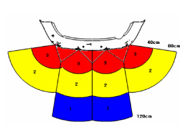

Cada função de histerese da zona de alerta para buzzer e exibição.

| Condição | 1ª Aviso (120 cm) | 2ª Aviso (80 cm) | 3ª Aviso (40 cm) |
| --- | --- | --- | --- |
| A distância entre o veículo e o obstáculo está se aproximando | Aviso imediato |  |  |
| A distância entre o veículo e o obstáculo está se afastando | Atraso de 2 segundos no aviso | Atraso de 2 segundos no aviso | Atraso de 1 segundo no aviso |

Método de alerta do RPAS

Se o sensor RPAS detectar um obstáculo, o dispositivo acústico
gera um som de alerta e o módulo de exibição (Cluster) indica cada
nível de alerta conforme segue.

O sensor RPAS envia os dados de distância para o BCM através da comunicação LIN e o BCM recebe os dados de distância de cada sensor.

O BCM tem a responsabilidade da função acústica.

O BCM tem a responsabilidade da função de gateway que envia os dados de alerta para o Cluster conforme o diagrama de tempo abaixo.

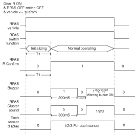

Quando mudar de uma zona de alerta para uma zona diferente, após
concluir um ciclo de saída de alerta, o próximo som de alerta deve
começar para a nova zona necessariamente.

Cronograma do Som de Alerta do RPAS

Se o sistema for alimentado (ligando IGN1 e colocando o câmbio em R), o BCM verificará a canal de cada sensor e, se não houver problemas, o
som do buzzer com período de ligação de 300 ms será gerado após 500 ms, mas
mesmo que um sensor tenha um problema, o som do buzzer não será para
“Start-buzzer do RPAS” mas para “Diagnosis-buzzer do RPAS”, A
próxima ação para o modo normal é como segue.

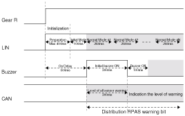

Após a armazenagem do câmbio em R, o funcionamento do sistema é como segue.

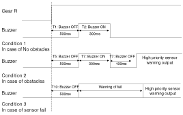

Tolerância de tempo: ± 10%

Após a desarmazenagem do câmbio em R, o funcionamento do sistema é como segue.

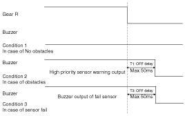

Tolerância de tempo: ± 10%

Especificações da saída de alarme dividindo a distância do sensor

A lógica de condição é como segue de acordo com a lógica de fase em prioridade. (No mesmo sensor)

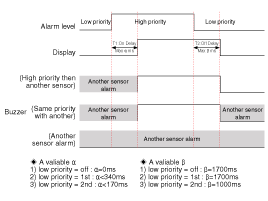

Zonas de operação do RPAS de acordo com a distância são as seguintes.

1. 1ª Aviso (81 cm ~ 120 cm)

   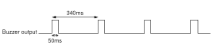

2. 2ª Aviso (41 cm ~ 80 cm)

   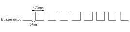

3. 3ª Aviso (40 cm ou menos)

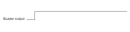

4. Ciclo de alarme de falha

   Quando o sistema inicia e há erros no sensor, o som de alerta é emitido conforme a posição do sensor é a seguinte.

   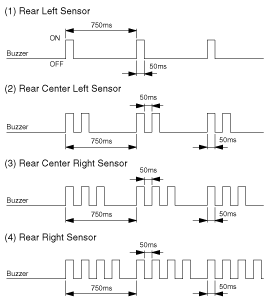

   ? No caso de múltiplos sensores apresentarem erros, a sequência de alerta dos sensores é a seguinte.

   RL > RCL > RCR > RR

   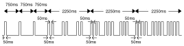

   ? Após a geração do som de alerta para diagnóstico, os outros sensores normais executam suas funções normais, como a detecção e a transmissão de dados de distância.

   > **Nota**
   >
   > - Tolerância de tempo do acima-mentionado onda de onda: Tempo ± 10%
   > - Para distâncias mais próximas do que 30cm, a detecção pode não ocorrer.
   > - Alarme será gerado com velocidade do veículo em ré 10km/h ou menos.
   > - Para alvo em movimento, a velocidade máxima de operação deve ser a velocidade de aproximação do alvo de 10km/h.
   > - Quando o veículo ou o alvo está em movimento, a geração sequencial de alarme ou o alarme efetivo pode falhar.
   > - Falso alarme ou falha no alarme pode ocorrer nas seguintes condições.
   > - Superfície de estrada irregular, estrada de pedra, ré em direção a relva.
   > - Som do buzina, motor de motocicleta, freio de ar de veículo grande, ou outro objeto gerando onda ultrasónica está próximo.
   > - Quando um transmissor sem fio é usado perto do sensor.
   > - Sujeira no sensor.
   > - A geração sequencial de alarme pode não ocorrer devido à velocidade de ré ou forma do alvo.

Método de tratamento de erros

? Linha LIN BUS Off de erro

| Divisão | Condição de erro | Condição de desativado |
| --- | --- | --- |
| Rotina inicial | Detectando LIN BUS OFF uma vez | Desativado (se LIN BUS ON for detectado 4 vezes consecutivas na rotina geral) |
| Rotina normal | Detectando LIN BUS OFF 4 vezes consecutivas | Desativado (se LIN BUS ON for detectado 4 vezes consecutivas) |

? Observações

1. LIN BUS OFF significa ausência de resposta dos sensores quando o BCM envia solicitação para os sensores.

2. No caso de erro na rotina inicial, som de alerta de diagnóstico + exibição de erro

3. No caso de erro na rotina normal, apenas exibição de erro

4. Se o erro ocorrer na condição direta de cada sensor,
   após isso, o erro é transmitido na condição indireta (lado do sensor).

? No caso de erro do sensor

| Divisão | Condição de erro | Condição de desativado |
| --- | --- | --- |
| Rotina inicial | Detectando a mensagem de erro do sensor | Desativado (se
 a mensagem que o sensor está normal for detectada 4 vezes consecutivas,
 mas é impossível ser desativado na rotina inicial) |
| Rotina geral | Detectando a mensagem de erro do sensor 4 vezes consecutivas | Desativado (se a mensagem que o sensor está normal for detectada 4 vezes consecutivas) |

? Observações

1. No caso de contagem de falhas, a saída de mensagem ou sinal com o último valor válido deve ser transmitida.

2. No caso de erro na rotina inicial, som de alerta de diagnóstico + exibição de erro

3. No caso de ocorrer um erro na rotina geral, a única exibição de erro
