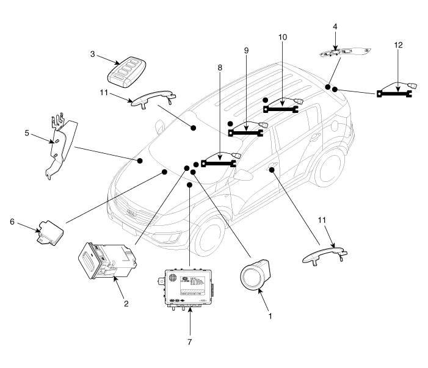

# Sistema de Início do Motor por Botão — Componentes e localização

[Home](../../index.md) / [Manual de Serviço e Reparo](../sportage-482.md) / [Sistema Elétrico do Corpo](sportage-984.md) / [Sistema de Início do Motor por Botão](sportage-1166.md) / Componentes e localização

## Diagrama

## Legenda

| Nº | Componente |
| --- | --- |
| 1 | Botão de Início e Parada (BIP) |
| 2 | Porta-chave remota (FOB) |
| 3 | Chave remota (FOB) |
| 4 | Interruptor do porta-malas |
| 5 | Unidade de chave inteligente |
| 6 | Receptor de rádio-frequência (RF) |
| 7 | Módulo de Controle do Corpo (BCM) |
| 8 | Antena interna 1 |
| 9 | Antena interna 2 |
| 10 | Antena interna 3 |
| 11 | Puxador da porta e antena da porta |
| 12 | Antena do para-choques |
