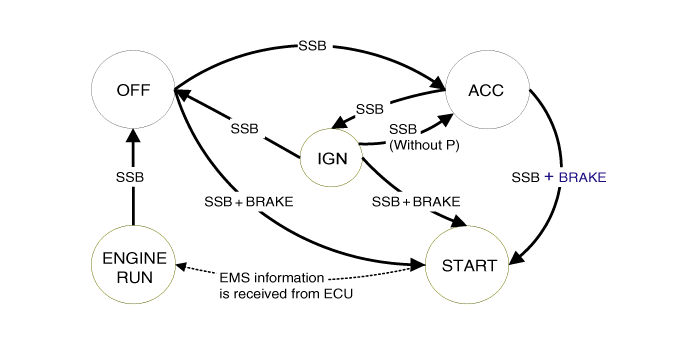
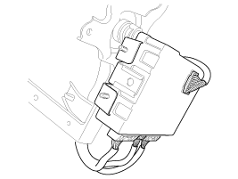
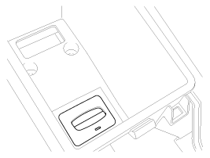
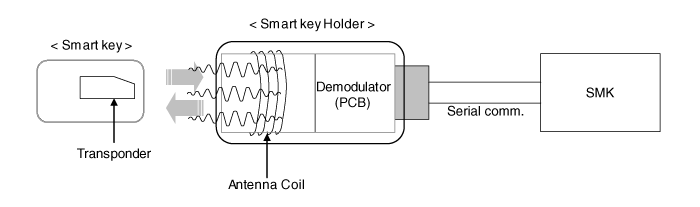
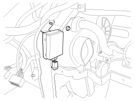
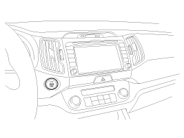

# Kia Sportage: Descrição e Operação

[Início](../../index.md) / [Manual de Serviço e Reparo do Kia Sportage SL](../sportage-482.md) / [Sistema Elétrico do Corpo](sportage-984.md) / [Sistema de Início do Motor por Botão](sportage-1166.md) / Descrição e Operação

## Descrição

Visão Geral do Sistema

O Sistema oferece as seguintes funcionalidades:

| – | Interface humano-máquina através de um botão de uma etapa, para troca de terminal e start do motor. |
| --- | --- |

| – | Controle de relays externos para troca de terminal ACC / IGN1 / IGN2 e STARTER, sem uso de um interruptor de ignição mecânico. |
| --- | --- |

| – | Indicação do status do veículo através de LED ou mensagens explícitas na tela. |
| --- | --- |

| – | Função de imobilizador por comunicação de transponder LF entre chave remota e suporte da chave remota. |
| --- | --- |

| – | Arquitetura redundante para alta dependabilidade do sistema. |
| --- | --- |

| – | Interface com a rede de comunicação CAN de baixa velocidade do veículo. |
| --- | --- |

| – | Interface com a rede de comunicação LIN do veículo dependendo da plataforma. |
| --- | --- |

As funções RKE e SMART KEY não são consideradas parte deste sistema de start do motor por botão e estão especificadas em sistemas separados.

Função Principal do Sistema

| – | Troca dos terminais ACC / IGN1 / IGN2. |
| --- | --- |

| – | Controle do relay BAT da linha STARTER (lado alto) com base na comunicação com o ECU EMS. |
| --- | --- |

| – | Gerenciamento da função de imobilizador. |
| --- | --- |

| – | Gerenciamento da função de alerta do start do motor. |
| --- | --- |

Sistema de Start do Motor por Botão

O Sistema de Start do Motor por Botão permite que o motorista opere o veículo simplesmente pressionando um botão (chamado de SSB) em vez de usar uma chave mecânica padrão.

Se o motorista pressionar o SSB enquanto as pré-requisitos de freios, autenticação da chave remota e status da transmissão forem satisfeitos, o Sistema de Start do Motor (BES) prosseguirá com a travagem/desbloqueio da coluna de direção, controle do terminal e acionamento do motor.

O motorista pode soltar o SSB assim que esta sequência for iniciada. Após uma resposta positiva da interrogatória do imobilizador, o sistema acionará o motor starter e comunicará com o ECU EMS para verificar o status do motor para liberação do motor starter.

O motorista poderá parar o motor com um curto pressionamento no SSB se o veículo estiver já em parada. O stop de emergência do motor será possível com um longo pressionamento no SSB ou 3 pressionamentos consecutivos caso o veículo esteja em execução do motor.

Se as condições para o acionamento do motor não forem satisfeitas enquanto um pressionamento no SSB for detectado e uma chave remota autenticada, o sistema desbloqueará a coluna de direção e ligará os terminais para IGN. Outro pressionamento no SSB será necessário para iniciar o motor.

Em caso de veículo equipado com o sistema SMART KEY, a autenticação da chave remota não exigirá nenhuma ação do motorista. Para start de emergência ou em caso de veículo sem SMART KEY, o motorista terá que inserir a chave remota no suporte da chave remota.

| • | Controle da ignição e do motor ON/OFF enviando sinal para o IPM. |
| --- | --- |

| • | Exibição do status através de lâmpada LED ON/OFF. (Amarelo ou Verde) |
| --- | --- |

Condições de Ligar/Desligar o Indicador no Estado Desligado da Chave

| Número | Lâmpada de caractere | Condições |
| --- | --- | --- |

| --- | --- | --- |
| 1 | Lampinha Indicadora ON | Porta aberta, Lampinha do Para-choque ON, ACC, IG ON |
| 2 | Lampinha Indicadora 30s ON > Lampinha OFF | Porta fechada, Lampinha do Para-choque OFF, IG OFF |
| 3 | Lampinha Indicadora OFF | LOCK Remoto, LOCK Passivo |
| 4 | Rheostato na Lampinha do Para-choque ON |  |

Condição de Ligar/Desligar da Lampinha de acordo com a Posição da Chave de Ignição

| Número | Condições de Ignição | Status do LED do Botão Start |
| --- | --- | --- |
| 1 | IG OFF | LED OFF |
| 2 | IG ACC | LED Amarelo ON |
| 3 | IG ON (Motor OFF) | LED Verde ON |
| 4 | Arranque | Manter o status do LED antes do arranque |
| 5 | Motor em funcionamento | LED OFF |

Unidade de Chave Inteligente

A SMK gerencia todas as funções relacionadas a:

| • | "Monitoramento do Botão Start/Stop (BSS)", |
| --- | --- |

| • | "Comunicação do Imobilizador" (com o Unidade de Gerenciamento do Motor para liberação do imobilizador), |
| --- | --- |

| • | "Servidor de Autenticação" (Validade do Transponder e autenticação do Fob Passivo, se a opção de Chave Inteligente estiver ativa), |
| --- | --- |

| • | "Monitoramento da Conformidade do Sistema", |
| --- | --- |

| • | "Diagnóstico do Sistema", |
| --- | --- |

| • | Controle da mensagem de exibição / buzzer de advertência. |
| --- | --- |

A unidade atua como o papel de Master no sistema inteiro.

No caso de aplicação SMART KEY, por exemplo, "Acesso Passivo", "Bloqueio Passivo" e "Autorização Passiva" são integradas para operações de troca de terminal.

A unidade coleta informações sobre o status do veículo de outros módulos (velocidade do veículo, status do alarme, porta do motorista aberta...), lê as entradas (por exemplo, BSS, Sensor Capacitivo / Botão de Bloqueio, Interruptor de Posição PARK), controla as saídas (por exemplo, antenas externas e internas), e comunica-se com outros dispositivos via a rede CAN bem como interfaces de linha única.

O diagnóstico e aprendizado dos componentes do Sistema BES são também gerenciados pela SMK.

A SMK gerencia as funções relacionadas ao "controle do terminal" ativando relays externos para ACC, IGN1 e IGN2. Esta unidade também é responsável pelo controle do relay do STARTER.

A SMK controla a iluminação do BSS assim como o "indicador de status do sistema", que consiste em 2 LEDs de diferentes cores. A iluminação do suporte do fob também é gerenciada pela SMK.

A SMK lê as entradas (fob do motorista inserido, velocidade do veículo, status de contato dos relays), controla as saídas (drivers de saída do relay do motor), e comunica-se com outros dispositivos via a rede CAN.

A arquitetura interna da SMK é definida de forma que o controle do terminal é garantido até mesmo em caso de falha de um dos dois microcontroladores, inconsistência do sistema ou interrupção da comunicação na rede CAN.

No caso de falha de um dos dois controladores, o controlador restante deve desabilitar o relay do STARTER. Os terminais IGN1 e IGN2 devem manter o estado memorizado antes da falha e o motorista deve ser capaz de desligar esses terminais IGN.

pressionar a SSB com a sequência EMERGENCY_STOP. No entanto, o reinício do motor não será permitido. O estado do relé ACC dependerá do tipo de falha.

As principais funções do SMK são:

| • | Controle dos relés terminais |
| --- | --- |

| • | Monitoramento da velocidade do veículo recebida do sensor ou ECU ABS/ESC. |
| --- | --- |

| • | Controle dos LEDs da SSB (iluminação, estado do aperto) e iluminação do HÁLDE. |
| --- | --- |

| • | Controle da estação base localizada no HÁLDE através de interface serial direta. |
| --- | --- |

| • | Monitoramento da consistência do sistema para diagnosticar falha do SMK e ativar o modo de regressão relevante. |
| --- | --- |

| • | Fornece informações de velocidade do veículo |
| --- | --- |

| • | Monitoramento da SSB (Start/Stop Button) |
| --- | --- |

| • | Controle do fornecimento de energia do starter |
| --- | --- |

HÁLDE

Este módulo é usado para autenticação de transponders. Em caso de veículo equipado com chave inteligente, esta autenticação de transponders é necessária em caso de falha da autenticação do fob passivo (perda de ligação RF ou LF com o fob).

O módulo HÁLDE integra uma vaga onde se insere o fob. O fob é mantido em posição com um mecanismo de bloqueio push-push (não elétrico) e um sinal (FOB IN) é enviado ao SMK assim que a inserção é detectada.

O fornecimento de energia do HÁLDE está ativo apenas se uma comunicação for iniciada pelo SMK.

A inserção do fob no HÁLDE e a comunicação com o transponders deve ser possível independentemente da direção de inserção do fob no HÁLDE (botões voltados para cima ou para baixo).

Um dispositivo de iluminação também está integrado para iluminação do HÁLDE e é controlado diretamente pelo SMK.

As principais funções do HÁLDE são:

| • | Base de estação de transponders |
| --- | --- |

| • | Bloqueio mecânico do fob |
| --- | --- |

| • | Iluminação |
| --- | --- |

Transponders

Receptor externo (SRX)

Os dados transmitidos pelo RKE ou fob inteligente são recebidos pelo receptor de RF externo chamado SRX. Este receptor será o mesmo para as aplicações do SMK, em termos de eletrônica, caixa, conector e software.

Este receptor está conectado ao SMK através de uma linha de comunicação serial.

Relés e Contato do Starter

Os relés serão usados para alternar os terminais ACC / IGN1 / IGN2. Esses relés de contato normalmente abertos serão controlados pelo SMK e localizados ou no compartimento do passageiro ou no compartimento do motor, dependendo da arquitetura do veículo.

Apenas um bobino de relé está conectado aos terminais de saída do SMK.

Estes relés devem integrar um resistor conectado em paralelo ao bobino para reduzir os transientes durante a troca.

Botão Start/Stop (SSB)

Um botão de pressão única é usado pelo motorista para operar o veículo. Pressionar este botão permite:

| • | Para ativar os modos de potência ‘Off’, ‘Accessory’, ‘Ignition’ e ‘Start’ ao trocar os terminais correspondentes |
| --- | --- |

| • | Para iniciar o motor |
| --- | --- |

| • | Para parar o motor |
| --- | --- |

O contato será segurado por um micro-disjuntor e uma
iluminação de fundo será fornecida para destacar a marcação do botão quando
necessário.

Dois (2) LEDs de cores estão localizados no centro do botão para
exibir o status do sistema. Outro LED de iluminação também
integrado no SSB para a iluminação dos caracteres "Engine Start/Stop".

Esquema de Estado do Sistema BES (Button Engine Start)

Estados do Sistema em MODO APRENDIDO

No modo aprendido, o Sistema BES pode ser configurado em 6 diferentes estados, dependendo do status dos terminais e do status do motor:

| Estado do Sistema | Status dos Terminais | Status do Motor |
| --- | --- | --- |
| 1. OFF - Bloqueado | OFF | Parado |
| 2. OFF - Desbloqueado | OFF | Parado |
| 3. ACC | ACC | Parado |
| 4. IGN | IGN1, IGN2, ACC | Parado |
| 5. Start | IGN1, Start | Em cranking |
| 6. IGN - Motor | IGN1, IGN2, ACC | Rodando (significa "auto-rodando") |

Referindo-se aos terminais, os estados do sistema descritos na
tabela acima são os mesmos encontrados em um sistema baseado em um
interruptor de ignição mecânico.

A diferença em relação ao sistema baseado em interruptor de ignição mecânico
é que o sistema BES permite transições específicas de [OFF] para
[START] sem passar pelos estados [ACC] e [IGN].

Estados do Sistema em MODO VIRGEM

O Sistema BES pode ser configurado em 5 diferentes estados (OFF LOCKED
não está disponível no modo virgem), dependendo do status dos terminais e do status do
motor :

| Estado do Sistema | Status dos Terminais | Status do Motor |
| --- | --- | --- |
| 1. OFF - DESBLOQUEADO | OFF | Parado |
| 2. ACC | ACC | Parado |
| 3. IGN | IGN1, IGN2, ACC | Parado |
| 4. Start | IGN1, START com padrão especial de ativação | Em cranking |
| 5. IGN - Motor | IGN1, IGN2, ACC | Rodando (significa "auto-rodando") |

Referindo-se aos terminais, os estados do sistema descritos na
tabela acima são os mesmos encontrados em um sistema baseado em um
interruptor de ignição mecânico.

A diferença em relação ao sistema baseado em interruptor de ignição mecânico
é que o sistema BES permite transições específicas de [OFF] para
[START] sem passar pelos estados [ACC] e [IGN].
