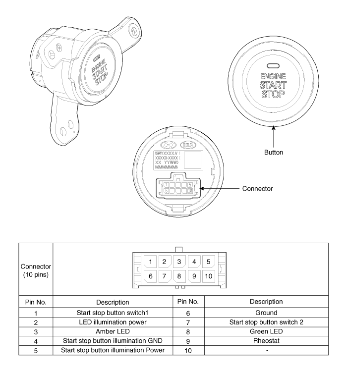

# Botão Start/Stop — Componentes e localização

[Home](../../index.md) / [Manual de Serviço e Reparo](../sportage-482.md) / [Sistema Elétrico do Corpo](sportage-984.md) / [Sistema de Início do Motor por Botão](sportage-1166.md) / Componentes e localização

## Diagrama

