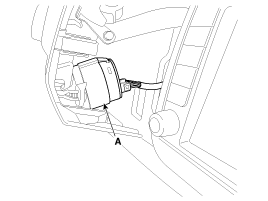
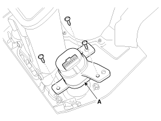

# Kia Sportage: Botão Start/Stop: Procedimentos de Reparo

[Home](../../index.md) / [Manual de Serviço e Reparo do Kia Sportage SL](../sportage-482.md) / [Sistema Elétrico do Corpo](sportage-984.md) / [Sistema de Início do Motor por Botão](sportage-1166.md) / Procedimentos de Reparo do Botão Start/Stop

## Remoção

1. Desconecte o terminal negativo (-) da bateria.

2. Remova o painel da fascia do cluster.

   (Consulte o grupo BD - "Painel de Impacto")

3. Desconecte o conectador (A).

   

4. Remova o botão Start/Stop (A) após soltar as 3 parafusos de montagem.

   

## Instalação

1. Instale o botão Start/Stop.

2. Instale o ventoinha do ar esquerda.
