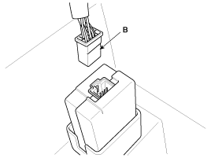
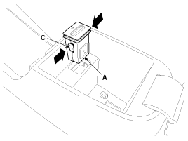

# Kia Sportage: Fob Holder: Procedimentos de Reparo

[Home](../../index.md) / [Manual de Serviço e Reparo do Kia Sportage SL](../sportage-482.md) / [Sistema Elétrico do Veículo](sportage-984.md) / [Sistema de Início do Motor por Botão](sportage-1166.md) / Procedimentos de Reparo do Fob Holder

## Remoção

1. Desconecte o terminal negativo (-) da bateria.

2. Remova o console do painel inferior.

   (Consulte o grupo BD - "Console")

3. Desconecte o conectador (B), depois remova a montagem do holder do fob (A) soltando o gancho (C).

   

   

## Instalação

1. Instale a montagem do holder do fob.

2. Instale o console do painel inferior.

3. Instale o terminal negativo (-) da bateria.
