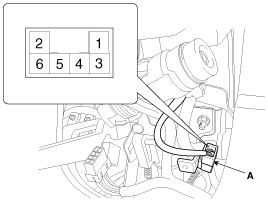
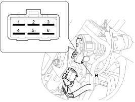
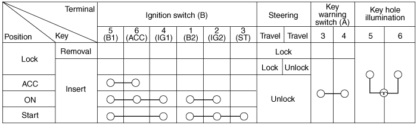
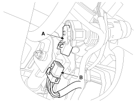
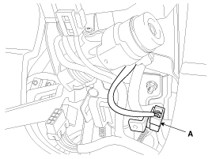
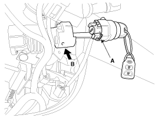

# Kia Sportage: Procedimentos de Reparo

[Home](../../index.md) / [Manual de Serviço e Reparo do Kia Sportage SL](../sportage-482.md) / [Sistema Elétrico do Corpo](sportage-984.md) / [Montador do Interruptor de Ignição](sportage-1174.md) / Procedimentos de Reparo

## Inspeção

1. Desconecte o conector do interruptor de ignição (B) e o conector do interruptor de advertência da chave (A) da coluna do volante.

   

   

2. Verifique a continuidade entre os terminais.

3. Se a continuidade não estiver especificada, substitua o interruptor.

## Remoção

1. Desconecte o terminal negativo (-) da bateria.

2. Remova as coberturas superiores e inferiores da coluna do volante.

   (Consulte o grupo ST - "Coluna do volante")

3. Remova o interruptor de ignição (A) após desconectar o conector 6P (B).

   

4. Remova o conector do interruptor de advertência e do imobilizador (A).

   

5. Remova a cobertura de iluminação da chave.

6. Se for necessário remover o cilindro da chave de bloqueio (A), remova o cilindro de bloqueio da chave após empurrar a pinça de bloqueio (B) com a chave em ACC.

   

## Instalação

1. Instale o cilindro de bloqueio da chave.

2. Instale a cobertura de iluminação.

3. Instale o conector do interruptor de advertência e do imobilizador.

4. Instale o interruptor de ignição.

5. Instale as coberturas da coluna do volante e o painel inferior do crash pad.
