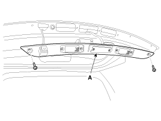
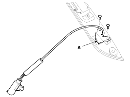

# Kia Sportage: Procedimentos de Reparo

[Home](../../index.md) / [Manual de Serviço e Reparo do Kia Sportage SL](../sportage-482.md) / [Sistema Elétrico do Corpo](sportage-984.md) / [Sistema de Câmera de Ré](sportage-1176.md) / Procedimentos de Reparo

## Remoção

1. Remova o acabamento da porta-tronca após remover as varetas e parafusos.

   (Consulte o grupo BD - "Porta-tronca")

2. Remova o acabamento da porta (A) após desconectar o conector e remover as varetas.

   

3. Remova a câmera de ré (A) após soltar os parafusos (2 unidades).

   

## Instalação

1. Instale a câmera de ré.

2. Instale o acabamento da porta e o acabamento.
