# Kia Sportage: Informações Gerais

[Home](../../index.md) / [Manual de Serviço e Reparo do Kia Sportage SL](../sportage-482.md) / [Sistema Elétrico do Veículo](sportage-984.md) / Informações Gerais

## Informações Gerais de Diagnóstico

Antes de Diagnóstico

1. Verifique os fusíveis aplicáveis no caixote de fusíveis e relés apropriado.

2. Verifique o estado do carregador, a carga e limpe e assegure as conexões.

   (Consulte o grupo EE - "Carregador")

   > **Nota**
   >
   > - Não carregue rapidamente um carregador a menos que a mola de terra do carregador tenha sido desconectada, caso contrário, você danificará os diodos do alternador.
   > - Não tente girar o motor com a mola de terra do carregador conectada de forma fraca, pois isso danificará gravemente a cablagem.

3. Verifique a tensão do cinto do alternador.

Manipulação de Conectores

1. Certifique-se de que os conectores estejam limpos e sem terminais de fio soltos.

2. Certifique-se de que conectores com múltiplas cavidades estejam cheios de graxa (exceto conectores impermeáveis).

3. Todos os conectores têm travas de liberar pressão (A).

   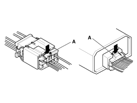

4. Alguns conectores têm um ganchinho em seu lado usado para fixá-los em um suporte no corpo ou em outro componente. Este ganchinho tem uma trava de liberar puxando.

5. Alguns conectores montados não podem ser desconectados a menos que você primeiro libere a trava e remova o conector de seu suporte (A).

   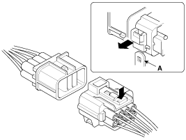

6. Nunca tente desconectar conectores puxando seus fios; puxe pelas metades do conector em vez disso.

7. Sempre reinstale as coberturas plásticas.

   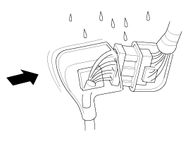

8. Antes de conectar conectores, certifique-se de que os terminais (A) estejam em seu lugar e não estejam dobergados.

   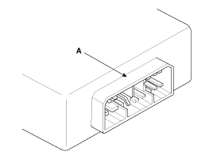

9. Verifique por travas soltas (A) e selos de borracha (B).

   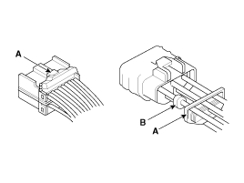

10. Algumas partes traseiras de conectores estão cheias de graxa. Adicione graxa se necessário. Se a graxa (A) estiver contaminada, substitua-a.

   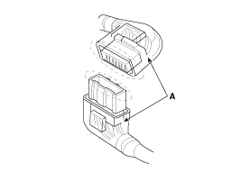

11. Insira o conector até o fundo e certifique-se de que ele esteja firmemente travado.

12. Posicione os fios para que a abertura da cobertura fique para baixo.

   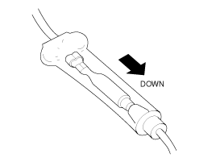

Manipulação de Fios e Cabos

1. Fixe os fios e os cabos de cablagem no quadro com as fitas de cablagem apropriadas nos locais designados.

2. Remova as pinças cuidadosamente; não danifique suas travas (A).

   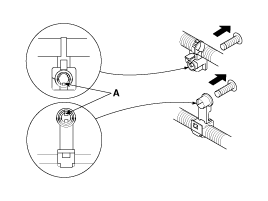

3. Insira pinças (A) sob a base da pinça e através do orifício em ângulo, e então aperte as pastilhas de expansão para liberar a pinça.

   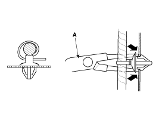

4. Após a instalação de pinças de cablagem, certifique-se de que o cabo de cablagem não interfira em nenhum componente móvel.

5. Manuseie cabos de cablagem longe de tubos de escapamento e outras partes quentes, de bordas afiadas de suportes e orifícios, e de parafusos e parafusos expostos.

6. Posicione as grommetas em seus sulcos corretamente (A). Não deixe grommetas distorcidas (B).

   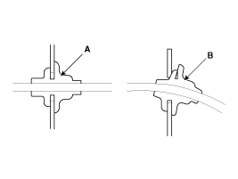

Testes e Reparações

1. Não use fios ou cabos com isolamento danificado.

   Substitua-os ou faça a reparação enrolando o rompimento com fita elétrica.

2. Após a instalação de peças, certifique-se de que nenhum fio esteja entalado sob elas.

3. Quando utilizar equipamentos de teste elétrico, siga as instruções do fabricante e as descritas neste manual.

4. Se possível, insira a ferramenta removível do lado do fio (exceto o conector impermeável).

   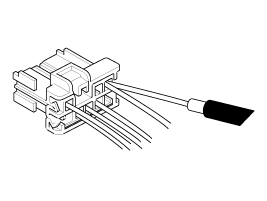

5. Use um cabo de probe com ponta côncava.

   Consulte o guia do usuário no kit de reparo de cabos (Nº de referência: TRK 015.)

   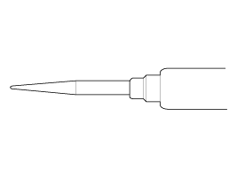

Cinco Passos de Diagnóstico

1. Verifique a queixa

   Ligue todos os componentes na circutaria problemática para verificar
   a queixa do cliente. Anote os sintomas. Não inicie a desmontagem ou
   teste até que você tenha definido a área do problema.

2. Analise o esquema

   Consulte o esquema para a circutaria problemática.

   Determine como a circutaria deve funcionar traçando os caminhos de
   corrente do alimentador de energia através dos componentes da circutaria até
   o solo. Se várias circutarias falharem ao mesmo tempo, o fusível ou o solo é
   uma causa provável.

   Com base nos sintomas e no seu entendimento do funcionamento da circutaria, identifique uma ou mais causas possíveis do problema.

3. Isole o problema ao testar a circutaria.

   Faça testes na circutaria para verificar a diagnóstico que você fez no passo 2.
    Lembre-se de que um procedimento lógico e simples é a chave para um bom
   diagnóstico.

   Teste a causa mais provável de falha primeiro. Tente fazer testes em pontos que são facilmente acessíveis.

4. Corrija o problema

   Uma vez que o problema específico foi identificado, faça a reparação. Certifique-se de usar ferramentas adequadas e procedimentos seguros.

5. Certifique-se de que a circutaria funcione

   Ligue todos os componentes na circutaria reparada em todos os modos
   para garantir que você tenha resolvido todo o problema. Se o problema foi um
   fusível queimado, certifique-se de testar todas as circutarias no fusível. Certifique-se
   de que nenhum novo problema apareça e o problema original não se repita.

Reset da Bateria

Descrição

Quando reconectar o cabo da bateria após desconectar,
recarregar a bateria após a descarga ou instalar o fusível de memória
localizado no painel do passageiro após a remoção, certifique-se de redefinir
os sistemas mencionados na tabela abaixo.

Além disso, quando substituir ou reinstalar seus fusíveis após
 remoção, eles devem ser redefinidos de acordo com a tabela abaixo. Consulte a tabela abaixo quando realizar a manutenção.

| Sistema | Definição |
| --- | --- |
| Janela automática | Cada vez
 que a janela não pode ser fechada ou aberta corretamente. Cada vez que a bateria é
 descarregada ou o fusível relacionado é substituído ou reinstalado, redefina o
sistema de janela elétrica de acordo com o procedimento abaixo. 1) Coloque a chave do ignição na posição ON. 2) Empurre o interruptor da janela elétrica para fechar completamente a janela, e então mantenha o interruptor do poder pressionado por cerca de 1
segundo. |
| 1) | Coloque a chave do ignição na posição ON. |
| 2) | Empurre o interruptor da janela elétrica para fechar completamente a janela, e então mantenha o interruptor do poder pressionado por cerca de 1
segundo. |
| Teto panorâmico | Cada vez

a bateria forçada, descarregada ou o respectivo fusível for substituído ou reinstalado, o sistema panorámico do teto deve ser reconfigurado de acordo com o procedimento abaixo. 1) Gire a chave do ignição para a posição ON e, em seguida, feche completamente o panorámico do teto. 2) Libere o controle do panorámico do teto. 3) Pressione e mantenha pressionado o botão FECHAR por mais de 10 segundos até que o telhado solar tenha se movido ligeiramente. 4) Libere o controle do panorámico do teto. 5) Pressione e mantenha pressionado o botão FECHAR novamente até que o telhado solar faça o seguinte. • Inclinado > Aberto pela滑动 > Fechado 然后，释放杠杆。 6) O procedimento de reconfiguração do sistema panorâmico foi concluído. |
| --- | 1) Gire a chave do ignição para a posição ON e, em seguida, feche completamente o panorámico do teto. |
| --- | Libere o controle do panorámico do teto. |
| --- | Pressione e mantenha pressionado o botão FECHAR por mais de 10 segundos até que o telhado solar tenha se movido ligeiramente. |
| --- | Libere o controle do panorámico do teto. |
| --- | Pressione e mantenha pressionado o botão FECHAR novamente até que o telhado solar faça o seguinte. |
| --- | Inclinado > Aberto pela滑动 > Fechado 然后，释放杠杆。 |
| --- | O procedimento de reconfiguração do sistema panorâmico foi concluído. |
| Computador de bordo | Quando
 a bateria for forçada e reforçada, as funções configuradas do computador de bordo serão inicializadas. Portanto, você precisa explicar essa informação ao cliente. |
| Relógio | Cada vez que as terminais da bateria ou os fusíveis relacionados forem desconectados, você deve reconfigurar o tempo. Quando o interruptor do ignição estiver na posição ACC ou ON, os botões do relógio funcionarão da seguinte forma: ? Hora: Pressionando o botão H avançará a hora exibida em uma hora. ? Minuto: Pressionando o botão M avançará a hora exibida em um minuto. ?
 Para mudar o formato de 24 horas para o formato de 12 horas (se equipado), enquanto pressionando o botão “H”, pressione o botão “M” por 3 segundos ou mais. Por exemplo, se os botões “H” e “M” forem pressionados por mais de 3 segundos enquanto a hora é 22:15, a exibição mudará para 10:15. |
| Som | Quando
 a bateria for forçada e reforçada, as estações de rádio do cliente serão inicializadas. Portanto, você precisa gravar as estações de rádio do cliente antes do serviço e, após o serviço, configurar as estações de rádio do cliente no som. |
