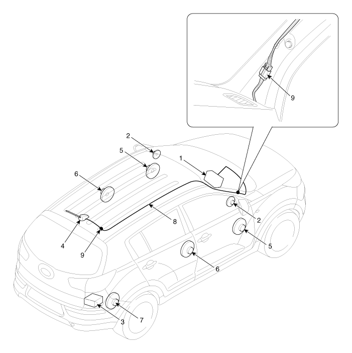

# Som — Componentes e localização

[Home](../../index.md) / [Manual de Serviço e Reparo](../sportage-482.md) / [Sistema Elétrico do Corpo](sportage-984.md) / [Som](sportage-987.md) / Componentes e localização

## Diagrama

## Legenda

| Nº | Componente |
| --- | --- |
| 1 | Unidade de som |
| 2 | Altifalante tweeter |
| 3 | Amplificador externo |
| 4 | Antena do teto (Rádio) |
| 5 | Altifalante da porta dianteira |
| 6 | Altifalante da porta traseira |
| 7 | Altifalante subwoofer |
| 8 | Fio de alimentação da antena |
| 9 | Conector do cabo de antena |
