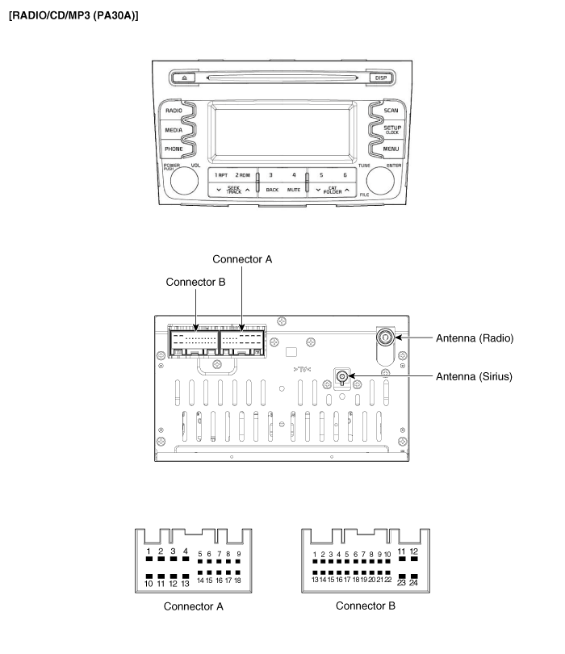
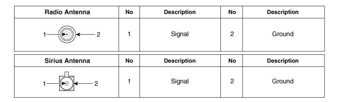
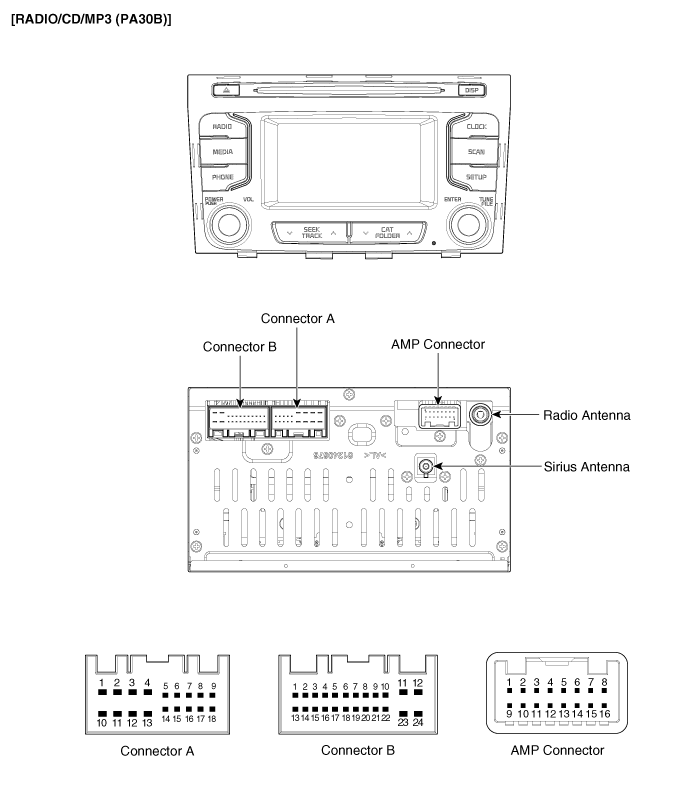
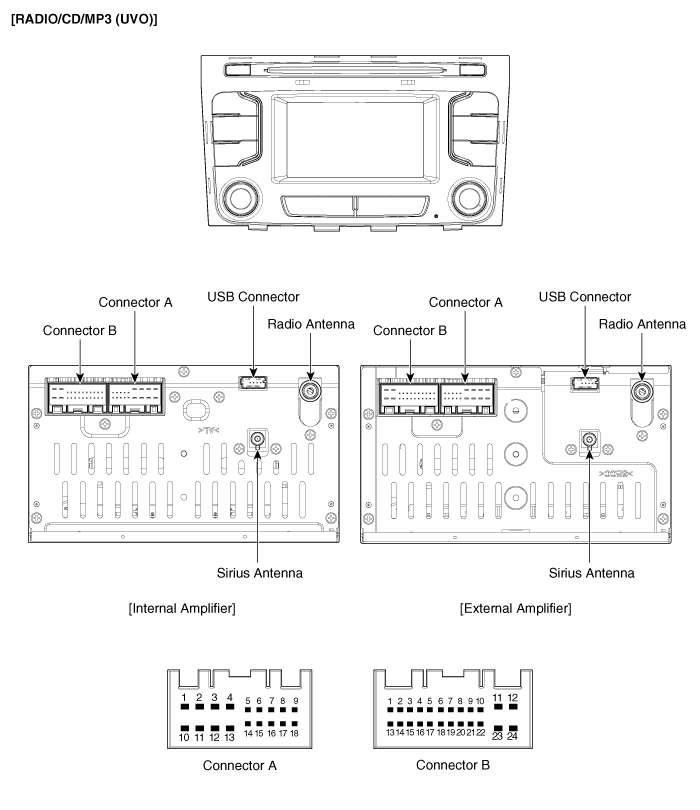
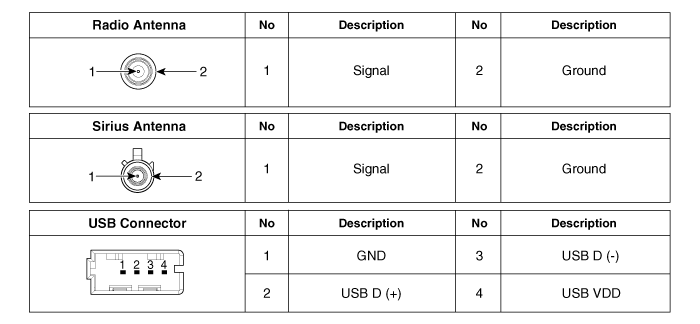
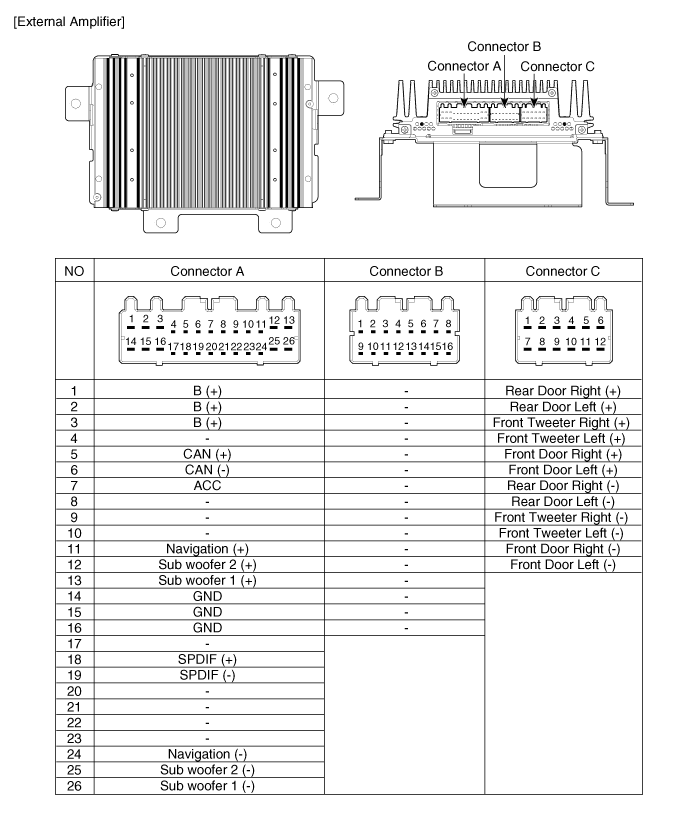
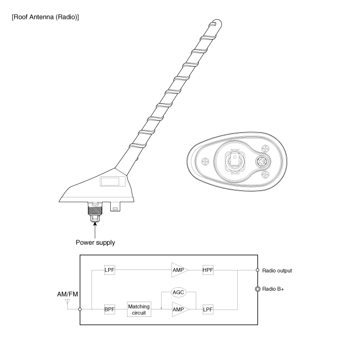
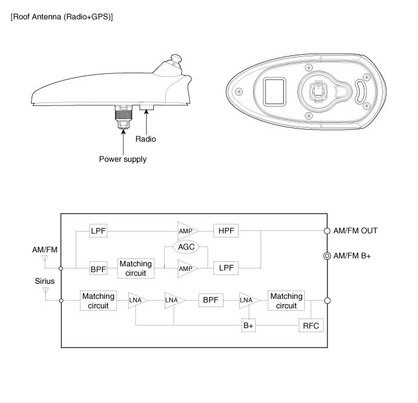

# Unidade de Som — Componentes e localização

[Home](../../index.md) / [Manual de Serviço e Reparo](../sportage-482.md) / [Sistema Elétrico do Corpo](sportage-984.md) / [Som](sportage-987.md) / Componentes e localização

## Diagrama

## Informações do Conector de Pinos

| No. | Conector A | Conector B |
| --- | --- | --- |
| 1 | Altavoz RL (+) | MM CAN HIGH |
| 2 | Altavoz FL (+) | - |
| 3 | Altavoz FR (+) | - |
| 4 | Altavoz RR (+) | Remoto de Direção |
| 5 | - | - |
| 6 | - | USB D (+) |
| 7 | - | USB/iPOD VDD |
| 8 | Iluminação (+) | Entrada AUX R |
| 9 | DETENT | Entrada AUX GND |
| 10 | Altavoz RL (-) | MIC (+) |
| 11 | Altavoz FL (-) | ACC |
| 12 | Altavoz FR (-) | Bateria (+) |
| 13 | Altavoz RR (-) | MM CAN LOW |
| 14 | - | - |
| 15 | - | - |
| 16 | - | Velocidade do Veículo |
| 17 | Iluminação (-) | GND Remoto |
| 18 | Antena Remoto | USB D (-) |
| 19 | ? | USB/iPOD GND |
| 20 | Detectar AUX |  |
| 21 | Entrada AUX L |  |
| 22 | MIC (-) |  |
| 23 | - |  |
| 24 | GND de Potência |  |

## Informações do Conector de Pinos

| No. | Conector A | Conector B | Conector do Amplificador |
| --- | --- | --- | --- |
| 1 | Altavoz RL (+) | CAN HIGH | - |
| 2 | Altavoz FL (+) | - | - |
| 3 | Altavoz FR (+) | - | GND da Câmera |
| 4 | Altavoz RR (+) | Remoto de Direção | VIN da Câmera |
| 5 | - | - | - |
| 6 | - | USB D (+) | - |
| 7 | - | USB/iPOD VDD | - |
| 8 | Iluminação (+) | Entrada AUX R | - |
| 9 | - | Entrada AUX GND | - |
| 10 | Altavoz RL (-) | MIC (+) | Bateria da Câmera (+) |
| 11 | Altavoz FL (-) | ACC | P GND |
| 12 | Altavoz FR (-) | Bateria (+) | R Position |
| 13 | Altavoz RR (-) | CAN LOW | - |
| 14 | - | - | - |
| 15 | - | Luz Automática | - |
| 16 | - | Velocidade do Veículo | - |
| 17 | Iluminação (-) | GND Remoto | ? |
| 18 | Antena Remoto | USB D (-) |  |
| 19 | ? | USB/iPOD GND |  |
| 20 | Detectar AUX |  |  |
| 21 | Entrada AUX L |  |  |
| 22 | MIC (-) |  |  |
| 23 | - |  |  |
| 24 | GND de Potência |  |  |

## Informações do Conector de Pinos

| No | Conector A | Conector B | Conector do Amplificador Interno | Conector do Amplificador Externo |  |
| --- | --- | --- | --- | --- | --- |
| Amplificador Interno | Amplificador Externo | Amplificador Interno | Amplificador Externo |  |
| 1 | Altavoz RL (+) | - | CAN High | CAN High |
| 2 | Altavoz FL (+) | - | - | - |
| 3 | Altavoz FR (+) | - | - | - |
| 4 | Altavoz RR (+) | - | Remoto de Direção | Remoto de Direção |
| 5 | - (SPDIF_GND) | SPDIF_GND | - (Rear Remote) | - (Rear Remote) |
| 6 | - (SPDIF_DN) | SPDIF_DN | VIN da Câmera | VIN da Câmera |
| 7 | - (IGN) | - (IGN) | Bateria da Câmera (+) | Bateria da Câmera (+) |
| 8 | Iluminação (+) | Iluminação (+) | Entrada AUX R | Entrada AUX R |
| 9 | - | - | Entrada AUX GND | Entrada AUX GND |
| 10 | Altavoz RL (-) | - | MIC (+) | MIC (+) |
| 11 | Altavoz FL (-) | - | ACC | ACC |
| 12 | Altavoz FR (-) | - | Bateria (+) | Bateria (+) |
| 13 | Altavoz RR (-) | - | CAN Low | CAN Low |
| 14 | - | - | - | - |
| 15 | - (SPDIF_DP) | SPDIF_DP | Luz Automática | Luz Automática |
| 16 | Desbloqueio da Porta | Desbloqueio da Porta | Speed IN | Speed IN |
| 17 | Iluminação (-) | Iluminação (-) | GND da Câmera | GND da Câmera |
| 18 | Antena Remoto | Antena Remoto | V_GND da Câmera | V_GND da Câmera |

| 19 | ? | ? | Camera REQ | Camera REQ |
| 20 | Detectação AUX | Detectação AUX |  |  |
| 21 | Entrada AUX L | Entrada AUX L |  |  |
| 22 | MIC (-) | MIC (-) |  |  |
| 23 | Camera P_GND | Camera P_GND |  |  |
| 24 | GND de Potência | GND de Potência |  |  |
