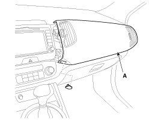
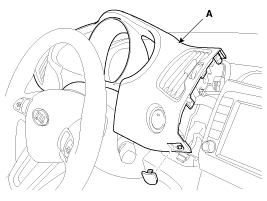
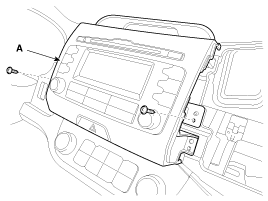
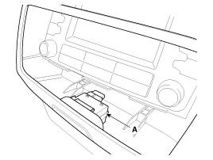
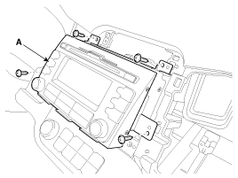
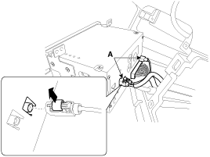
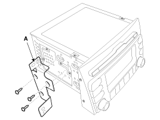
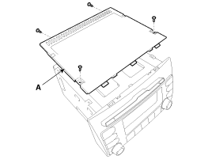
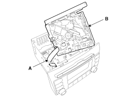

# Kia Sportage: Unidade de Som: Procedimentos de Reparo

[Home](../../index.md) / [Manual de Serviço e Reparo do Kia Sportage SL](../sportage-482.md) / [Sistema Elétrico do Corpo](sportage-984.md) / [Som](sportage-987.md) / Procedimentos de Reparo da Unidade de Som

## Remoção

1. Desconecte o terminal negativo (-) da bateria.

2. Remova o adorno do painel do passageiro (A).

   (Consulte o grupo BD - "Painel do Padrão de Impacto")

   

3. Desconecte os conectores e remova o painel do cluster (A).

   (Consulte o grupo BD - "Painel do Padrão de Impacto")

   

4. Remova o painel do centro (A) após desafinar o parafuso de montagem (2EA).

   

5. Desconecte o conector (A) instalado no painel do centro.

   

6. Remova a unidade de som (A) após desafinar os parafusos de montagem (4EA).

   

7. Desconecte os conectores e o cabo (A) da unidade de som, e remova a unidade de som completamente.

   

   > **Nota**
   >
   > - Levante a alça do conector na direção da seta, desconecte o conector.
   > - Ao reconstituir, instale o conector e a alça do conector.

   > **Cuidado**
   >
   > - Se o CD não sair, não tente removê-lo.
   > - O player pode ser danificado.
   > - Portanto, entre em contato com uma oficina de serviço para reparos.

## Instalação

1. Conecte os conectores e o cabo da unidade de som.

2. Instale a unidade de som.

3. Instale o painel do centro.

4. Instale o painel do cluster.

5. Instale o adorno do painel do passageiro do padrão de impacto.

6. Conecte o terminal negativo (-) da bateria.

   > **Nota**
   >
   > - Certifique-se de que os conectores estejam conectados corretamente.
   > - Verifique o sistema de som.

## Desmontagem

1. Desafine os parafusos (Esquerda 3EA, Direita 3EA) e remova o suporte de montagem da unidade de som (A).

   

2. Se necessário, remova a tampa superior (A) após desafinar os parafusos (4EA) para separar o drive do CD.

   

3. Após desafinar os parafusos, remova o drive do CD (B).

   

   > **Nota**
   >
   > - Cuide para não danificar as conexões do cabo (A) ao remover o drive.
