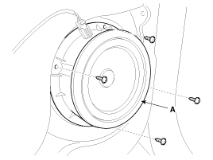
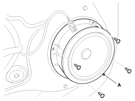
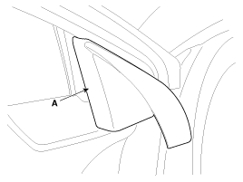
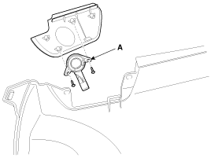
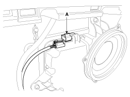
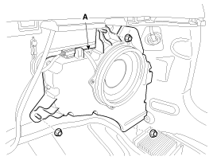
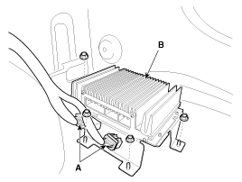

# Kia Sportage: Altifalantes: Procedimentos de reparo

[Início](../../index.md) / [Manual de Serviço e Reparo do Kia Sportage SL](../sportage-482.md) / [Sistema Elétrico do Corpo](sportage-984.md) / [Som](sportage-987.md) / Procedimentos de reparo dos altifalantes

## Inspeção

1. Diagnóstico do Altifalante

   | (1) | Inspeção Básica do Altifalante Inspeção do som do altifalante após verificar que as viga de fixação do altifalante foram removidas e o conectador de fiação está conectado para remover qualquer possível vibração transmitida pelos acabamentos do corpo e pelas partes adjacentes. |
   | --- | --- |

   | (2) | Diagnóstico do Caso No. Inspeção/Correção 1 Som tremulante 1) Antes de substituir o altifalante, inspecione se a viga de fixação está instalada normalmente. 2) Após a reinstalação do altifalante, verifique se não há som tremulante. 3) Quando ouvir novamente um som tremulante, substitua o altifalante por um novo. 2 Ruído 1) Verifique se o conectador de fiação está conectado normalmente. Se não estiver, conecte novamente o conectador de fiação. 2) No caso de ruído de rádio, verifique se há ruído do player CD. 3) Quando um ruído é ouvido ao ligar o rádio e o CD, substitua o altifalante por um novo. No caso de apenas ruído de rádio, isso é causado por uma recepção ruim do rádio. Assim, o altifalante não precisa de reparo e substituição. 3 Funcionamento Ruim Inspeção da conexão de fiação entre a bateria e o altifalante 1) Antes de substituir o altifalante, inspecione se a conexão de fiação entre a bateria e o altifalante está normal. 2) Verifique o fornecimento de energia ao altifalante e a resistência, então inspecione a qualidade do som. 3) Se o altifalante funciona mal, substitua-o por um novo. Ao manipular os altifalantes: – Não danifique o altifalante com impacto, como cair ou lançá-lo. – Cuide para não molhar e poluir os altifalantes com água e óleo. – Cuidado ao manipular o altifalante porque o material do diáfano é papel que pode ser rasgado por impacto ou força externa. – Modificar o sistema de áudio pode causar danos aos altifalantes. Se isso for o caso, os altifalantes não estão cobertos pela garantia do fabricante. | |
   | --- | --- | --- |
   | No. | Caso | Inspeção/Correção |
   | 1 | Som tremulante | 1) Antes de substituir o altifalante, inspecione se a viga de fixação está instalada normalmente. 2) Após a reinstalação do altifalante, verifique se não há som tremulante. 3) Quando ouvir novamente um som tremulante, substitua o altifalante por um novo. |
   | 1) | Antes de substituir o altifalante, inspecione se a viga de fixação está instalada normalmente. | |
   | 2) | Após a reinstalação do altifalante, verifique se não há som tremulante. | |
   | 3) | Quando ouvir novamente um som tremulante, substitua o altifalante por um novo. | |
   | 2 | Ruído | 1) Verifique se o conectador de fiação está conectado normalmente. Se não estiver, conecte novamente o conectador de fiação. 2) No caso de ruído de rádio, verifique se há ruído do player CD. 3) Quando um ruído é ouvido ao ligar o rádio e o CD, substitua o altifalante por um novo. No caso de apenas ruído de rádio, isso é causado por uma recepção ruim do rádio. Assim, o altifalante não precisa de reparo e substituição. |
   | 1) | Verifique se o conectador de fiação está conectado normalmente. Se não estiver, conecte novamente o conectador de fiação. | |

| 2) | Em caso de ruído de rádio, verifique se há um ruído do player de CD. | |
   | 3) | Quando um ruído é ouvido ao ligar o rádio e o CD, substitua o alto-falante por um novo. | |
   | Em caso de apenas ruído de rádio, isso ocorre devido a uma recepção ruim do rádio. Assim, o alto-falante não precisa de reparo e substituição. | | |
   | 3 | Funcionamento fraco | Inspeção da conexão de fiação entre a bateria e o alto-falante 1) Antes de substituir o alto-falante, verifique se a conexão de fiação entre a bateria e o alto-falante está normal. 2) Verifique o fornecimento de energia ao alto-falante e a resistência, então inspecione a qualidade do som. 3) Se o alto-falante funciona mal, substitua-o por um novo. |
   | 1) | Antes de substituir o alto-falante, verifique se a conexão de fiação entre a bateria e o alto-falante está normal. | |
   | 2) | Verifique o fornecimento de energia ao alto-falante e a resistência, então inspecione a qualidade do som. | |
   | 3) | Se o alto-falante funciona mal, substitua-o por um novo. | |
   | Ao manipular os alto-falantes: – Não danifique o alto-falante com impactos, como cair ou jogá-lo. – Cuide para não derramar água e óleo nos alto-falantes. – Cuidado ao manipular o alto-falante porque o material do diáfano é papel, que pode ser rasgado por impactos ou força externa. – Modificar o sistema de áudio pode danificar os alto-falantes. Se
   for esse o caso, os alto-falantes não estão cobertos pela garantia do fabricante. | | |
   | – | Não danifique o alto-falante com impactos, como cair ou jogá-lo. | |
   | – | Cuide para não derramar água e óleo nos alto-falantes. | |
   | – | Cuidado ao manipular o alto-falante porque o material do diáfano é papel, que pode ser rasgado por impactos ou força externa. | |
   | – | Modificar o sistema de áudio pode danificar os alto-falantes. Se
   for esse o caso, os alto-falantes não estão cobertos pela garantia do fabricante. | |

## Remoção

Falante da Porta Dianteira

1. Remova o trim da porta dianteira.

   (Consulte o grupo BD - "Porta dianteira")

2. Remova o falante (A) após remover 4 pregos.

   

Falante da Porta Traseira

1. Remova o trim da porta traseira.

   (Consulte o grupo BD - "Porta traseira")

2. Remova o falante (A) após remover 4 pregos.

   

Falante Tweeter (Dianteiro)

1. Remova o cover delta da porta dianteira (A).

   

   > **Nota**
   >
   > - Cuide para não danificar e arranhar o cover delta e suas partes relacionadas.

2. Remova o trim da porta.

   (Consulte o grupo BD – "Porta dianteira")

3. Remova o falante tweeter (A) após desconectar o conector.

   

Falante Woofer

1. Remova o trim do lado do porta-malas direito.

   (Consulte o grupo BD – "Trim interno")

2. Desconecte o conector do falante woofer (A).

   

3. Remova o falante woofer (A) após remover os parafusos (3EA).

   

Amplificador Externo

1. Remova o trim do lado do porta-malas direito.

   (Consulte o grupo BD – "Trim interno")

2. Desconecte os conectores do amplificador externo (A).

   

3. Remova o amplificador externo (B) após soltar os parafusos de montagem (4EA).

## Instalação

Falante da Porta Dianteira

1. Instale o falante na abertura do falante na placa da porta interna.

2. Reconecte o conector do falante.

Falante da Porta Traseira

1. Instale o falante na abertura do falante na placa da porta interna.

2. Reconecte o conector do falante.

Falante Tweeter (Dianteiro)

1. Instale o falante tweeter na porta dianteira.

2. Reconecte o conector e, em seguida, instale o cover delta.

Falante Woofer

1. Instale o falante woofer no painel interno do lado traseiro direito.

2. Reconecte o conector.

3. Instale o trim do lado do porta-malas direito.

Amplificador Externo

1. Reabra o amplificador externo após conectar o conector.

2. Instale o trim do lado do porta-malas direito.

   > **Nota**
   >
   > - Certifique-se de que os conectores do amplificador estejam conectados corretamente.
   > - Verifique o sistema de som.
