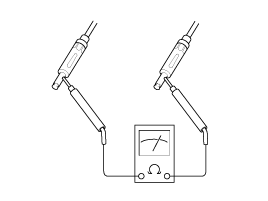
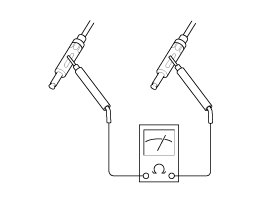
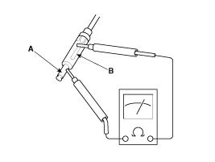
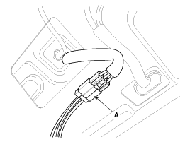
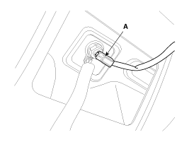
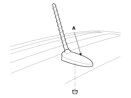

# Kia Sportage: Antena: Procedimentos de reparo

[Home](../../index.md) / [Manual de Serviço e Reparo do Kia Sportage SL](../sportage-482.md) / [Sistema Elétrico do Corpo](sportage-984.md) / [Som](sportage-987.md) / Procedimentos de reparo da antena

## Inspeção

Antena Cabo

1. Remova o conector da antena do unidade de som e da antena.

2. Verifique a continuidade entre os pinos centrais do cabo da antena.

   

3. Verifique a continuidade entre os pinos externos do cabo da antena. Deve haver continuidade.

   

4. Se não houver continuidade, substitua o cabo da antena.

5. Verifique a continuidade entre o pino central (A) e o pino externo (B) do cabo da antena. Não deve haver continuidade.

   

6. Se houver continuidade, substitua o cabo da antena.

## Remoção

Antena do Teto

1. Remova o trim do teto traseiro.

   (Consulte o grupo BD - "Trim do teto")

2. Desconecte o cabo alimentador da antena do teto (A) e o conectador (A) do antena do teto.

   

3. Desconecte o cabo de alimentação da antena (A).

   

4. Remova a antena do teto (A) após remover um parafuso.

   

## Instalação

1. Instale a antena do teto no painel do teto.

   ```
   Torque de aperto (parafuso) :
   8 ~ 15 Nm (0.8 ~ 1.5 kgf.m , 5.8 ~ 10.8 lb-ft)
   ```

2. Conecte o cabo alimentador à antena.

3. Conecte o cabo de alimentação à antena.

4. Instale o trim do teto traseiro.

   > **Nota**
   >
   > - Certifique-se de que os cabos e conectores estejam conectados corretamente.
   > - Verifique o sistema de som.
