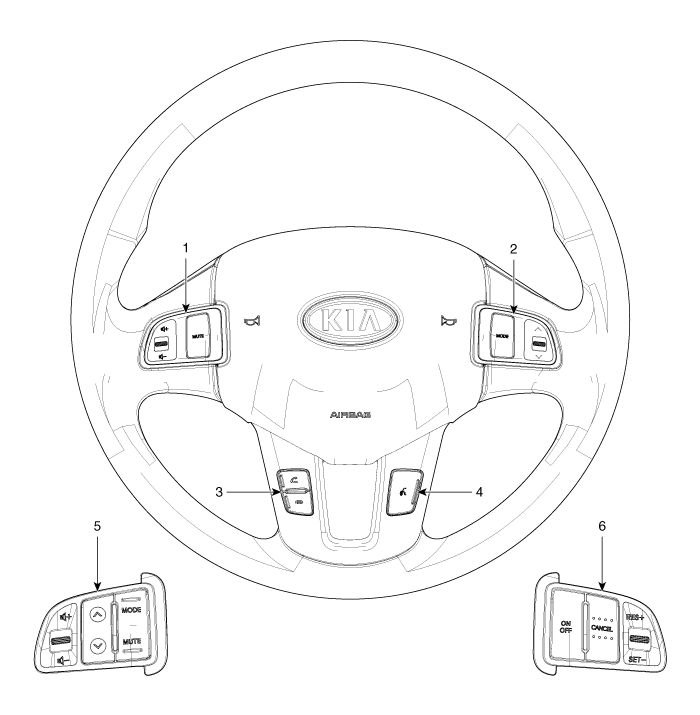

# Kia Sportage: Controle Remoto de Som: Componentes e Localização

[Home](../../index.md) / [Manual de Serviço e Reparo do Kia Sportage SL](../sportage-482.md) / [Sistema Elétrico do Corpo](sportage-984.md) / [Som](sportage-987.md) / Componentes e Localização do Controle Remoto de Som

## Localização dos Componentes

| 1. Interruptor de controle remoto de som (Esquerda) 2. Interruptor de controle remoto de som (Direita) 3. Interruptor Bluetooth | 4. Interruptor de voz 5. Interruptor de controle remoto de som 6. Interruptor de controle remoto de cruise control |
| --- | --- |
