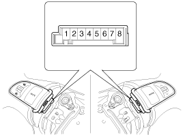
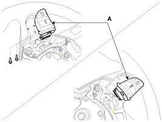

# Kia Sportage: Controle Remoto de Som: Procedimentos de Reparo

[Home](../../index.md) / [Manual de Serviço e Reparo do Kia Sportage SL](../sportage-482.md) / [Sistema Elétrico do Corpo](sportage-984.md) / [Som](sportage-987.md) / Procedimentos de Reparo do Controle Remoto de Som

## Inspeção

1. Verifique a resistência entre os terminais No.6 e No.7 em cada posição do interruptor.

   

   [Sistema de Som]

   | Interruptor | Conector terminal | Resistência (±5%) |
   | --- | --- | --- |
   | Desligar volume | 6 - 7 | 6,81 k? |
   | Aumentar volume | 6 - 7 | 4,61 k? |
   | Silenciar | 6 - 7 | 3,11 k? |
   | Modo | 6 - 7 | 2,11 k? |
   | Deslocar para baixo | 6 - 7 | 1,1 k? |
   | Deslocar para cima | 6 - 7 | 430 ? |

2. Verifique a tensão entre os terminais No.6 e No.7 em cada posição do interruptor.

   [Sistema de Som]

   | Interruptor | Conector terminal | Tensão de saída (±0,22V) |
   | --- | --- | --- |
   | Desligar volume | 6 - 7 | 3 |
   | Aumentar volume | 6 - 7 | 2,5 |
   | Silenciar | 6 - 7 | 2 |
   | Modo | 6 - 7 | 1,5 |
   | Deslocar para baixo | 6 - 7 | 1 |
   | Deslocar para cima | 6 - 7 | 0,4 |

## Remoção

1. Remova o módulo do airbag do condutor.

   (Consulte o grupo RT - "Módulo do airbag")

2. Remova as parafusos de montagem do interruptor do controle remoto do volante (2 unidades).

   Desconecte o conector e remova o interruptor do controle remoto do volante (A).

   

## Instalação

1. Instale o interruptor do controle remoto de som no volante.

2. Reconecte o conector do interruptor do controle remoto de som e os conectores do airbag.

   > **Nota**
   >
   > - Certifique-se de que o conector do interruptor esteja conectado corretamente.

3. Instale o módulo do airbag do condutor.

   > **Nota**
   >
   > - Ligue o interruptor do acionamento do sistema de ignição; a luz do indicador do SRS deve acender por cerca de seis segundos e depois apagar.
   > - Certifique-se de que o botão do buzina funcione.
