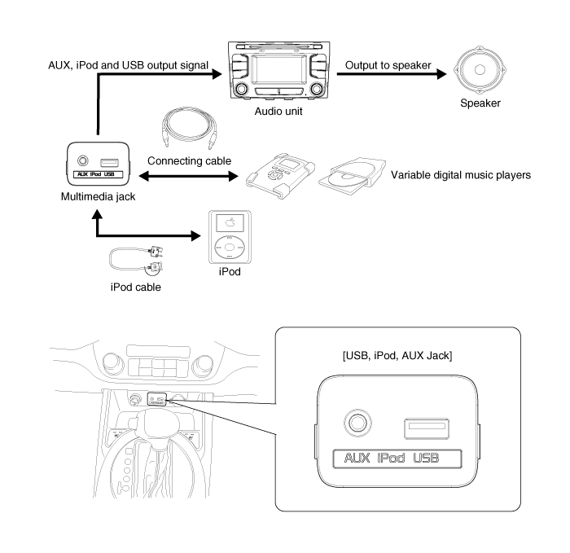

# Kia Sportage: Jack Auxiliar: Descrição e Operação

[Início](../../index.md) / [Manual de Serviço e Reparo do Kia Sportage SL](../sportage-482.md) / [Sistema Elétrico do Corpo](sportage-984.md) / [Som](sportage-987.md) / Jack Auxiliar: Descrição e Operação

## Descrição

O JACOBO AUX, iPod e USB no console central é para clientes que gostam de ouvir players de música portátil externos como o MP3, iPod, fone de ouvido, pen drive, player de CD e etc., através do sistema de som do veículo quando conectado a este jaco. O cliente tem esta opção adicional.

Em caso de distorções de mídia conectada à fonte AUX, o unidade de áudio pode não estar defeituosa, mas o nível de saída da mídia utilizada não corresponde à especificação do input AUX.

