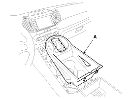
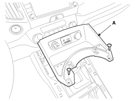
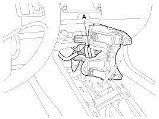
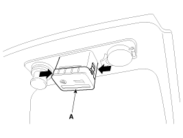

# Kia Sportage: AUX(Auxiliar) Jack: Procedimentos de Reparo

[Home](../../index.md) / [Manual de Serviço e Reparo do Kia Sportage SL](../sportage-482.md) / [Sistema Elétrico do Vidro e do Som](sportage-984.md) / [Som](sportage-987.md) / AUX(Auxiliar) Jack: Procedimentos de Reparo

## Remoção

1. Remova o botão. Remova a tampa superior do console do chão (A) usando a ferramenta apropriada.

   (Consulte o grupo BD - "Console")

   

2. Aos soltar as parafusos (2EA) e remova a tampa inferior do console do chão (A).

   

   > **Observação**
   >
   > - Cuide para não danificar a ganchos ao remover o interruptor.

3. Desconecte os conectores (A) da tampa inferior do console do chão.

   

4. Remova o fone de ouvido multifuncional (A) da tampa inferior do console do chão após pressionar os ganchos.

   

## Instalação

1. Instale o fone de ouvido multifuncional.

2. Instale a tampa inferior do console do chão.

3. Instale a tampa superior do console do chão.
