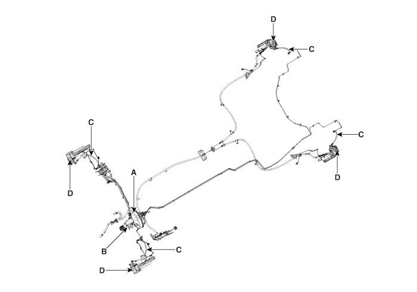
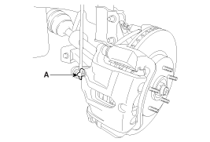
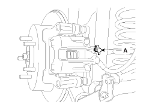
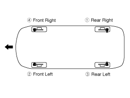

# Kia Sportage: Procedimentos de Reparo

[Início](../../index.md) / [Manual de Serviço e Reparo do Kia Sportage SL](../sportage-482.md) / [Sistema de Freios](sportage-894.md) / [Sistema de Freios](sportage-898.md) / Procedimentos de Reparo

## Verificação de Operação e Perda

Verifique todos os seguintes itens:

| Componente | Procedimento |
| --- | --- |
| Booster de Freio (A) | Verifique a operação do freio durante uma viagem de teste ao aplicar os freios. Se os freios parecerem difíceis de serem pressionados, verifique o booster de freio. Substitua o booster de freio como um conjunto se ele não funcionar corretamente ou se houver sinais de vazamento. |
| Inspeção da Cupula do Pistão e da Cupula de Pressão (B) | • Verifique a operação do freio ao aplicar os freios. Procure danos ou sinais de vazamento de líquido. Substitua o cilindro mestre como um conjunto se o pedal não funcionar corretamente ou se houver danos ou sinais de vazamento de líquido. • Verifique a diferença no movimento do pedal do freio entre aplicações rápidas e lentas. Substitua o cilindro mestre se houver diferença no movimento do pedal. |
| • | Verifique a operação do freio ao aplicar os freios. Procure danos ou sinais de vazamento de líquido. Substitua o cilindro mestre como um conjunto se o pedal não funcionar corretamente ou se houver danos ou sinais de vazamento de líquido. |
| • | Verifique a diferença no movimento do pedal do freio entre aplicações rápidas e lentas. Substitua o cilindro mestre se houver diferença no movimento do pedal. |
| Mangueiras de Freio (C) | Procure danos ou sinais de vazamento de líquido. Substitua a mangueira de freio por uma nova se ela estiver danificada ou vazando. |
| Pistão do Caliper e Protetor do Pistão (D) | Verifique a operação do freio ao aplicar os freios. Procure danos ou sinais de vazamento de líquido. Se o pedal não funcionar corretamente, os freios estiverem arrastando ou houver danos ou sinais de vazamento de líquido, desmonte e inspecione o caliper do freio. Substitua os protetores e selos por novos sempre que o caliper do freio for desmontado. |

Verificação de Sangria do Sistema de Freios

> **Cuidado**
>
> - Não reutilize o líquido drenado.
> - Sempre use o líquido de freio genuíno DOT3/DOT4.
> - Usar um líquido de freio não genuíno pode causar corrosão e diminuir a vida do sistema.
> - Certifique-se de que nenhuma sujeira ou outra matéria estranha não contamine o líquido de freio.
> - Não derrame líquido de freio no veículo, ele pode danificar a pintura; se o líquido de freio entrar em contato com a pintura, lave-o imediatamente com água.
> - O reservatório do cilindro mestre deve estar no nível MAX (superior) no início do procedimento de sangria e verificado após a sangria de cada caliper de freio. Adicione líquido conforme necessário.

1. Certifique-se de que o líquido de freio no reservatório esteja no nível MAX (superior) da linha.

2. Peça a alguém para puxar o pedal do freio várias vezes e então aplicar pressão.

3. Ajuste o parafuso de sangria do caliper traseiro direito (A) para permitir a saída de ar do sistema. Em seguida, apertar o parafuso de sangria seguramente.

   Frente

   

   Trás

   

4. Repita o procedimento para o eixo mostrado na sequência abaixo até que mais ar não apareça no líquido.

   

5. Reforne o reservatório do cilindro mestre para o nível MAX (superior) da linha.
