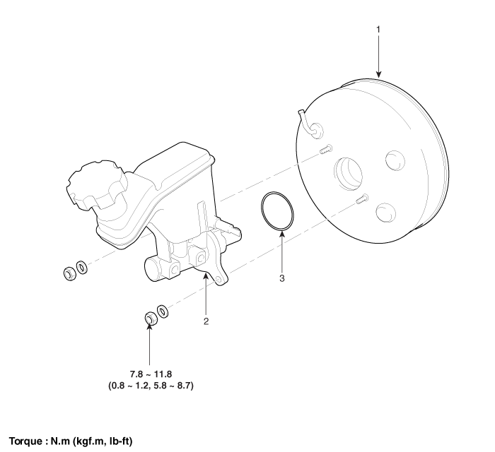
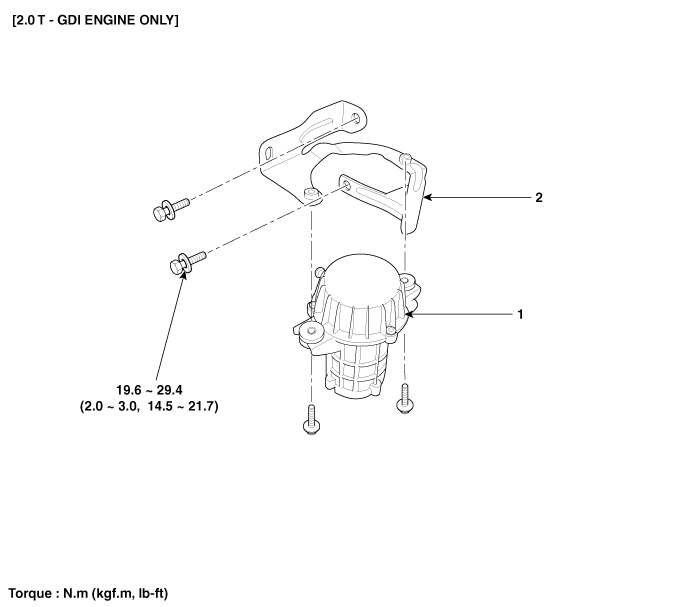

# Kia Sportage: Booster de Freio: Componentes e Localização dos Componentes

[Home](../../index.md) / [Manual de Serviço e Reparo do Kia Sportage SL](../sportage-482.md) / [Sistema de Freios](sportage-894.md) / [Sistema de Freios](sportage-898.md) / Booster de Freio: Componentes e Localização dos Componentes

## Componentes (1)

| 1. Booster de freio 2. Conjunto da câmara-mãe | 3. Aro |
| --- | --- |

## Componentes (2)

| 1. Bomba de vácuo | 2. Suporte |
| --- | --- |
