# Kia Sportage: Booster de Freio: Procedimentos de Reparo

[Home](../../index.md) / [Manual de Serviço e Reparo do Kia Sportage SL](../sportage-482.md) / [Sistema de Freio](sportage-894.md) / [Sistema de Freio](sportage-898.md) / Procedimentos de Reparo do Booster de Freio

## Teste de Operação do Booster de Freio

Para um simples teste da operação do booster de freio, realize os seguintes testes.

1. Inicie o motor por um ou dois minutos, e então pare. Se
   o pedal de freio ceder completamente a primeira vez, mas gradualmente se eleva
   nas tentativas seguintes, o booster está operando corretamente, se
   a altura do pedal permanecer inalterada, o booster está inoperante.

   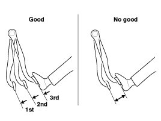

2. Com o motor parado, pisque no pedal de freio várias vezes.

   Em seguida, pisque no pedal de freio e inicie o motor. Se o
   pedal se mover ligeiramente para baixo, o booster está em bom estado. Se
   não houver mudança, o booster está inoperante.

   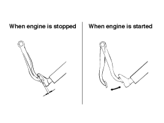

3. Com o motor em funcionamento, pisque no pedal de freio e então
   pare o motor. Mantenha o pedal pressionado por 30 segundos. Se a altura do pedal
   não mudar, o booster está em bom estado, se o pedal subir, o booster está inoperante.

   Se os três testes acima estiverem ok, o desempenho do booster pode ser determinado como bom.

   Mesmo que um dos três testes acima não esteja ok, verifique o check valve, o tubo de vácuo e o booster para falhas.

   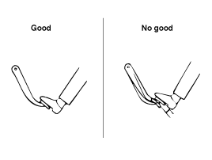

## Remoção

Booster de Freio

1. Desligue o interruptor de ignição e desconecte o cabo negativo (-) da bateria.

2. Desconecte o terminal da bateria e, em seguida, remova a bateria.

   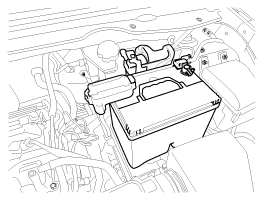

3. Desconecte o conector do ECM e, em seguida, o ECM e a prateleira da bateria.

4. Desconecte o tubo de vácuo (A) do booster de freio.

   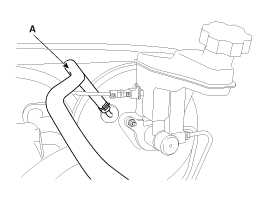

5. Remova o cilindro-mestre. (Consulte Cilindro-mestre)

6. Remova o pincolet (A) e o pincolet (B).

   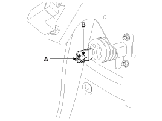

7. Remova as engrenagens de fixação.

   ```
   Torque de aperto:
   16,7 ~ 25,5 N.m (1,7 ~ 2,6 kgf.m, 12,3 ~ 18,8 lb-ft)
   ```

   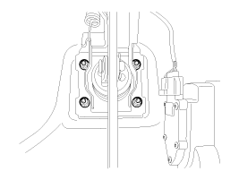

8. Remova o booster de freio.

Pompa de Vácuo

1. Desligue o interruptor de ignição.

2. Remova os capós inferiores (A).

   ```
   Torque de aperto:
   9,8 ~ 11,8 N.m (1,0 ~ 1,2 kgf.m, 7,2 ~ 8,7 lb-ft)
   ```

   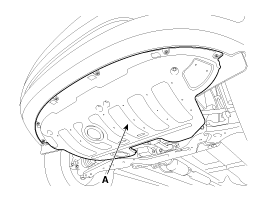

3. Desconecte o conector da pompa de vácuo (A).

   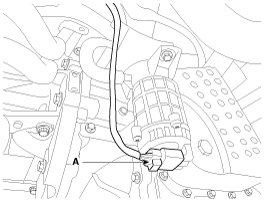

4. Desconecte o tubo de vácuo (A).

   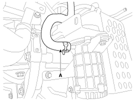

5. Desloque as engrenagens de fixação do suporte da pompa de vácuo (A), e, em seguida, remova a pompa de vácuo e o suporte.

   ```
   Torque de aperto:
   19,6 ~ 29,4 N.m (2,0 ~ 3,0 kgf.m, 14,5 ~ 21,7 lb-ft)
   ```

   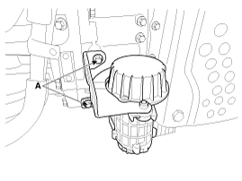

6. Remova os 2 parafusos, e, em seguida, remova o suporte da pompa de vácuo.

## Inspeção

1. Inspeçaõ do válvula de check no tubo de vácuo, intensificador e seção de conexão.

   > **Cuidado**
   >
   > - Não remova a válvula de check do tubo de vácuo.

2. Verifique o capuz para danos.

Pompa de Vácuo

1. Verifique a luz do freio no estado IGN ON.

   > **Observação**
   >
   > - A luz do freio está ligada nas seguintes condições.
   > - Aviso do freio de estacionamento
   > - Aviso do nível baixo de líquido do freio
   > - Aviso do vácuo baixo no freio
   > - Condição anormal da pompa de vácuo
   > - Condição anormal da comunicação CAN da pompa de vácuo
   > - Condição anormal do interruptor de vácuo

2. Verifique se a luz do freio está ligada após soltar o freio de estacionamento com um nível adequado de líquido do freio.

   Se a luz do freio estiver ligada, verifique os seguintes pontos.

   | (1) | A luz do freio está ligada dentro de 5 segundos após o IGN ON? (Erro de Timeout CAN) Erro de Timeout CAN ; A luz do freio está ligada quando a
   comunicação falha por mais de 2 segundos entre a pompa de vácuo e o cluster. ?
    Reinstale a conexão da pompa de vácuo após removê-la. E se a luz do freio estiver ligada dentro de 5 segundos após o IGN ON, substitua a pompa de vácuo. ? Vá para o Passo 2). |
   | --- | --- |
   | Erro de Timeout CAN ; A luz do freio está ligada quando a
   comunicação falha por mais de 2 segundos entre a pompa de vácuo e o cluster. | |
   | | ?
    Reinstale a conexão da pompa de vácuo após removê-la. E se a luz do freio estiver ligada dentro de 5 segundos após o IGN ON, substitua a pompa de vácuo. |
   | | ? Vá para o Passo 2). |

   | (2) | A luz do freio está ligada dentro de 45 ~ 55 segundos? ? O interruptor de vácuo do freio está em condições normais. ? Vá para o Passo 3). |
   | --- | --- |
   | | ? O interruptor de vácuo do freio está em condições normais. |
   | | ? Vá para o Passo 3). |

   | (3) | A luz do freio está ligada dentro de 15 ~ 35 segundos após remover o tubo de vácuo do booster do freio? ? Substitua a pompa de vácuo. ? A pompa de vácuo está em condições normais. |
   | --- | --- |
   | | ? Substitua a pompa de vácuo. |
   | | ? A pompa de vácuo está em condições normais. |

## Instalação

Ampulhetas do Freio

1. A instalação é o inverso da remoção.

   > **Cuidado**
   >
   > - Antes de instalar o pin, aplique a manteiga no pin de articulação.
   > - Use um novo pin de engate sempre que instalar.

2. Ajuste a altura e o play livre do pedal do freio.

   (Consulte o ajuste da altura e do play livre do pedal do freio)

3. Após a instalação, sangre o sistema de freio. (Consulte o sangramento do sistema de freio)

Pompa de Vácuo

1. A instalação é o inverso da remoção.

2. Ajuste os parafusos de montagem da pompa de vácuo para o torque especificado.
