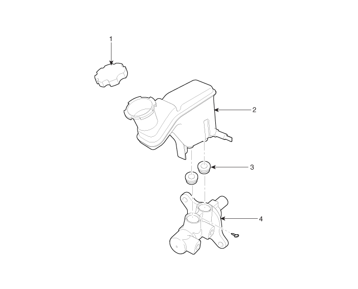

# Mola Master — Componentes e localização

[Home](../../index.md) / [Manual de Serviço e Reparo](../sportage-482.md) / [Sistema de Freio](sportage-894.md) / [Sistema de Freio](sportage-898.md) / Componentes e localização

## Diagrama

## Legenda

| Nº | Componente |
| --- | --- |
| 1 | Tampa do Reservatório |
| 2 | Reservatório |
| 3 | Protetor |
| 4 | Mola Master |
