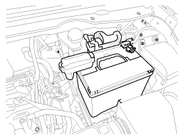
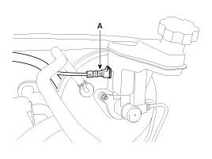
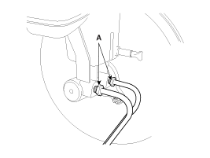
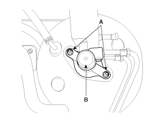

# Kia Sportage: Master Cylinder: Procedimentos de Reparo

[Home](../../index.md) / [Manual de Serviço e Reparo do Kia Sportage SL](../sportage-482.md) / [Sistema de Freio](sportage-894.md) / [Sistema de Freio](sportage-898.md) / Procedimentos de Reparo do Master Cylinder

## Remoção

1. Desligue a ignição e desconecte o cabo negativo (-) da bateria.

2. Desconecte o terminal da bateria e, em seguida, remova a bateria.

   

3. Desconecte o conectador do ECM e o ECM e a prateleira da bateria.

4. Desconecte o conectador do nível do líquido de freio (A) e remova a tampa do reservatório.

   

5. Remova o líquido de freio do reservatório do master cylinder com uma seringa.

   > **Cuidado**
   >
   > - Certifique-se de remover completamente as sujeiras do redor do
   reservatório de líquido de freio e da tampa antes de abrir a tampa do reservatório. Caso contrário, isso pode causar contaminação do líquido de freio e deterioração do desempenho do freio.
   > - Não derrame líquido de freio no veículo, pois pode danificar a pintura; se o líquido de freio entrar em contato com a pintura, lave-o imediatamente com água.

6. Desconecte a mangueira do master cylinder (A) do tubo do freio, soltando o parafuso do flare.

   ```
   Torque de aperto:
   16,7 ~ 22,6 N.m (1,7 ~ 2,3 kgf.m, 12,3 ~ 16,6 lb-ft)
   ```

   

7. Remova o master cylinder (B) do boostador do freio após soltar os parafusos de montagem (A).

   ```
   Torque de aperto:
   7,9 ~ 11,8 N.m (0,8 ~ 1,2 kgf.m, 5,8 ~ 8,7 lb-ft)
   ```

   

## Instalação

1. A instalação é o inverso da remoção.

2. Após a instalação, realize a limpeza do sistema de freio. (Consulte a limpeza do sistema de freio)
