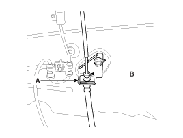
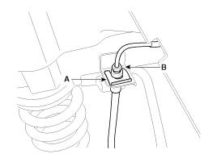
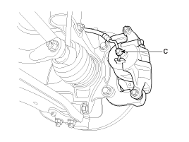
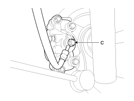
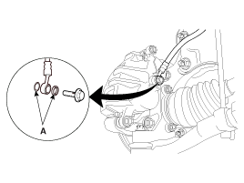

# Kia Sportage: Linha de Freio: Procedimentos de Reparo

[Home](../../index.md) / [Manual de Serviço e Reparo do Kia Sportage SL](../sportage-482.md) / [Sistema de Freio](sportage-894.md) / [Sistema de Freio](sportage-898.md) / Linha de Freio: Procedimentos de Reparo

## Remoção

1. Desconecte o conector do nível do líquido de freio, e remova a tampa do reservatório.

2. Remova o líquido de freio do reservatório do cilindro-mestre com uma seringa.

   > **Cuidado**
   >
   > - Não derrame líquido de freio no veículo, pois pode danificar a
   pintura; se o líquido de freio entrar em contato com a pintura, lave-o imediatamente com água.

3. Remova a roda e o pneu.

4. Remova o clip da mangueira de freio (A).

   Frente

   

   Traseira

   

5. Desconecte a mangueira de freio desafrouxando o parafuso do flare (B).

   ```
   Torque de aperto:
   12,7 ~16,7 N.m (1,3 ~1,7 kgf.m, 9,4 ~12,3 lb-ft)
   ```

6. Desconecte a mangueira de freio do calibro do freio desafrouxando o parafuso (C).

   ```
   Torque de aperto:
   24,5 ~29,4 N.m (2,5 ~3,0 kgf.m, 18,1 ~21,7 lb-ft)
   ```

   Frente

   

   Traseira

   

## Inspeção

1. Verifique as mangueiras de freio para rachaduras, dobras e corrosão.

2. Verifique as mangueiras de freio para rachaduras, danos e vazamento de líquido.

3. Verifique os parafusos do flare das mangueiras de freio para danos e vazamento de líquido.

4. Verifique o suporte de montagem da mangueira de freio para rachaduras ou deformação.

## Instalação

1. A instalação é o contrário da remoção.

   > **Cuidado**
   >
   > - Use uma borracha nova (A) sempre que instalar.

   

2. Após a instalação, limpe o sistema de freio. (Consulte a limpeza do sistema de freio)

3. Verifique o líquido de freio derramado.
