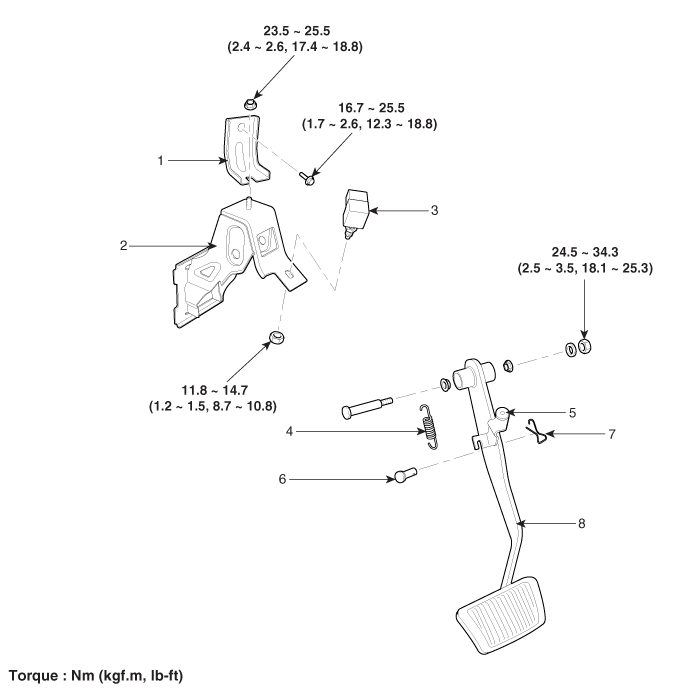

# Pedal do Freio — Componentes e localização

[Home](../../index.md) / [Manual de Serviço e Reparo](../sportage-482.md) / [Sistema de Freio](sportage-894.md) / [Sistema de Freio](sportage-898.md) / Componentes e localização

## Diagrama

## Legenda

| Nº | Componente |
| --- | --- |
| 1 | Braço do capô |
| 2 | Montagem do pedal do freio |
| 3 | Interruptor da luz de parada |
| 4 | Mola de retorno |
| 5 | Parador do pedal do freio |
| 6 | Pincoleta |
| 7 | Pincoleta com enganche rápido |
| 8 | Pedal do freio |
