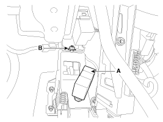
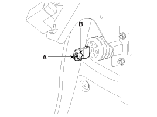
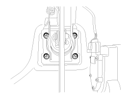
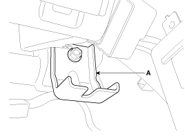
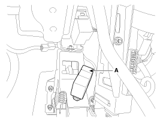
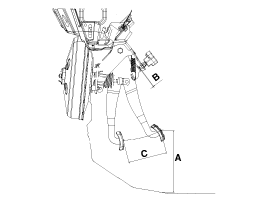

# Kia Sportage: Pedal de Freio: Procedimentos de Reparo

[Home](../../index.md) / [Manual de Serviço e Reparo do Kia Sportage SL](../sportage-482.md) / [Sistema de Freio](sportage-894.md) / [Sistema de Freio](sportage-898.md) / Procedimentos de Reparo do Pedal de Freio

## Remoção

1. Remova o painel inferior do capotamento e o painel de reforço. (Consulte o grupo do corpo - capotamento).

2. Desça o eixo do volante após remover os parafusos e as porcas.

3. Desconecte o conector do interruptor do farol de parada (A).

   

4. Remova a porca de montagem do membro do pedal de freio (B).

   ```
   Torque de aperto:
   16,5 ~ 25,5 N.m (1,7 ~ 2,6 kgf.m, 12,3 ~ 18,8 lb-ft)
   ```

5. Remova a pinça (A) e a porca de clevis (B).

   

6. Remova as porcas de montagem do membro do pedal de freio e, em seguida, remova o conjunto do pedal de freio.

   ```
   Torque de aperto:
   16,7 ~ 25,5 N.m (1,7 ~ 2,6 kgf.m, 12,3 ~ 18,8 lb-ft)
   ```

   

7. Remova o suporte do capô (A).

   ```
   Torque de aperto:
   23,5 ~ 25,5 N.m (2,4 ~ 2,6 kgf.m, 17,4 ~ 18,8 lb-ft)
   ```

   

## Inspeção

1. Verifique a pastilha para desgaste.

2. Verifique o pedal de freio para deformação ou torção.

3. Verifique a mola de retorno do pedal de freio para danos.

4. Verifique o interruptor do farol de parada.

   | (1) | Conecte um teste de circuito ao conector do interruptor do farol de parada e verifique a continuidade quando o plunger do interruptor do farol de parada é pressionado e quando é liberado. |
   | --- | --- |

   | (2) | O interruptor do farol de parada está em bom estado se não houver continuidade quando o plunger (A) é pressionado. |
   | --- | --- |

## Instalação

1. A instalação é o inverso da remoção.

   > **Cuidado**
   >
   > - Antes de instalar a pinça, aplique a manteiga na porca de clevis.
   > - Use uma nova pinça sempre que for instalada.

2. Ajuste a altura do pedal de freio e o espaço livre.

3. Verifique a operação do pedal de freio.

## Ajuste

Altura do Pedal de Freio e Espaço Livre

1. Desconecte o conector do interruptor do farol de parada (A) e desloque o parafuso de bloqueio do interruptor do farol de parada.

   

2. Ajuste a altura do pedal de freio (A) conforme a ilustração abaixo.

   ```
   Altura do pedal (A): 165 mm (6,50 in)
   Comprimento total (C): 135 mm (5,31 in)
   ```

   

3. Ajuste a distância do interruptor do farol de parada (B) e o espaço livre do pedal de freio.

   ```
   Distância do interruptor do farol de parada: 1,5 ~ 2,0 mm (0,06 ~ 0,08 in)
   Espaço livre do pedal: 3,0 ~ 8,0 mm (0,12 ~ 0,31 in)
   ```

4. Conecte o conector do interruptor do farol de parada.
