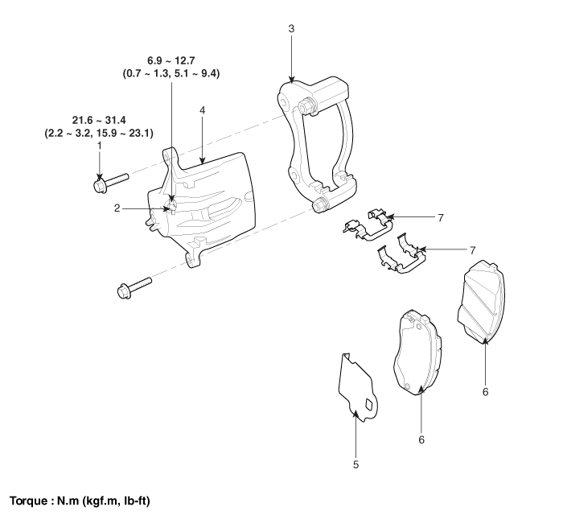

# Freio Discos Frente — Componentes e localização

[Home](../../index.md) / [Manual de Serviço e Reparo](../sportage-482.md) / [Sistema de Freios](sportage-894.md) / [Sistema de Freios](sportage-898.md) / Componentes e localização

## Diagrama

## Legenda

| Nº | Componente |
| --- | --- |
| 1 | Parafuso do eixo guia |
| 2 | Fita de vedação |
| 3 | Suporte do caliper |
| 4 | Corpo do caliper |
| 5 | Aquecedor interno do disco |
| 6 | Disco de freio |
| 7 | Retentor do disco |
