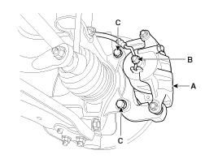
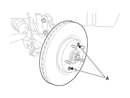
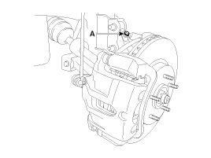
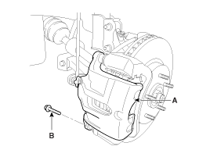
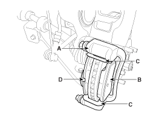
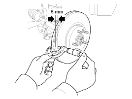
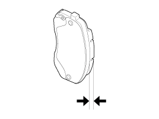
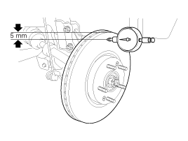
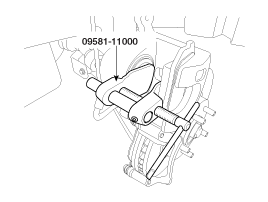

# Kia Sportage: Freio Discos Frentes: Procedimentos de Reparo

[Home](../../index.md) / [Manual de Serviço e Reparo do Kia Sportage SL](../sportage-482.md) / [Sistema de Freio](sportage-894.md) / [Sistema de Freio](sportage-898.md) / Procedimentos de Reparo dos Freios Discos Frentes

## Remoção

1. Remova a roda e o pneu dianteiros.

   ```
   Torque de aperto:
   88,3 ~107,9 N.m (9,0 ~11,0 kgf.m, 65,1 ~79,6 lb-ft)
   ```

2. Desloque o parafuso do olho do tubo de freio (B) e os parafusos de montagem do caliper (C), depois remova a montagem do caliper dianteiro (A).

   ```
   Torque de aperto:
   Tubo de freio para caliper (B):
   24,5 ~29,4 N.m (2,5 ~3,0 kgf.m, 18,1 ~21,7 lb-ft)
   Montagem do caliper para o buço (C):
   78,5 ~98,1 N.m (8,0 ~10,0 kgf.m, 57,9 ~72,3 lb-ft)
   ```

   

3. Remova o disco de freio dianteiro deslocando os parafusos (A).

   

## Substituição

Pads de freio dianteiros

1. Remova o parafuso do suporte do tubo de freio (A).

   

2. Desloque o parafuso do guia (B) e pivote o caliper (A) para fora do caminho.

   ```
   Torque de aperto:
   21,6 ~31,4 N.m (2,2 ~3,2 kgf.m, 15,9 ~23,1 lb-ft)
   ```

   

3. Substitua a chapa de amortecimento (D), os mantos de retenção (C) e os pads de freio (B) na montagem do caliper (A).

   

## Inspeção

Verificação da espessura do disco de freio dianteiro

1. Verifique o desgaste e a descoloração das pastilhas de freio.

2. Verifique o disco de freio para danos e rachaduras.

3. Remova toda a ferrugem e sujeira da superfície, e
   mede a espessura do disco em 8 pontos, pelo menos, a uma distância de 5mm
   da circunferência externa do disco de freio.

   ```
   Espessura do disco de freio
   [2WD]
   - Padrão : 26 mm (1.02 in)
   - Limite de Serviço : 24.4 mm (0.96 in)
   [4WD]
   - Padrão : 28 mm (1.10 in)
   - Limite de Serviço : 26.4 mm (1.04 in)
   Desvio: Menos de 0.005mm (0.0002in)
   ```

   

4. Se o desgaste exceder o limite, substitua os discos e a montagem das pastilhas de freio do lado esquerdo e direito do veículo.

Verificação das pastilhas de freio dianteiras

1. Verifique o desgaste das pastilhas. Mede a espessura da pastilha e substitua-a se for menor que o valor especificado.

   ```
   Espessura da pastilha
   Valor padrão: 11 mm (0.43 in)
   Limite de serviço: 2.0 mm (0.0787 in)
   ```

2. Verifique se foi aplicada manteiga, nos pontos de contato em movimento e a pastilha e a chapa de fundo para danos.

   

Verificação do deslocamento do disco de freio dianteiro

1. Coloque um indicador de volante a uma distância de 5mm (0.2 in.) da circunferência externa do disco de freio, e mede o deslocamento do disco.

   ```
   Deslocamento do disco de freio
   Limite: 0.025 mm (0.00098 in.) ou menos (novo)
   ```

   

2. Se o deslocamento do disco de freio exceder o limite especificado, substitua o disco, e então mede o deslocamento novamente.

3. Se o deslocamento não exceder o limite especificado,
   instale o disco de freio após girá-lo 180° e então verifique o deslocamento
   do disco de freio novamente.

4. Se o deslocamento não puder ser corrigido mudando a posição do disco de freio, substitua o disco de freio.

## Instalação

1. A instalação é o contrário da remoção.

2. Use um SST (09581-11000) na instalação da montagem do calibração de freio.

   

3. Após a instalação, realize a limpeza do sistema de freio. (Consulte a limpeza do sistema de freio)
