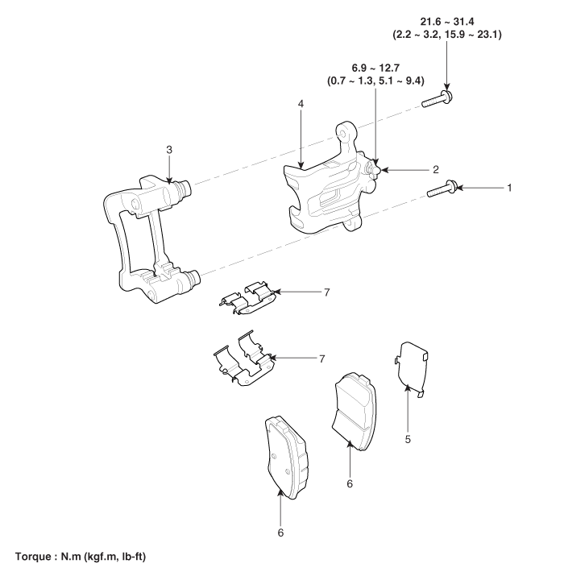

# Kia Sportage: Freio Discos Traseiros: Componentes e Localização dos Componentes

[Home](../../index.md) / [Manual de Serviço e Reparo do Kia Sportage SL](../sportage-482.md) / [Sistema de Freio](sportage-894.md) / [Sistema de Freio](sportage-898.md) / Freio Discos Traseiros: Componentes e Localização dos Componentes

## Componentes

| 1. Parafuso do eixo guia 2. Fita de vedação 3. Suporte do calipé 4. Corpo do calipé | 5. Aquecedor do travão interno 6. Disco de travão 7. Retenção do disco de travão |
| --- | --- |
