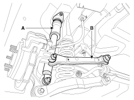
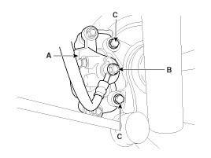
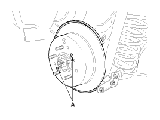
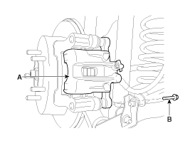
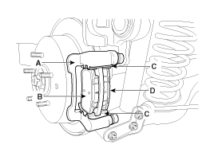
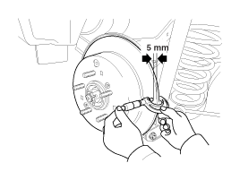
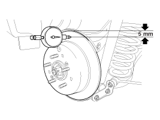
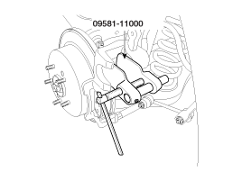

# Kia Sportage: Freio Discos Traseiros: Procedimentos de Reparo

[Home](../../index.md) / [Manual de Serviço e Reparo do Kia Sportage SL](../sportage-482.md) / [Sistema de Freio](sportage-894.md) / [Sistema de Freio](sportage-898.md) / Procedimentos de Reparo dos Discos Traseiros

## Remoção

1. Remova a roda traseira e o pneu.

   ```
   Torque de aperto:
   88.3 ~107.9 N.m(9.0 ~11.0 kgf.m, 65.1 ~79.6 lb-ft)
   ```

2. Remova o amortecedor traseiro (A). [Só para 2WD]

   (Consulte o grupo de suspensão - amortecedor traseiro)

   

3. Remova o braço superior traseiro (B). [Só para 2WD]

   (Consulte o grupo de suspensão - braço superior traseiro)

4. Desloque o parafuso de apoio do mangote (B) e os parafusos de montagem do caliper (C), depois remova a montagem do caliper traseiro (A).

   ```
   Torque de aperto:
   Mangote ao caliper (B):
   24.5 ~ 29.4 N.m (2.5 ~ 3.0 kgf.m, 18.1 ~ 21.7 lb-ft)
   Caliper assembly ao carrier (C):
   78.5 ~ 98.1 N.m (8.0 ~10.0 kgf.m, 57.9 ~ 72.3 lb-ft)
   ```

   

5. Remova o disco traseiro deslocando os parafusos (A).

   

## Troca

Pads de freio traseiros

1. Desloque o parafuso do eixo guia (B) e puxe o caliper (A) para cima, de lado.

   ```
   Torque de aperto:
   21.6 ~31.4 N.m (2.2 ~3.2 kgf.m, 15.9 ~23.1 lb-ft)
   ```

   

2. Substitua a espiga de amortecimento (D), os mantenedores (C) e os pads de freio (B) no suporte do caliper (A).

   

## Inspeção

Verificação da Espessura do Disco Freio Traseiro

1. Verifique o desgaste e a perda de eficiência das pastilhas de freio.

2. Verifique o disco freio traseiro para danos e rachaduras.

3. Remova toda a ferrugem e sujeira da superfície, e
   meda a espessura do disco em pelo menos 8 pontos, a uma distância de pelo menos 5mm
   da circunferência externa do disco freio.

   ```
   Espessura do disco freio
   Padrão: 10 mm (0,39 in)
   Limite de serviço: 8,4 mm (0,33 in)
   Desvio: menos de 0,005 mm (0,0002 in)
   ```

   

4. Se o desgaste exceder o limite, substitua os discos e a montagem de pastilhas do lado esquerdo e direito do veículo.

Verificação da Pastilha Freio Traseira

1. Verifique o desgaste da pastilha. Meda a espessura da pastilha e substitua-a se ela for menor que o valor especificado.

   ```
   Espessura da pastilha
   Valor padrão: 10 mm (0,393 in)
   Limite de serviço: 2,0 mm (0,0787 in)
   ```

2. Verifique se foi aplicada manteiga nas áreas de contato deslizante e a pastilha e a metalagem de apoio para danos.

Verificação do Runout do Disco Freio Traseiro

1. Coloque um indicador de rotação de cerca de 5mm (0,2 in.) da circunferência externa do disco freio, e mede o runout do disco.

   ```
   Runout do disco freio
   Limite: 0,03 mm (0,00118 in.) ou menos (novo)
   ```

   

2. Se o runout do disco freio exceder o limite especificado, substitua o disco, e então mede o runout novamente.

3. Se o runout exceder o limite especificado, instale o
   disco freio após girá-lo 180° e então verifique novamente o runout do disco freio.

4. Se o runout não puder ser corrigido mudando a posição do disco freio, substitua o disco freio.

## Instalação

1. A instalação é o inverso da remoção.

2. Use um SST (09581-11000) ao instalar a montagem do calibração do freio.

   

3. Após a instalação, descarregue o sistema de freio. (Consulte a descarga do sistema de freio)
