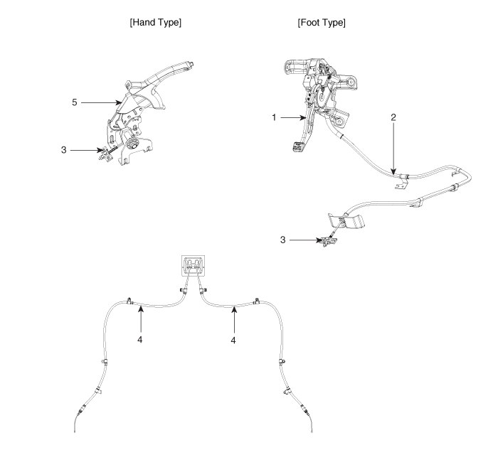
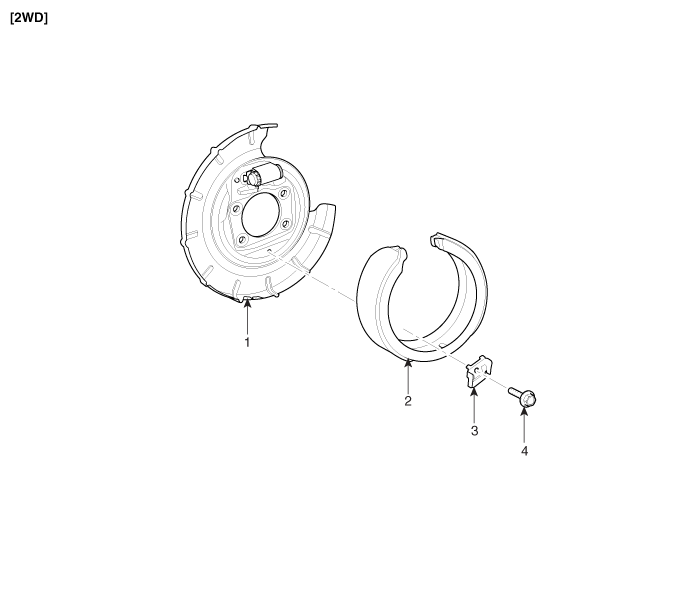

# Assembleia do Freio de Estacionamento — Componentes e localização

[Home](../../index.md) / [Manual de Serviço e Reparo](../sportage-482.md) / [Sistema de Freios](sportage-894.md) / [Sistema de Freio de Estacionamento](sportage-912.md) / Componentes e localização

## Diagrama (1)

## Legenda (1)

| Nº | Componente |
| --- | --- |
| 1 | Assembleia do pedal do freio de estacionamento |
| 2 | Fio de freio de estacionamento (apenas do tipo de pé) |
| 3 | Assembleia do equilibrador |
| 4 | Fio de freio de estacionamento traseiro |
| 5 | Assembleia do lembrete do freio de estacionamento |

## Diagrama (2)

## Legenda (2)

| Nº | Componente |
| --- | --- |
| 1 | Placa de apoio |
| 2 | Freio de disco |
| 3 | Aro de fixação do freio |
| 4 | Parafuso |

## Diagrama (3)

## Legenda (3)

| Nº | Componente |
| --- | --- |
| 1 | Placa de apoio |
| 2 | Mola do amortecedor |
| 3 | Amortecedor |
| 4 | Freio de disco e revestimento |
| 5 | Guiador do freio |
| 6 | Mola de retorno |
| 7 | Ajustador |
| 8 | Mola de retorno |
| 9 | Washer de concha |
| 10 | Mola de fixação do freio |
| 11 | Pin de fixação do freio |
