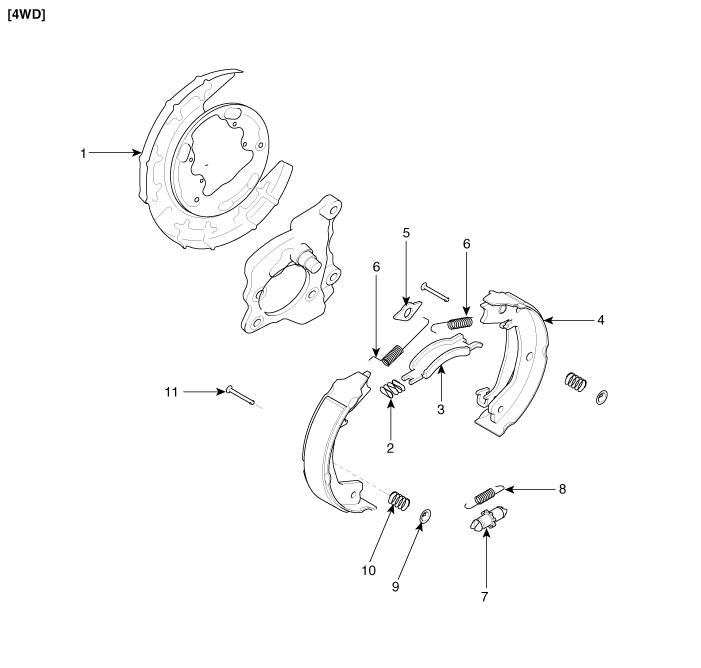

# Kia Sportage: Assembleia do Freio de Estacionamento: Componentes e Localização dos Componentes

[Home](../../index.md) / [Manual de Serviço e Reparo do Kia Sportage SL](../sportage-482.md) / [Sistema de Freios](sportage-894.md) / [Sistema de Freio de Estacionamento](sportage-912.md) / Assembleia do Freio de Estacionamento: Componentes e Localização dos Componentes

## Componentes (1)

| 1. Assembleia do pedal do freio de estacionamento 2. Fio de freio de estacionamento (apenas do tipo de pé) 3. Assembleia do equilibrador | 4. Fio de freio de estacionamento traseiro 5. Assembleia do lembrete do freio de estacionamento |
| --- | --- |

## Componentes (2)

| 1. Placa de apoio 2. Freio de disco | 3. Aro de fixação do freio 4. Parafuso |
| --- | --- |

## Componentes (3)

| 1. Placa de apoio 2. Mola do amortecedor 3. Amortecedor 4. Freio de disco e revestimento 5. Guiador do freio 6. Mola de retorno | 7. Ajustador 8. Mola de retorno 9. Washer de concha 10. Mola de fixação do freio 11. Pin de fixação do freio |
| --- | --- |
