# Kia Sportage: Assembleia do Freio de Estacionamento: Procedimentos de Reparo

[Home](../../index.md) / [Manual de Serviço e Reparo do Kia Sportage SL](../sportage-482.md) / [Sistema de Freios](sportage-894.md) / [Sistema de Freio de Estacionamento](sportage-912.md) / Procedimentos de Reparo da Assembleia do Freio de Estacionamento

## Remoção

Pedale do Freio de Estacionamento [Tipo de Perna]

1. Remova o painel inferior do capotamento e o painel de reforço. (Consulte o grupo de capotamento)

2. Remova a caixa de conexão. (Consulte o grupo de Sistema Elétrico do Corpo - Fusíveis e Relés)

3. Desconecte o conector do interruptor do freio de estacionamento (A).

   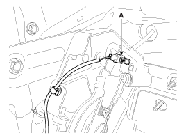

4. Remova o parafuso de montagem da correia do freio de estacionamento (A).

   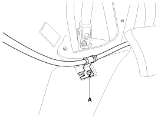

5. Remova os parafusos de montagem (A) e a螺母 (B) do pedale do freio de estacionamento.

   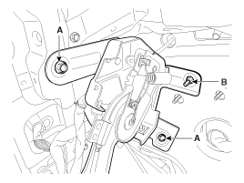

6. Remova o clip de fixação (A) e o parafuso de fixação (B) da correia do freio de estacionamento, e então remova o pedale do freio de estacionamento.

   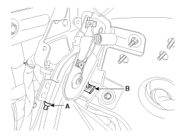

7. Remova o console do chão. (Consulte o grupo de Corpo - Console)

8. Remova o suporte do console do chão (A).

   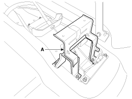

9. Remova o clip de fixação (A) e os parafusos (B) da correia do freio de estacionamento.

   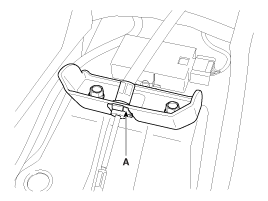

   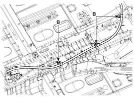

10. Ajuste o parafuso de fixação (A) e remova a correia do freio de estacionamento dianteira.

   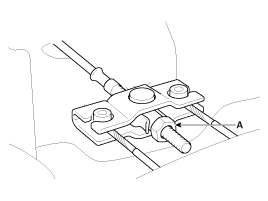

11. Eleva o veículo e certifique-se de que esteja firmemente suportado.

12. Remova a correia do freio de estacionamento (A) após remover o anel de retenção (B).

   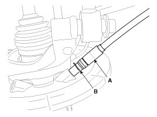

13. Ajuste os parafusos de fixação do suporte da correia do freio de estacionamento e remova a correia do freio de estacionamento traseiro.

Pedale do Freio de Estacionamento [Tipo de Mano]

1. Remova o console do chão. (Consulte o grupo de Corpo - Console)

2. Desconecte o conector (A) do interruptor do freio de estacionamento.

   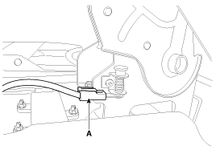

3. Remova o suporte do console do chão (A).

   

4. Ajuste o parafuso de fixação (A) e remova as correias do freio de estacionamento.

   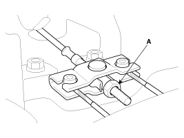

5. Remova a montagem do pedale do freio de estacionamento após remover os 4 parafusos (A) como mostrado abaixo.

   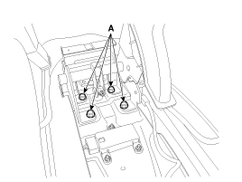

6. Eleva o veículo e certifique-se de que esteja firmemente suportado.

7. Remova a correia do freio de estacionamento (A) após remover o clip de retenção (B).

   

8. Ajuste os parafusos de fixação do suporte da correia do freio de estacionamento e remova a correia do freio de estacionamento.

Freio de Estacionamento (Freio de Estacionamento)

1. Eleva o veículo e certifique-se de que esteja firmemente suportado.

2. Remova a roda e o pneu traseiro.

3. Remova o caliper traseiro e o disco de freio traseiro.

   (Consulte a remoção do disco de freio traseiro)

4. Remova a correia do freio de estacionamento (B), após remover o clip (A).

   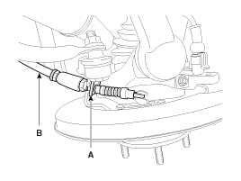

5. Remova a montagem do disco de freio e do freio de estacionamento.

6. Ajuste o parafuso de montagem do clip de retenção (A) e então remova o disco de freio.

   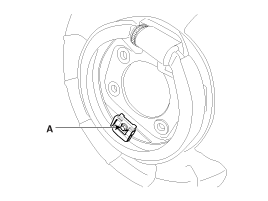

Freio de Estacionamento (Freio de Estacionamento 4WD)

1. Eleva o veículo e certifique-se de que esteja firmemente suportado.

2. Remova a roda e o pneu traseiro, e então remova o caliper traseiro. (Consulte a remoção do disco de freio traseiro)

3. Remova o disco de freio traseiro ao soltar as parafusos (A).

   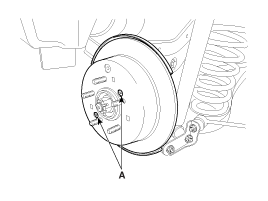

4. Remova o rolamento do eixo traseiro (A).

   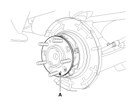

5. Remova a viga de fixação do tambor (A) e o molas (B) empurrando o molas de retenção e girando a viga.

   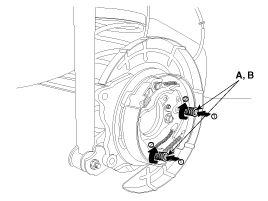

6. Remova a montagem reguladora (A) e o molas de retorno (B).

   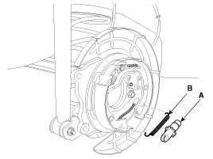

7. Remova o cabo de freio de estacionamento (B) do tambor de freio (A).

   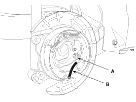

8. Remova o braço de amortecedor (C) e o molas de amortecedor (D).

   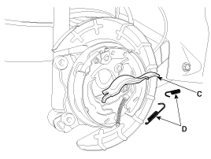

9. Remova o tambor de freio.

10. Remova a viga de retenção do cabo de freio de estacionamento (B), do cabo de freio de estacionamento (A).

    

## Instalação

Freio de Estacionamento [2WD]

1. Instale o tambor de freio.

2. Fixe o tambor de freio com a pinça de fixação e, em seguida, instale a viga (A).

   ```
   Torque de aperto:
   2,0 ~ 4,9 N.m (0,2 ~ 0,5 kgf.m, 1,4 ~ 3,6 lb-ft)
   ```

   

3. Instale a montagem do freio de estacionamento e a montagem do eixo.

4. Instale o cabo do freio de estacionamento (B), em seguida, instale a pinça (A).

   

5. Instale o disco de freio traseiro, em seguida, ajuste a distância entre os tambores de freio.

   | (1) | Remova o plug do disco. |
   | --- | --- |

   | (2) | Gire o disco de ajuste com uma vareta até que o disco pare de se mover, e então retorne-o em 3 notações na direção oposta. |
   | --- | --- |

6. Instale a montagem do calibro de freio. (Consulte a "Instalação do freio traseiro")

7. Instale a roda e o pneu, após instalar o plug no disco.

8. Se o tambor de freio de estacionamento ou o disco de freio foram substituídos por novos, realize o procedimento de preaquecimento do tambor de freio.

   | (1) | Tipo manual - Enquanto operar o pedal do freio de estacionamento com um esforço de 68,6 N (7 kgf, 15,4 lbf), dirija o veículo 500 metros (0,31 milhas) a uma velocidade de 30 km/h (18,6 mph). Tipo de pé - Enquanto operar o cabo do freio de estacionamento com um esforço de 147 N (15 kgf, 33 lbf), dirija o veículo 500 metros (0,31 milhas) a uma velocidade de 30 km/h (18,6 mph). |
   | --- | --- |

   | (2) | Repita o procedimento acima mais de três vezes. |
   | --- | --- |

   | (3) | Deve ser mantido em 20% de subida. Após ajustar o freio de estacionamento, observe o seguinte: 1) Não deve haver problemas quando o pedal do freio de estacionamento é operado com um esforço de 686,5 N (70 kgf, 154 lbf). 2) Verifique que todos os componentes se movam suavemente. 3) O indicador do freio de estacionamento deve estar aceso quando o pedal do freio de estacionamento estiver em funcionamento e deve se apagar quando o pedal for liberado. |
   | --- | --- |
   | Após ajustar o freio de estacionamento, observe o seguinte: 1) Não deve haver problemas quando o pedal do freio de estacionamento é operado com um esforço de 686,5 N (70 kgf, 154 lbf). 2) Verifique que todos os componentes se movam suavemente. 3) O indicador do freio de estacionamento deve estar aceso quando o pedal do freio de estacionamento estiver em funcionamento e deve se apagar quando o pedal for liberado. | |
   | 1) | Não deve haver problemas quando o pedal do freio de estacionamento é operado com um esforço de 686,5 N (70 kgf, 154 lbf). |
   | 2) | Verifique que todos os componentes se movam suavemente. |
   | 3) | O indicador do freio de estacionamento deve estar aceso quando o pedal do freio de estacionamento estiver em funcionamento e deve se apagar quando o pedal for liberado. |

Freio de Estacionamento [4WD]

1. Instale o tambor de freio (A) na placa de traseira (B).

   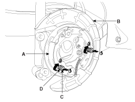

2. Instale a pinça de fixação (C) e o molas (D) empurrando a mola de retenção (D) e girando as pinças.

3. Após instalar o amortecedor (C) e a mola de retorno superior (D), instale a montagem de ajuste e a mola de retorno inferior.

   

4. Instale o cabo do freio de estacionamento (A), em seguida, instale a pinça de retenção (B).

   

5. Aplicar uma camada do lubrificante especificado em cada parte deslizante do freio de estacionamento conforme indicado.

   ```
   Lubrificante especificado :
   Graxa multiuso SAE J310, NLGI No.2
   ```

   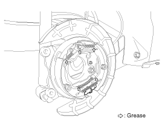

6. Instalar o disco de freio traseiro, depois ajustar a distância entre os amortecedores traseiros.

   | (1) | Remover o plug do disco. |
   | --- | --- |

   | (2) | Girar o disco dentado do ajustador com uma régua até que o disco pare de se mover, e então retorná-lo em 3 notações na direção oposta. |
   | --- | --- |

7. Instalar o calibro do freio. (Consultar a instalação do freio traseiro)

8. Instalar a roda e o pneu.

9. Se o amortecedor do freio de estacionamento ou o disco de freio foram substituídos por novos, realize o procedimento de preaquecimento do amortecedor do freio de estacionamento.

   | (1) | Tipo manual - Ao operar o pedal do freio de estacionamento com esforço de 68,6 N (7 kgf, 15,4 lbf), conduza o veículo 500 metros (0,31 milhas) a uma velocidade de 30 km/h (18,6 mph). Tipo de pé - Ao operar o cabo do freio de estacionamento com esforço de 147 N (15 kgf, 33 lbf), conduza o veículo 500 metros (0,31 milhas) a uma velocidade de 30 km/h (18,6 mph). |
   | --- | --- |

   | (2) | Repita o procedimento acima mais de três vezes. |
   | --- | --- |

   | (3) | Deve permanecer retido em 20% de subida. Após ajustar o freio de estacionamento, observe os seguintes itens: 1) Não deve apresentar problemas ao operar o pedal do freio de estacionamento com esforço de 686,5 N (70 kgf, 154 lbf). 2) Verifique que todos os componentes se movam suavemente. 3) O indicador do freio de estacionamento deve se acender após o pedal do freio de estacionamento ser operado e deve se apagar após o pedal ser liberado. |
   | --- | --- |

   | Após ajustar o freio de estacionamento, observe os seguintes itens: 1) Não deve apresentar problemas ao operar o pedal do freio de estacionamento com esforço de 686,5 N (70 kgf, 154 lbf). 2) Verifique que todos os componentes se movam suavemente. 3) O indicador do freio de estacionamento deve se acender após o pedal do freio de estacionamento ser operado e deve se apagar após o pedal ser liberado. | |
   | 1) | Não deve apresentar problemas ao operar o pedal do freio de estacionamento com esforço de 686,5 N (70 kgf, 154 lbf). |
   | 2) | Verifique que todos os componentes se movam suavemente. |
   | 3) | O indicador do freio de estacionamento deve se acender após o pedal do freio de estacionamento ser operado e deve se apagar após o pedal ser liberado. |

Cabo do Freio de Estacionamento [Tipo Manual]

1. Instalar a montagem do cabo do freio de estacionamento, depois apertar os parafusos de montagem (A).

   

2. Aplicar uma camada do lubrificante especificado em cada parte deslizante (A) do disco dentado ou do pêndulo do disco.

   ```
   Lubrificante especificado :
   Graxa multiuso SAE J310, NLGI No.2
   ```

   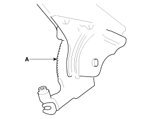

3. Instalar o ajustador do cabo do freio de estacionamento, depois ajustar a distância de atuação do cabo do freio de estacionamento girando o parafuso de ajuste (A).

   ```
   Distância de atuação do cabo do freio de estacionamento :
   6 cliks (Puxe o cabo com 20 kgf)
   ```

   > **Nota**
   >
   > - Após a reparação do amortecedor do freio de estacionamento, ajuste a distância entre os amortecedores, e então ajuste a distância de atuação do cabo do freio de estacionamento. (Consultar a instalação do amortecedor do freio de estacionamento)

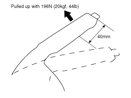

   

4. Libere completamente o cabo do travamento do estacionamento e verifique se os travamentos de estacionamento não travam quando as rodas traseiras são viradas. Ajuste se necessário.

5. Certifique-se de que os travamentos de estacionamento estejam completamente aplicados quando o cabo do travamento do estacionamento for puxado completamente.

6. Reconecte o conectador do interruptor do travamento do estacionamento.

   > **Nota**
   >
   > - Verifique a continuidade do interruptor do travamento do estacionamento.

   ```
   Quando o cabo do travamento do estacionamento for puxado : continuidade
   Quando o cabo do travamento do estacionamento for solto : sem continuidade
   ```

7. Instale o suporte do painel do console do chão (A).

   

8. Instale o console do chão. (Consulte o grupo Corpo - "Console do chão")

Pedale do Travamento de Estacionamento [Tipo de Pé]

1. Instale o cabo do travamento de estacionamento.

2. Instale o gancho de retenção (B) e o parafuso de ajuste do cabo (A) após fixar o cabo do travamento de estacionamento.

   

3. Instale o pedale do travamento de estacionamento, e então instale as parafusos de montagem do pedale do travamento de estacionamento (A) e a mola (B).

   

4. Instale o parafuso de montagem do cabo do travamento de estacionamento (A).

   

5. Ajuste o movimento do pedale do travamento de estacionamento girando o parafuso de ajuste (A).

   | (1) | Operar o pedale do travamento de estacionamento por um movimento completo de mais de três vezes para ajustar o cabo do travamento de estacionamento. |
   | --- | --- |

   | (2) | Ajuste o parafuso de ajuste (A) para um movimento de 4 notações do pedale do travamento de estacionamento quando o esforço de operação for de 196N (20kgf. 44lb). 1) O ajuste do travamento de estacionamento deve ser realizado após o ajuste do travamento traseiro. 2) Após o ajuste do travamento de estacionamento, observe os seguintes pontos. a. Não deve haver clearance entre o parafuso de ajuste e a pinça. b. Verifique se o travamento não está travando. |
   | --- | --- |
   | 1) O ajuste do travamento de estacionamento deve ser realizado após o ajuste do travamento traseiro. 2) Após o ajuste do travamento de estacionamento, observe os seguintes pontos. |
   | a. | Não deve haver clearance entre o parafuso de ajuste e a pinça. |
   | b. | Verifique se o travamento não está travando. |

6. Reconecte o conectador do interruptor do travamento de estacionamento (A).

   

7. Instale a caixa de junção. (Consulte o grupo Sistema Elétrico do Corpo - Fusíveis e Relés)

8. Instale o painel de reforço e o painel de amortecimento inferior. (Consulte o grupo Corpo - Amortecimento)

## Ajuste

Ajuste da Clearance das Freijos do Freio de Estacionamento [2WD]

1. Elevar o veículo e garantir que esteja suportado de forma segura.

2. Remover a roda e o pneu traseiros.

3. Remover o plug do disco.

4. Girar a roda dentada do ajustador com uma furadeira até que o disco não se mova, e então retorná-la em 3 notações na direção oposta.

   Não deve haver força de arrasto do disco e deve-se confirmar a ocorrência de força de arrasto do disco.

5. Instalar a roda e o pneu traseiros após instalar o plug no disco.

Ajuste da Clearance das Freijos do Freio de Estacionamento [4WD]

1. Elevar o veículo e garantir que esteja suportado de forma segura.

2. Remover a roda e o pneu traseiros.

3. Remover o plug (A) do disco.

   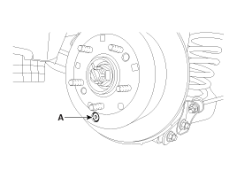

4. Girar a roda dentada do ajustador com uma furadeira até que o disco não se mova, e então retorná-la em 3 notações na direção oposta.

   Não deve haver força de arrasto do disco e deve-se confirmar a ocorrência de força de arrasto do disco.

5. Instalar a roda e o pneu traseiros após instalar o plug no disco.

Ajuste do Passeio do Pedal do Freio de Estacionamento

1. Operar o pedal do freio de estacionamento por um passeio completo de 3 vezes para ajustar as amarras do freio de estacionamento.

2. Ajustar o parafuso de ajuste (A) para o passeio do pedal do freio de estacionamento em 4 notações quando o esforço de ajuste é 196N (20kgf, 44lbf)

   

   > **Cautela**
   >
   > - O ajuste do freio de estacionamento deve ser realizado após ajustar o freio traseiro.
   > - Após ajustar o freio de estacionamento, prestar atenção às seguintes matérias.
   > - Não deve haver clearance entre o parafuso de ajuste e a pinça.
   > - Verificar se o freio não está arrastando de forma segura.

Ajuste do Passeio da Alavanca do Freio de Estacionamento

1. Elevar o veículo e garantir que esteja suportado de forma segura.

2. Remover a capa traseira do console do chão.

3. Ajustar o passeio da alavanca do freio de estacionamento girando o parafuso de ajuste (A).

   ```
   Passeio da alavanca do freio de estacionamento :
   6 cliques (Puxar a alavanca com 20kgf)
   ```

   > **Nota**
   >
   > - Após a reparação do freio de estacionamento, ajustar a clearance do freio de estacionamento e, em seguida, ajustar o passeio da alavanca do freio de estacionamento. (Consultar o "Instalação do freio de estacionamento")

   

   

4. Liberar a alavanca do freio de estacionamento completamente e verificar se os freios de estacionamento não estão arrastando quando as rodas traseiras são viradas. Ajustar novamente se necessário.

5. Verificar se os freios de estacionamento estão aplicados completamente quando a alavanca do freio de estacionamento é puxada completamente.

6. Instalar a capa traseira do console do chão.
