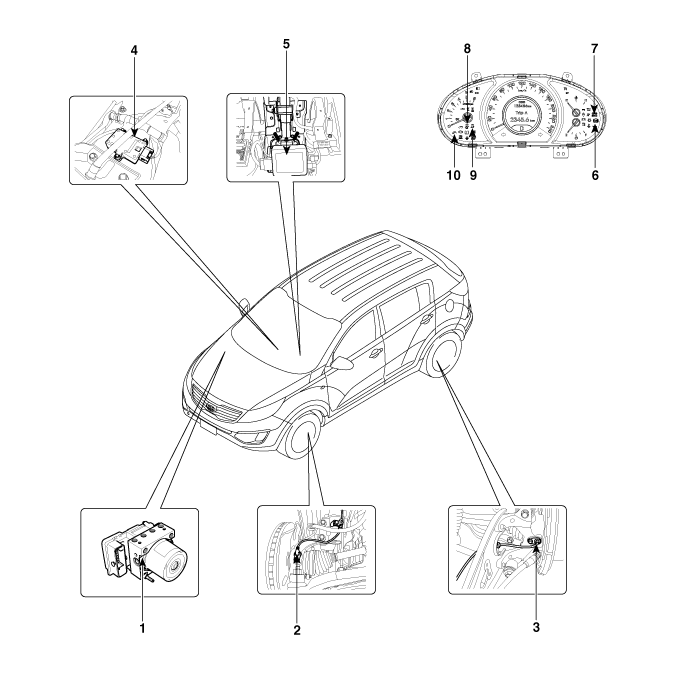

# Kia Sportage: Componentes e Localização dos Componentes

[Home](../../index.md) / [Manual de Serviço e Reparo do Kia Sportage SL](../sportage-482.md) / [Sistema de Freios](sportage-894.md) / [Sistema ESC (Controle Estável Eletrônico)](sportage-915.md) / Componentes e Localização dos Componentes

## Componentes

| 1. Módulo HECU 2. Sensor de velocidade do eixo frontal 3. Sensor de velocidade do eixo traseiro 4. Sensor de taxa de yaw e G lateral e longitudinal 5. Sensor de ângulo do volante | 6. Lampada de advertência do sistema ABS 7. Lampada de advertência do travamento do freio de estacionamento/EBC 8. Lampada ESC OFF 9. Lampada de função e advertência do sistema ESC 10. Lampada de advertência do DBC |
