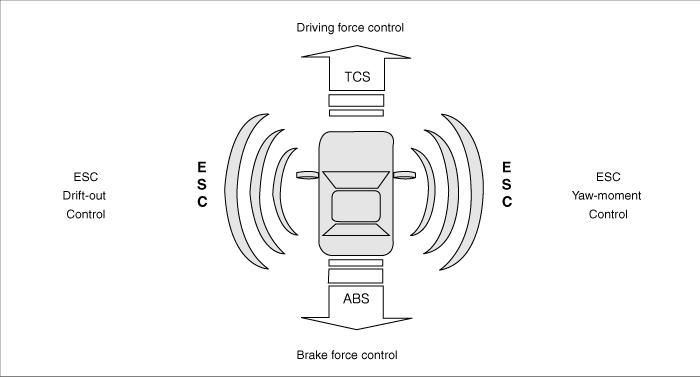
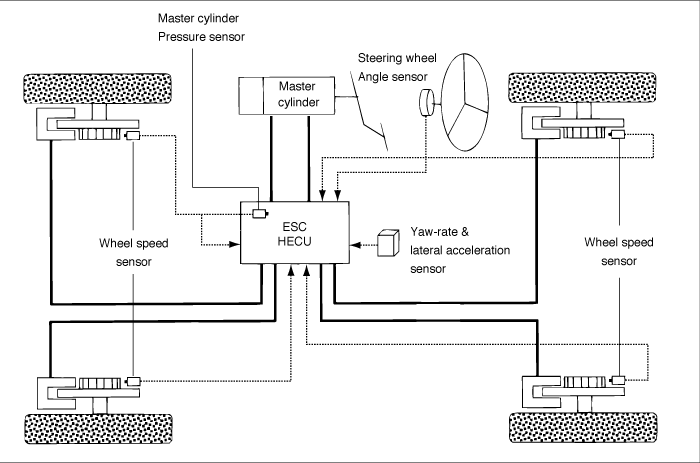
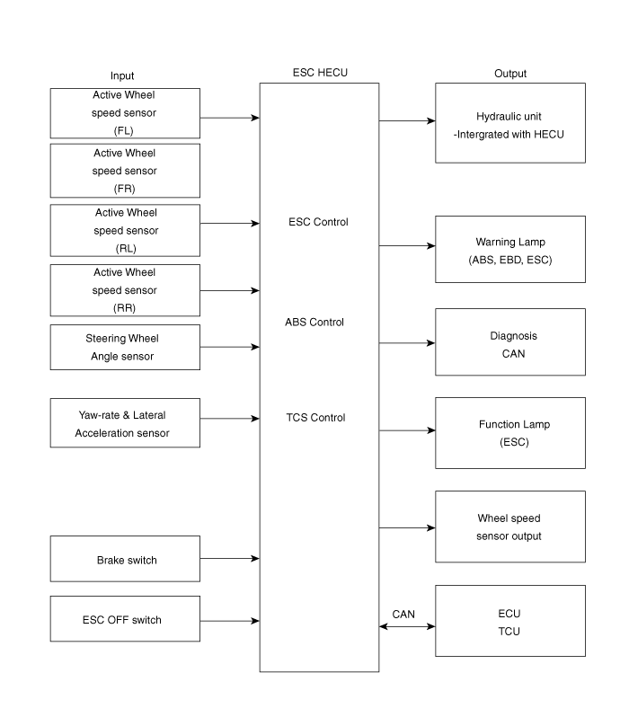
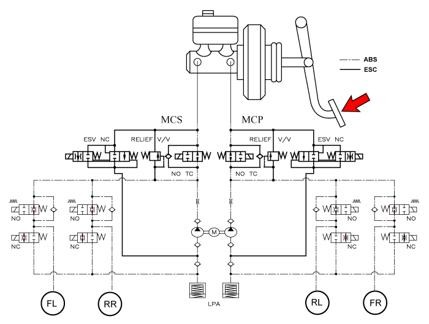
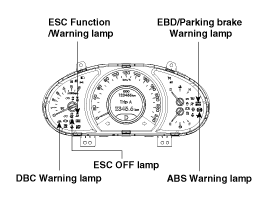

# Kia Sportage: Descrição e Operação

[Home](../../index.md) / [Manual de Serviço e Reparo do Kia Sportage SL](../sportage-482.md) / [Sistema de Freios](sportage-894.md) / [Sistema ESC (Controlador de Estabilidade Eletrônica)](sportage-915.md) / Descrição e Operação

## Descrição do ESC

A segurança de condução ótima agora tem um nome: ESC, o Controlador de Estabilidade Eletrônica.

O ESC reconhece condições de condução críticas, como reações de pânico em situações perigosas, e estabiliza o veículo através de freios individuais das rodas e intervenção no controle do motor.

O ESC adiciona uma função adicional conhecida como Controle Activo de Yaw (AYC) às funções ABS, TCS, EBD e ESC. Enquanto as funções ABS/TCS controlam a escorregadia das rodas durante o freio e a aceleração, e, portanto, principalmente intervêm nas dinâmicas longitudinais do veículo, o controle activo de yaw estabiliza o veículo em torno do seu eixo vertical.

Isso é alcançado através de intervenção individual do freio das rodas e adaptação do torque do motor momentâneo sem a necessidade de qualquer ação do condutor.

O sistema ESC essencialmente consiste em três componentes: os sensores, a unidade de controle eletrônico e os atuadores.

A função de controle de estabilidade funciona em todas as condições de condução e operação. Em certas condições de condução, a função ABS/TCS pode ser ativada simultaneamente com a função ESC em resposta a um comando do condutor.

Em caso de falha da função de controle de estabilidade, a função básica de segurança, ABS, ainda é mantida.

Descrição do Controle do ESC

O sistema ESC inclui as funções ABS/EBD, TCS e AYC.

Função ABS/EBD: A ECU transforma o sinal ativo do sensor (corrente de mudança) vindo dos quatro sensores de rodas em onda quadrada. Usando a entrada desses sinais, a ECU calcula a velocidade do veículo e a aceleração e desaceleração das quatro rodas. E, a ECU julga se a função ABS/EBD deve ser ativada ou não.

Função TCS impede o escorregamento das rodas na direção de propulsão adicionando a pressão de freio e a redução do torque do motor através da comunicação CAN. A função TCS usa o sinal do sensor de velocidade da roda para determinar o escorregamento da roda, conforme a função ABS.

Função AYC impede manobras instáveis do veículo. Para determinar a manobra do veículo, a função AYC usa os sinais do sensor de manobra (Sensor de Taxa de Yaw, Sensor de Aceleração Lateral, Sensor de Ângulo da Volante).

Se a manobra do veículo for instável (Over Steer ou Under Steer), a função AYC aplica a pressão de freio em certas rodas e envia um sinal de redução de torque do motor através da CAN.

Depois de ligar a chave, a ECU continua diagnosticando a falha do sistema (diagnóstico automático). Se a falha do sistema for detectada, a ECU informa ao condutor a falha do sistema através da lâmpada de advertência BRAKE/ABS/ESC. (advertência de segurança)

Diagrama de Entrada e Saída

## Modo de Operação ESC

Sistema Hidráulico ESC

1. **Modo de operação não-ESC**: Freio normal.

   | Valvula de solenoide | Continuidade | Valvula | Bomba motor | Valvula TC |
   | --- | --- | --- | --- | --- |
   | IN (NO) | OFF | ABERTO | OFF | OFF |
   | OUT (NC) | OFF | FECHADO | | |

2. **Modo de operação ESC**

   | Valvula de solenoide | Continuidade | Valvula | Bomba motor | Valvula TC | |
   | --- | --- | --- | --- | --- | --- |
   | Subestreamentação (Apenas o interior da roda traseira) | IN(NO) | OFF | ABERTO | ON | ON |
   | OUT(NC) | OFF | FECHADO | | | |
   | Superestreamentação (Apenas o exterior da roda dianteira) | IN(NO) | OFF | ABERTO | | |
   | OUT(NC) | OFF | FECHADO | | | |

   

Módulo da Luz do Alerta ABS

O módulo da luz do alerta ativo ABS indica o teste automático e o status de falha do ABS. A luz do alerta ABS deve estar acesa:

| – | Durante a fase de inicialização após o acionamento do IGN (continuamente 3 segundos). |
| --- | --- |

| – | Em caso de inibição das funções do ABS devido a falha. |
| --- | --- |

| – | Durante o modo de diagnóstico. |
| --- | --- |

| – | Quando a conexão do ECU é separada do ECU. |
| --- | --- |

| – | A luz do cluster está acesa quando a comunicação com o módulo CAN é impossível. |
| --- | --- |

Módulo da Luz do Alerta EBD/Trava de Estacionamento

O módulo da luz do alerta ativo EBD indica o teste automático e o status de falha do EBD. No entanto, se o interruptor de trava de estacionamento estiver ligado, a luz do alerta EBD permanecerá ligada independentemente das funções do EBD. A luz do alerta EBD deve estar acesa:

| – | Durante a fase de inicialização após o acionamento do IGN (continuamente 3 segundos). |
| --- | --- |

| – | Quando o interruptor de trava de estacionamento estiver ligado ou o nível do líquido de freio estiver baixo. |
| --- | --- |

| – | Quando a função do EBD estiver fora de ordem. |
| --- | --- |

| – | Durante o modo de diagnóstico. |
| --- | --- |

| – | Quando a conexão do ECU é separada do ECU. |
| --- | --- |

| – | A luz do cluster está acesa quando a comunicação com o módulo CAN é impossível. |
| --- | --- |

Luz do Alerta Função/Quente (Sistema ESC)

A luz do alerta função/quentar indica o teste automático e o status de falha do ESC.

A luz do alerta função/quentar será acesa sob as seguintes condições:

| – | Durante a fase de inicialização após o acionamento do IGN (continuamente 3 segundos). |
| --- | --- |

| – | Quando a função do ESC estiver inibida devido a falha do sistema. |
| --- | --- |

| – | Quando o controle do ESC estiver em operação. (Blinking - 2Hz) |
| --- | --- |

| – | Durante o modo de diagnóstico (exceto o modo padrão). |
| --- | --- |

| – | A luz do cluster está acesa quando a comunicação com o módulo CAN é impossível. |
| --- | --- |

Luz do Alerta ESC Off (Sistema ESC)

A luz do alerta ESC Off indica o teste automático e o status de operação do ESC.

A luz do alerta ESC Off opera sob as seguintes condições:

| – | Durante o modo de inicialização após o acionamento do IGN (continuamente 3 segundos). |
| --- | --- |

| – | A luz do alerta ESC Off está acesa quando o condutor aciona o interruptor ESC Off. |
| --- | --- |

Interruptor ESC On/Off (Sistema ESC)

O Interruptor On/Off ESC deve ser usado para alternar a função ESC entre os estados On/Off com base na entrada do motorista.

O interruptor On/Off deve ser um interruptor de contato momentâneo de abertura normal. Contatos fechados ligam o circuito à ignição.

O status inicial da função ESC é ligado e o interruptor alterna o estado.

Aviso de Lampada DBC (apenas DBC)

A lampada de aviso DBC indica o status de teste automático, falha e operacional da função DBC.

A lampada DBC opera sob as seguintes condições:

| – | Durante a fase de inicialização após o acionamento do IGN1. |
| --- | --- |

| – | Quando o motorista liga a função DBC pelo interruptor On/Off. |
| --- | --- |

| – | Em caso de inibição da função DBC devido a uma falha. |
| --- | --- |

| – | Quando o controle DBC está em operação. (Blinking-2Hz) |
| --- | --- |

| – | Durante o modo de diagnóstico. (Exceto no modo padrão) |
| --- | --- |

| – | A lampada do cluster está ligada quando a comunicação com o módulo CAN é impossível. |
| --- | --- |
