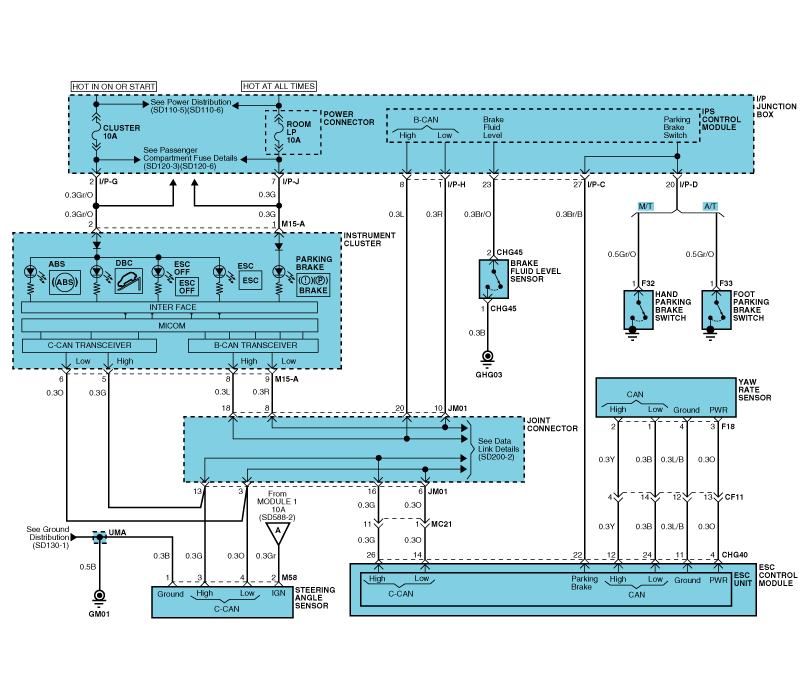
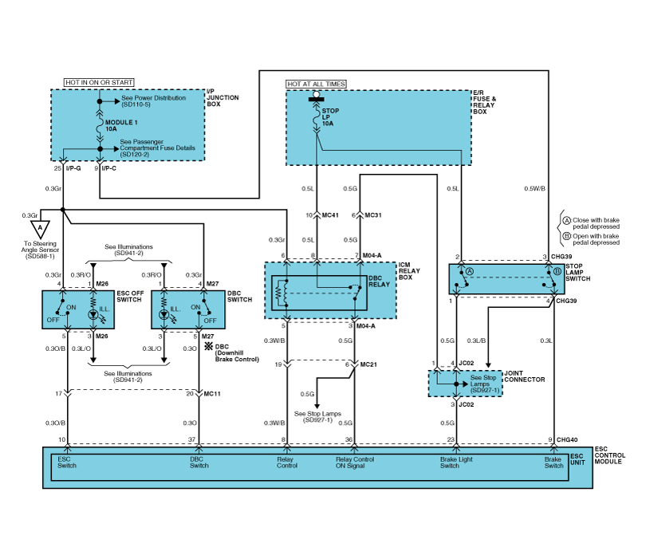
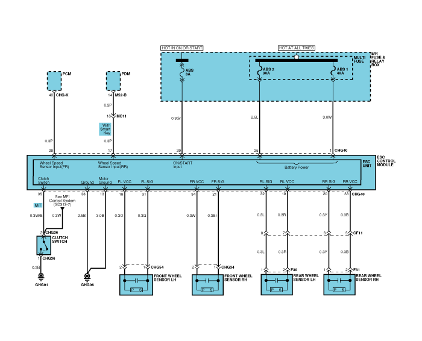
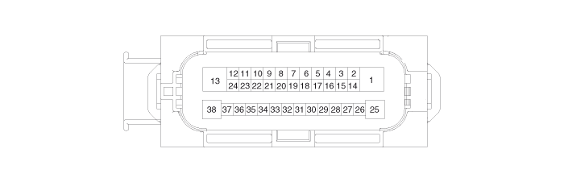

# Kia Sportage: Diagramas Esquemáticos

[Home](../../index.md) / [Manual de Serviço e Reparo do Kia Sportage SL](../sportage-482.md) / [Sistema de Freios](sportage-894.md) / [Sistema ESC (Controle Estável Eletrônico)](sportage-915.md) / Diagramas Esquemáticos

## Diagrama de Circuito - ESC(1)

## Diagrama de Circuito - ESC(2)

## Diagrama de Circuito - ESC(3)

## Conector ESC - Entrada/Saída

| Terminal do Conector | Especificação | Observação |  |
| --- | --- | --- | --- |
| N° | Descrição |  |  |
| 29 | IGNITION1(+) | Nível alto de tensão de despertar: 4,5V < V < 16,0V Nível baixo de tensão de despertar: V < 2,4V Corrente máxima: I < 50mA |  |
| 25 | POS. BATERIA 1.(VÁLVULA) | Faixa de tensão de sobre-tensão: 17,0 ± 0,5V Faixa de tensão de operação: 10,0 ± 0,5V < V < 16,0 ± 0,5V Faixa de tensão baixa: 7,0 ± 0,5V < V < 9,5 ± 0,5V Corrente máxima: I < 40A Corrente de fuga máxima: I < 0,25mA |  |
| 1 | POS. BATERIA 2.(MOTOR) | Faixa de tensão de operação: 10,0 ± 0,5V < V < 16,0 ± 0,5V Corrente de rush: I < 110A Corrente máxima: I < 40A Corrente de fuga máxima: I < 0,25mA |  |
| 38 | CHÃO | Corrente nominal: I < 550mA Corrente máxima: I < 40A |  |
| 13 | CHÃO DO MOTOR DO PUMP | Corrente de rush: I < 110A Corrente máxima: I < 40A |  |
| 11 | CHÃO DO SENSOR | Corrente nominal: I < 250mA |  |
| 4 | Poder do SENSOR | Capacidade máxima de corrente: I < 250mA Tensão máxima: V_BAT1 -0,8V |  |
| 23 | CHAVE DE LUZ DE FREIO | Tensão de entrada (baixa): V < 2V Tensão de entrada (alta): V > 6V Corrente máxima de entrada: I < 3mA |  |
| 9 | CHAVE DE FREIO |  |  |
| 22 | CHAVE DE FREIO DE ESTACIONAMENTO | Tensão de entrada (baixa): V < 2V Tensão de entrada (alta): V > 6V Corrente máxima de entrada: I < 5mA |  |
| 35 | CHAVE DE CAVA (Apenas M/T) |  |  |
| 28 | SAÍDA DO SENSOR DA FRETEIRA DIREITA | Resistência de puxo externo: 1 K? < R Duty do sensor: 50 ± 20% |  |
| 17 | SAÍDA DO SENSOR DA REDEIREITA |  |  |
| 10 | CHAVE ESC ON/OFF | Tensão de entrada (baixa): V < 2V Tensão de entrada (alta): V > 6V Corrente máxima de entrada: I < 3mA |  |
| 37 | CHAVE DBC |  |  |
| 14 | LINHA CAN BAIXO | Corrente máxima de entrada: I < 10mA |  |
| 26 | LINHA CAN ALTO |  |  |
| 18 | Poder do SENSOR DA FRETEIRA ESQUERDA | Tensão de saída: V_BAT1 -0,6V ~ V_BAT1 -1,1V Corrente de saída: Máx 30mA |  |
| 34 | Poder do SENSOR DA FRETEIRA DIREITA |  |  |
| 19 | Poder do SENSOR DA FRETEIRA ESQUERDA |  |  |
| 33 | Poder do SENSOR DA FRETEIRA DIREITA |  |  |
| 31 | SINAL DO SENSOR DA FRETEIRA ESQUERDA | Corrente de entrada baixa: 5,9 ~ 8,4mA Corrente de entrada alta: 11,8 ~ 16,8mA Faixa de frequência: 1 ~ 2500Hz Duty do sinal: 50 ± 10% | Tipo. 7mA Tipo. 14mA |
| 21 | SINAL DO SENSOR DA FRETEIRA DIREITA |  |  |
| 32 | SINAL DO SENSOR DA FRETEIRA ESQUERDA |  |  |
| 20 | SINAL DO SENSOR DA FRETEIRA DIREITA |  |  |
| 12 | LINHA DO SENSOR CAN ALTO | Corrente máxima de entrada: I < 10mA |  |
| 24 | LINHA DO SENSOR CAN BAIXO |  |  |
| 8 | RELAY DO FREIO | Corrente máxima: I < 180mA Tensão de saída baixa máxima: V < 1,2V |  |
| 36 | MONITORAMENTO DO ESTADO DO RELAY | Tensão de entrada (baixa): V < 2V Tensão de entrada (alta): V > 6V Corrente máxima de entrada: I < 10mA |  |
