# Kia Sportage: Diagnóstico

[Início](../../index.md) / [Manual de Serviço e Reparo do Kia Sportage SL](../sportage-482.md) / [Sistema de Freios](sportage-894.md) / [Sistema ESC (Controlador Estável Eletrônico)](sportage-915.md) / Diagnóstico

## Diagnóstico de Falha

1. Em princípio, o controle de ESC e TCS está proibido em caso de falha do ABS.

2. Quando o ESC ou TCS falha, apenas o controle do sistema falhado é proibido.

3. O relé do válvula relé deve ser desligado em caso de falha do ESC, consulte o fail-safe do ABS.

4. Informações sobre fail-safe do ABS são idênticas ao fail-safe em sistemas onde o ESC não está instalado.

**Memória do Código de Falha**

1. Mantém o código enquanto a luz de backup de energia estiver conectada. (O)

2. Mantém o código enquanto a energia do HCU estiver ligada. (X)

**Verificação de Falha**

1. A verificação inicial é realizada imediatamente após o ligar do HECU.

2. A verificação do relé da válvula é realizada imediatamente após o IG2 ON.

3. Executa a verificação enquanto o IG2 estiver ligado.

4. A verificação inicial é realizada nos seguintes casos.

   | (1) | Quando a falha não foi detectada agora. |
   | --- | --- |

   | (2) | Quando o ABS e o ESC não estão em controle. |
   | --- | --- |

   | (3) | A verificação inicial não é realizada após o ligar do ECU. |
   | --- | --- |

   | (4) | Se a velocidade do veículo for superior a 5 mph (8 km/h) quando o interruptor da luz de freio estiver desligado. |
   | --- | --- |

   | (5) | Se a velocidade do veículo for superior a 24,8 mph (40 km/h). |
   | --- | --- |

5. Embora, a verificação continue mesmo se o interruptor da luz de freio estiver ligado.

6. Quando realizar o controle do ABS ou ESC antes da verificação inicial, pare a verificação inicial e aguarde a entrada de energia do HECU novamente.

7. Julgue a falha nos seguintes casos.

   | (1) | Quando a energia estiver normal. |
   | --- | --- |

   | (2) | Do ponto em que a velocidade do veículo atingir 4,9 mph (8 km/h) após o ligar do HECU. |
   | --- | --- |

**Medidas de Controle em Falha**

1. Desligue o sistema e realize as seguintes ações e aguarde a desligar do HECU.

2. Desligue o relé da válvula.

3. Pare o controle durante a operação e não execute nenhum até que a condição normal se restabeleça.

**Lâmpada de Aviso ON**

1. A lâmpada de aviso do ESC acende por 3 segundos após o ligar do IGN.

2. A lâmpada de função do ESC piscará quando o ESC estiver em operação.

3. Se ocorrer falha no ESC, a lâmpada de aviso do ESC acenderá.

4. A lâmpada de desligamento do ESC acenderá em caso de

   | – | Desligamento do interruptor do ESC |
   | --- | --- |

   | – | 3 segundos após o ligar do IGN |
   | --- | --- |

**Fluxo Padrão de Diagnóstico de Problemas**

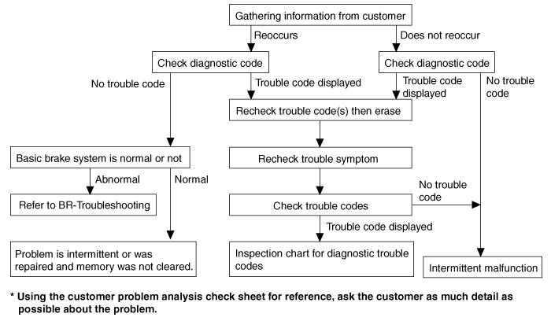

**Notas Relacionadas ao Diagnóstico**

Os fenômenos listados na tabela a seguir não são normais.

| Condição | Explicação |
| --- | --- |
| Som de verificação do sistema | Quando o motor é ligado, às vezes pode ser ouvido um som de batida vindo do compartimento do motor. Isso ocorre porque a verificação do sistema está sendo realizada. |
| Som de operação do ABS | 1) Som do motor dentro do conjunto hidráulico do ABS (whine). 2) Som gerado junto com a vibração do pedal do freio (scraping). 3) Quando o ABS opera, som é gerado no chassis do veículo devido à repetição de aplicação e liberação do freio (Thump: suspensão; squeak: pneus) |
| 1) | Som do motor dentro do conjunto hidráulico do ABS (whine). |

| 2) | Um som é gerado junto com a vibração do pedal de freio (raspa). |
| 3) | Quando o ABS opera, um som é gerado do chassi do veículo devido à aplicação e liberação repetidas do freio (Trombada: suspensão; Chiado: pneus) |
| Operação do ABS (Distância de frenagem longa) | Em
caminhos como as estradas de neve e areia, a distância de frenagem dos
veículos com ABS pode ser maior do que a de outros veículos. Portanto,
aconselhe o cliente a dirija com segurança em tais estradas reduzindo a
velocidade do veículo. |
| As condições de detecção da diagnóstico podem variar dependendo do código de diagnóstico. Ao verificar o sintoma de falha após o código de diagnóstico ter sido apagado, assegure-se de que as exigências listadas em "Comentário" sejam atendidas. |  |

Planilha de Verificação ABS

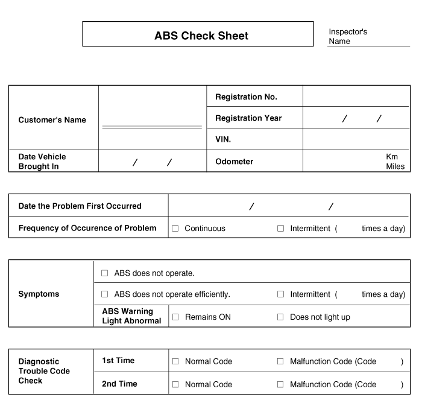

Tabela de Sintomas de Problemas

| Sintoma | Área Suspeita |
| --- | --- |
| O ABS não opera. | Somente quando 1~4 estiverem todos normais e o problema ainda ocorrer, substitua o HECU. 1) Verifique o DTC, confirmando que o código normal é emitido. 2) Circuito de alimentação. 3) Circuito do sensor de velocidade. 4) Verifique o circuito hidráulico para vazamento. |
| 1) | Verifique o DTC, confirmando que o código normal é emitido. |
| 2) | Circuito de alimentação. |
| 3) | Circuito do sensor de velocidade. |
| 4) | Verifique o circuito hidráulico para vazamento. |
| A comunicação com o GDS não é possível. (A comunicação com qualquer sistema não é possível) | 1) Circuito de alimentação 2) Linha CAN |
| 1) | Circuito de alimentação |
| 2) | Linha CAN |
| A comunicação com o GDS não é possível. (A comunicação com o ABS apenas não é possível) | 1) Circuito de alimentação 2) Linha CAN 3) HECU |
| 1) | Circuito de alimentação |
| 2) | Linha CAN |
| 3) | HECU |
| Quando a chave do motor é ligada (motor desligado), a luz do indicador de ABS não acende. | 1) Circuito da luz do indicador de ABS 2) HECU |
| 1) | Circuito da luz do indicador de ABS |
| 2) | HECU |
| Mesmo após o motor ser ligado, a luz do indicador de ABS permanece acendida. | 1) Circuito da luz do indicador de ABS 2) HECU |
| 1) | Circuito da luz do indicador de ABS |
| 2) | HECU |

> **Cuidado**
>
> - Durante a operação do ABS, o pedal do freio pode vibrar ou não
poder ser pressionado. Essas fenômenos são devido a mudanças intermitentes
na pressão hidráulica no sistema de freio para prevenir o bloqueio dos
pneus e não são um comportamento anormal.


Condições de Detecção

| Sintomas de Falha | Causa Possível |
| --- | --- |
| A operação do freio
varia dependendo das condições de direção e do tipo de superfície do
caminho |  |

condições, então a diagnóstico pode ser difícil. No entanto, se um código DTC normal for exibido, verifique as causas prováveis a seguir. Quando o problema ainda estiver ocorrendo, inspecione o módulo de controle ABS. | – Circuito de alimentação defeituoso – Circuito do sensor de velocidade do eixo defeituoso – Circuito hidráulico defeituoso para vazamento – HECU defeituoso |
| – | Circuito de alimentação defeituoso |
| – | Circuito do sensor de velocidade do eixo defeituoso |
| – | Circuito hidráulico defeituoso para vazamento |
| – | HECU defeituoso |

Procedimentos de inspeção

Verificação de DTC

1. Conecte o GDS ao conectador de ligação de dados e ligue o interruptor de ignição.

2. Verifique se o código normal é exibido.

3. O código normal está sendo exibido?

   | | ? Verifique o circuito de alimentação. |
   | --- | --- |
   | | ? Exclua o DTC e re-inspecione usando GDS. |

Verifique o circuito de alimentação

1. Desconecte o conectador do módulo de controle ABS.

2. Ligue o interruptor de ignição, medindo a tensão entre o terminal 29 do conectador do lado do módulo de controle ABS e o chassi.

   ```
   Especificação: aproximadamente B+
   ```

3. A tensão está dentro da especificação?

   | | ? Verifique o circuito de terra. |
   | --- | --- |
   | | ?
    Verifique o fio ou o conectador entre o fusível (3A) na caixa de fusíveis do compartimento do motor e o módulo de controle ABS. Repare se necessário. |

   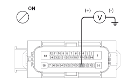

Verifique o circuito de terra

1. Desconecte o conectador do módulo de controle ABS.

2. Verifique a continuidade entre os terminais 13, 38 do conectador do lado do módulo de controle ABS e o ponto de terra.

3. Existe continuidade?

   | | ? Verifique o circuito do sensor de velocidade do eixo. |
   | --- | --- |
   | | ? Repare ou substitua o sensor de velocidade do eixo. |

   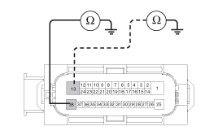

Verifique o circuito do sensor de velocidade do eixo

1. Consulte as instruções de solução de problemas do DTC.

2. Está normal?

   | | ? Verifique o circuito hidráulico para vazamento. |
   | --- | --- |
   | | ? Repare ou substitua o sensor de velocidade do eixo. |

Verifique o circuito hidráulico para vazamento

1. Consulte as linhas hidráulicas.

2. Inspeção de vazamento nas linhas hidráulicas.

3. Está normal?

   | | ? O problema ainda está ocorrendo, substitua o módulo de controle ABS. |
   | --- | --- |
   | | ? Repare as linhas hidráulicas para vazamento. |


Detecção de condição

| Sintomas de Falha | Causa Possível |
| --- | --- |
| A operação do freio varia dependendo das condições de condução e das condições de superfície do pavimento, então a diagnóstico pode ser difícil. No entanto, se um código DTC normal for exibido, verifique as causas possíveis a seguir. Quando o problema ainda estiver ocorrendo, inspecione o módulo de controle ABS. | – Circuito de alimentação defeituoso – Circuito do sensor de velocidade do eixo defeituoso – Circuito hidráulico defeituoso para vazamento – HECU defeituoso |
| – | Circuito de alimentação defeituoso |
| – | Circuito do sensor de velocidade do eixo defeituoso |
| – | Circuito hidráulico defeituoso para vazamento |
| – | HECU defeituoso |

Procedimentos de inspeção

Verificação de DTC

1. Conecte o GDS ao adaptador de dados e ligue o interruptor de ignição.

2. Verifique se o código normal é exibido.

3. O código normal está sendo exibido?

   | | ? Verifique o circuito do sensor de velocidade do eixo. |
   | --- | --- |
   | | ? Exclua os códigos de diagnóstico e re-verifique usando o GDS. |

Verifique o circuito do sensor de velocidade do eixo

1. Refira-se aos procedimentos de solução de problemas para códigos de diagnóstico.

2. Está normal?

   | | ? Verifique o circuito do interruptor do farol de freio. |
   | --- | --- |
   | | ? Repare ou substitua o sensor de velocidade do eixo. |

Verifique o circuito do interruptor do farol de freio

1. Verifique se os faróis de freio acendem quando o pé é colocado no pedal de freio e se apagam quando o pé é retirado do pedal de freio.

2. Medida da tensão entre o terminal 23 do conector do módulo de controle ABS do lado do adaptador do módulo de controle ABS e o solo do corpo quando o pé é colocado no pedal de freio.

   ```
   Especificação : aproximadamente B+
   ```

3. A tensão está dentro da especificação?

   | | ? Verifique a circulação hidráulica para vazamento. |
   | --- | --- |
   | | ? Repare o interruptor do farol de freio. Repare um aberto no fio entre o módulo de controle ABS e o interruptor do farol de freio. |

   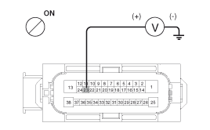

Verifique a circulação hidráulica para vazamento

1. Refira-se às linhas hidráulicas.

2. Inspeção de vazamento nas linhas hidráulicas.

3. Está normal?

   | | ? O problema ainda está ocorrendo, substitua o módulo de controle ABS. |
   | --- | --- |
   | | ? Repare as linhas hidráulicas para vazamento. |


Detectando condição

| Sintomas do Problema | Causa Possível |
| --- | --- |
| Possível defeito no circuito de alimentação do diagnóstico (incluindo solo) para a linha de diagnóstico. | – Aberto no fio – Solo ruim – Circuito de alimentação defeituoso |
| – | Aberto no fio |
| – | Solo ruim |
| – | Circuito de alimentação defeituoso |

Procedimentos de Inspeção

Verifique o Circuito de Alimentação do Diagnóstico

1. Medida da tensão entre o terminal 9 do adaptador de dados e o solo do corpo.

   ```
   Especificação : aproximadamente B+
   ```

2. A tensão está dentro da especificação?

   | | ? Verifique o circuito de solo do diagnóstico. |
   | --- | --- |
   | | ? Repare um aberto no fio entre o terminal 5 do adaptador de dados e o ponto de solo. |

   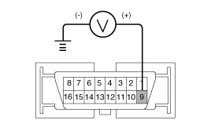

Verifique o circuito de solo do diagnóstico

1. Verifique a continuidade entre o terminal 5 do adaptador de dados e o solo do corpo.

2. Existe continuidade?

   | | ? Repare um aberto no fio entre o terminal 5 do adaptador de dados e o ponto de solo. |
   | --- | --- |

   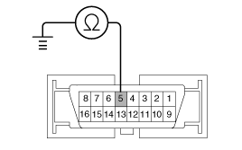


Detectando condição

| Sintomas do Problema | Causa Possível |
| --- | --- |
| Quando
 a comunicação com o GDS não é possível, a causa pode ser provavelmente um
aberto no circuito de alimentação do HECU ou um aberto no circuito de saída de diagnóstico. | – Aberto no fio – HECU defeituoso – Circuito de alimentação defeituoso |
| – | Aberto no fio |
| – | HECU defeituoso |
| – | Circuito de alimentação defeituoso |

Procedimentos de Inspeção

Verifique a Continuidade na Linha CAN

1. Desconecte o conector do módulo de controle ABS.

2. Verifique a continuidade entre os terminais 26, 14 do conector do módulo de controle ABS e 3, 11 do conector do link de dados.

3. Há continuidade?

   | | ? Verifique a fonte de energia do módulo de controle ABS. |
   | --- | --- |
   | | ? Repare uma abertura no fio. |

Verifique a fonte de energia do módulo de controle ABS

1. Desconecte o conector do módulo de controle ABS.

2. Ligue o chave de ignição, medindo a tensão entre o terminal 29 do conector do lado do harness do módulo de controle ABS e o chassi.

   ```
   Especificação : aproximadamente B+
   ```

3. A tensão está dentro da especificação?

   | | ? Verifique a conexão de chassi. |
   | --- | --- |
   | | ?
    Verifique o harness ou conector entre o fusível (7,5A) na bloco de fusíveis do compartimento do motor e o módulo de controle ABS. Repare se necessário. |

   

Verifique a conexão de chassi

1. Verifique a continuidade entre o terminal 5 do conector do link de dados e o ponto de chassi.

   | | ? Substitua o módulo de controle ABS e reavalie. |
   | --- | --- |
   | | ? Repare uma abertura no fio ou conexão fraca |

   


Detecção de condição

| Sintomas de Falha | Causa Possível |
| --- | --- |
| Quando a corrente flui no HECU, a luz do sistema ABS muda de ON para OFF durante a verificação inicial. Portanto, se a luz não acender, a causa pode ser uma abertura na circunflexo de alimentação da luz do sistema ABS, uma lâmpada queimada, uma abertura nas duas circunflexos entre a lâmpada do sistema ABS e o HECU, e o HECU defeituoso. | – Lâmpada do sistema ABS defeituosa – Fusível queimado relacionado ao sistema ABS no bloco de fusíveis do compartimento do motor – Módulo da lâmpada do sistema ABS defeituoso – HECU defeituoso |
| – | Lâmpada do sistema ABS defeituosa |
| – | Fusível queimado relacionado ao sistema ABS no bloco de fusíveis do compartimento do motor |
| – | Módulo da lâmpada do sistema ABS defeituoso |
| – | HECU defeituoso |

Procedimentos de verificação

Verificação do problema

1. Desconecte o conector do módulo de controle ABS e ligue a chave de ignição.

2. A luz do sistema ABS acende?

   | | ? Reavalie após substituir o HECU do sistema ABS. |
   | --- | --- |
   | | ? Verifique a fonte de energia da luz do sistema ABS. |

Verifique a fonte de energia da luz do sistema ABS

1. Desconecte o conector do painel de instrumentos (M15) e ligue a chave de ignição.

2. Mede a tensão entre o terminal (M15) 39 do conector do lado do harness do painel de instrumentos e o chassi.

   ```
   Especificação : aproximadamente B+
   ```

   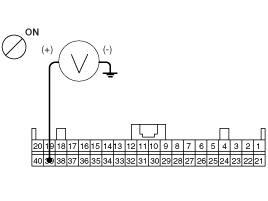

3. A tensão está dentro da especificação?

   | | ? Verifique a resistência da circunflexo CAN para a luz do sistema ABS. |
   | --- | --- |
   | | ? Verifique o fusível queimado. |

Verifique a resistência da circunflexo CAN para a luz do sistema ABS

1. Desligue a chave de ignição. Desconecte o conector do painel de instrumentos (M15).

2. Medir a resistência entre os terminais (M15) 36 e 37 do conectador do painel do cluster.

   ```
   Especificação : 60?
   ```

   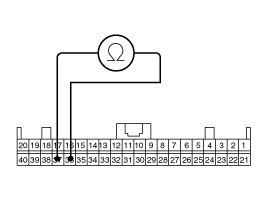

3. A resistência está dentro da especificação?

   | | ? Reparar a lâmpada do indicador ABS ou a montagem do painel do instrumento. |
   | --- | --- |
   | | ? Verificar a montagem do circuito CAN para o indicador ABS. |

Verificar a montagem do circuito CAN para o indicador ABS

1. Desligar o interruptor do painel. Desconectar o conectador do painel do instrumento (M15) e o conectador do HECU ABS.

2. Verificar a continuidade entre o terminal (M15) 36 do conectador do painel do cluster e o terminal 26 do conectador do painel do HECU ABS.

   Verificar a continuidade entre o terminal (M15) 37 do conectador do painel do cluster e o terminal 14 do conectador do painel do HECU ABS.

   ```
   Especificação : Menor que 1?
   ```

3. A resistência está dentro da especificação?

   | | ? Reparar a montagem do circuito com curto entre os terminais 26, 14 do conectador do HECU ABS e o módulo do indicador ABS. |
   | --- | --- |
   | | ? Reparar a montagem do circuito com abertura entre os terminais 26, 14 do conectador do HECU ABS e o módulo do indicador ABS. |


Detecção de condição

| Sintomas de Falha | Causa Possível |
| --- | --- |
| Se o HECU detectar uma falha, ele acende o indicador ABS e, simultaneamente, proíbe o controle ABS. O HECU então registra um DTC na memória. Se o indicador ABS permanecer acesso, mesmo após a correção e limpeza do problema com o DTC, a causa pode ser uma abertura ou curto no circuito do indicador ABS. | – Abertura no fio – Montagem do painel do instrumento defeituosa – Módulo do indicador ABS defeituoso – HECU defeituoso |
| – | Abertura no fio |
| – | Montagem do painel do instrumento defeituosa |
| – | Módulo do indicador ABS defeituoso |
| – | HECU defeituoso |

Procedimentos de inspeção

Verificar o DTC de Saída

1. Conectar o GDS ao conectador do link de dados 16P localizado atrás do painel do passageiro do lado do motorista.

2. Verificar o DTC de saída usando o GDS.

3. O DTC está sendo emitido?

   | | ? Realizar o procedimento de solução de problemas do DTC (Consultar a solução de problemas do DTC). |
   | --- | --- |
   | | ? Verificar a resistência do circuito CAN para o indicador ABS. |

Verificar a resistência do circuito CAN para o indicador ABS

1. Desligar o interruptor do painel. Desconectar o conectador do painel do instrumento (M15).

2. Medir a resistência entre os terminais (M15) 36 e 37 do conectador do painel do cluster.

   ```
   Especificação : 60?
   ```

   

3. A resistência está dentro da especificação?

   | | ? Reparar a lâmpada do indicador ABS ou a montagem do painel do instrumento. |
   | --- | --- |
   | | ? Verificar a montagem do circuito CAN para o indicador ABS. |

Verificar a montagem do circuito CAN para o indicador ABS

1. Desligar o interruptor do painel. Desconectar o conectador do painel do instrumento (M15) e o conectador do HECU ABS.

Verifique a continuidade entre o terminal (M15) 37 do conectador do lado do fio de distribuição do cluster e o terminal 14 do fio de distribuição do HECU ABS.

```
Especificação : Menor que 1?
```

3. Existe continuidade?

   | | ?
    Repare a continuidade elétrica entre o terminal 26, 14 do fio de distribuição do HECU ABS e o módulo da luz de advertência do ABS. Se não houver problema na conexão, inspecione novamente após a substituição do HECU ABS. |
   | --- | --- |
   | | ?
    Repare a continuidade elétrica entre o terminal 26, 14 do fio de distribuição do HECU ABS e o módulo da luz de advertência do ABS. Se não houver problema na conexão, inspecione novamente após a substituição do HECU ABS. |

Sangria do Sistema de Freios

Este procedimento deve ser seguido para garantir a desativação adequada do ar e a preenchimento da unidade ESC, das linhas de freio e do cilindro-mestre com líquido de freio.

1. Remova a tampa do reservatório e preencha o reservatório de freios com líquido de freio.

   > **Cuidado**
   >
   > - Se houver qualquer líquido de freio em qualquer superfície pintada, lave imediatamente.

   > **Nota**
   >
   > - Ao fazer a sangria sob pressão, não pressione o pedal de freio.
   > - Líquido recomendado........ DOT3 ou DOT4

2. Conecte um tubo de plástico transparente ao plugue do cilindro do freio e insira o outro extremo do tubo em um recipiente de plástico transparente meio cheio.

3. Conecte o GDS ao conector do link de dados localizado sob o painel do dash.

4. Selecione e operacionalize conforme as instruções na tela do GDS.

   > **Cuidado**
   >
   > - Você deve obedecer ao tempo máximo de operação do motor do ABS com o GDS para prevenir o aquecimento do motor-pompa.

   | (1) | Selecione o nome do veículo. |
   | --- | --- |

   | (2) | Selecione o sistema de freio ABS. |
   | --- | --- |

   | (3) | Selecione o modo de desativação do HCU. |
   | --- | --- |

   | (4) | Pressione "OK" para operar o motor-pompa e o valvulino. |
   | --- | --- |

   | (5) | Aguarde 60 segundos antes de operar a desativação do ar (caso contrário, pode danificar o motor). |
   | --- | --- |

   | (6) | Realize a desativação do ar. |
   | --- | --- |

5. Puxe o pedal de freio várias vezes e, em seguida, solte o plugue de desativação até que o líquido de freio comece a sair sem bolhas. Feche então o plugue de desativação (A).

   Frente

   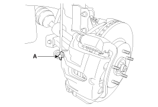

   Traseira

   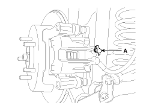

6. Repita o passo 5 até que não haja mais bolhas no líquido para cada rodas, usando o gráfico abaixo para o processo de ordem de desativação.

   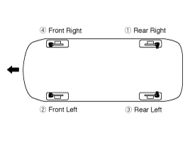

7. Apertar o plugue de desativação.

   ```
   Torque de aperto do plugue de desativação:
   7 ~ 13 Nm (0.7 ~ 1.3 kgf.m, 5.4 ~ 9.5 lb-ft)
   ```
