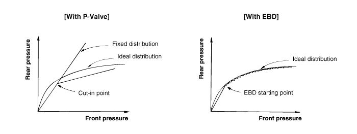

# Kia Sportage: EBD(Distribuição Eletrônica de Fórce de Freio): Descrição e Operação

[Home](../../index.md) / [Manual de Serviço e Reparo do Kia Sportage SL](../sportage-482.md) / [Sistema de Freio](sportage-894.md) / [Sistema ESC(Sistema de Estabilidade Eletrônica)](sportage-915.md) / Distribuição Eletrônica de Fórce de Freio: Descrição e Operação

## Operação

O sistema EBD (Distribuição Eletrônica de Fórce de Freio) como sub-sistema do sistema ABS é responsável por controlar o máximo da eficácia de frenagem nas rodas traseiras.

Ele utiliza ainda a eficiência das equipas ABS avançadas ao controlar o deslizamento das rodas traseiras no intervalo parcial de frenagem.

A força de freio é movida ainda mais perto do ótimo e controlada eletronicamente, dispensando a necessidade do valve de proporcionalidade.

O valve de proporcionalidade, devido a um dispositivo mecânico, tem limitações para alcançar uma distribuição ideal de força de freio para as rodas traseiras, bem como para realizar a distribuição proporcional de força de freio flexível de acordo com a carga ou peso do veículo. E em caso de falha, o condutor não pode notar se falhou ou não.

O EBD é controlado pelo módulo de controle ABS, calcula a razão de deslizamento de cada rodas em todo o tempo e controla a pressão do freio das rodas traseiras para não ultrapassar a das rodas dianteiras.

Se o EBD falhar, a lâmpada de advertência EBD (lâmpada do freio de estacionamento) acende.

### Vantagens

| – | Melhoria da função do sistema de freio básico. |
| --- | --- |

| – | Compensação das diferentes coeficientes de atrito. |
| --- | --- |

| – | Eliminação do valve de proporcionalidade. |
| --- | --- |

| – | Reconhecimento de falha pela lâmpada de advertência. |
| --- | --- |

### Comparação entre Valve de Proporcionalidade e EBD

