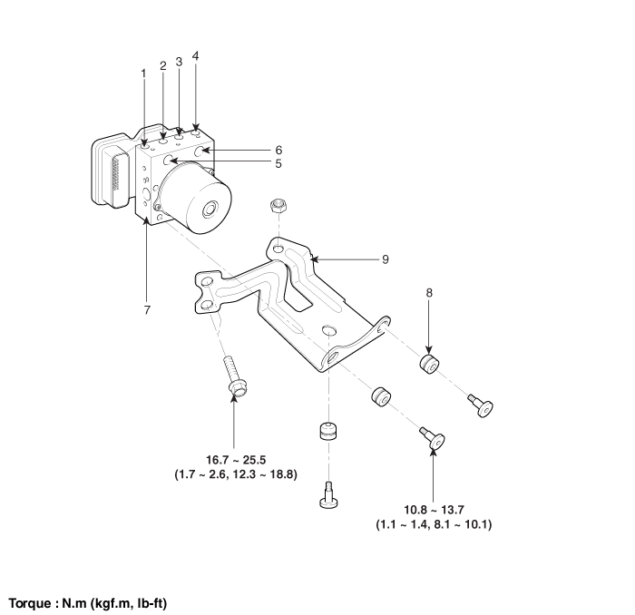

# Kia Sportage: Módulo de Controle de ESC: Componentes e Localização dos Componentes

[Home](../../index.md) / [Manual de Serviço e Reparo do Kia Sportage SL](../sportage-482.md) / [Sistema de Freios](sportage-894.md) / [Sistema de Estabilidade ESC](sportage-915.md) / Componentes e Localização do Módulo de Controle de ESC

## Componentes

| 1. Tubo dianteiro - esquerdo 2. Tubo traseiro - direito 3. Tubo traseiro - esquerdo 4. Tubo dianteiro - direito 5. MC2 | 6. MC1 7. Módulo de controle de ESC (HECU) 8. Amortecedor 9. Suporte |
| --- | --- |
