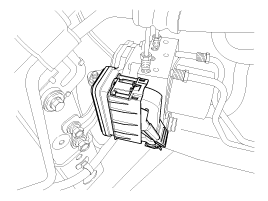
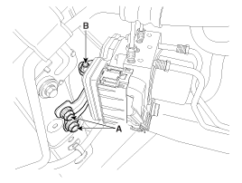
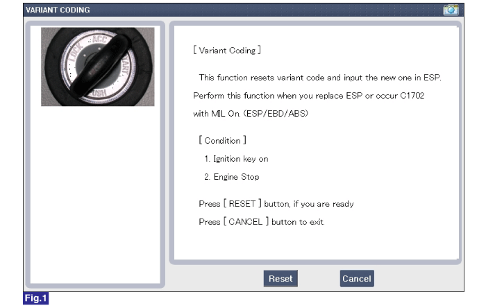

# Kia Sportage: Módulo de Controle de ESC: Procedimentos de Reparo

[Home](../../index.md) / [Manual de Serviço e Reparo do Kia Sportage SL](../sportage-482.md) / [Sistema de Freio](sportage-894.md) / [Sistema ESC (Controle Estável Eletrônico)](sportage-915.md) / Procedimentos de Reparo do Módulo de Controle de ESC

## Remoção

1. Desligue o chaveador do sistema de ignição.

2. Desconecte as mangueiras de freio do HECU deslocando as varetas das engrenagens no sentido anti-horário com uma chave.

   ```
   Torque de aperto :
   12,7 ~ 16,7N.m(1,3 ~ 1,7kgf.m, 9,4 ~ 12,3lb-ft)
   16,7 ~ 22,6N.m(1,7 ~ 2,3kgf.m, 12,3 ~ 16,6lb-ft)
   ```

3. Empurre para cima o travamento do conector do módulo de controle de ESC, depois desconecte o conector.

   

4. Desloque as varetas de aperto (A) e o parafuso (B) do suporte do HECU, depois remova o HECU e o suporte.

   ```
   Torque de aperto :
   16,7 ~ 25,5N.m(1,7 ~ 2,6kgf.m, 12,3 ~ 18,8lb-ft)
   ```

   

   > **Cuidado**
   >
   > - Nunca tente desmontar o HECU.
   > - O HECU deve ser transportado e armazenado.
   > - Nunca choque o HECU.

5. Remova os 3 parafusos, depois remova o suporte do HECU.

   ```
   Torque de aperto :
   10,8 ~ 13,7N.m(1,1 ~ 1,4kgf.m, 8,0 ~ 10,1lb-ft)
   ```

## Instalação

1. A instalação é o inverso da remoção.

2. Ajuste os parafusos de montagem do HECU e as varetas de aperto ao torque especificado.

3. Após a instalação, vátilhe o sistema de freio. (Consulte o vátilho do ABS)

Processo de codificação variante

Os veículos 2WD e 4WD compartilham o HECU entre si. Para aplicar o veículo apropriado, é necessário um processo de codificação variante.

1. Conecte o GDS ao Data Link Connector (DLC).

2. IG "LIGADO"

3. Usando o GDS, execute o programa de codificação variante.

   

4. IG "LIGADO" e aguarde cerca de 10 segundos, depois IG "LIGADO"

5. IG "LIGADO" e aguarde cerca de 10 segundos novamente, depois IG "LIGADO"

   > **Nota**
   >
   > - ? No caso de substituição do HECU, execute as seguintes funções
   > - "Calibração do Sensor de Ângulo do Volante" para correção do deslocamento do sensor de ângulo do volante (consulte C1261)
   > - "Calibração do Sensor Longitudinal" para correção do deslocamento do sensor longitudinal (consulte C1285)

O processo de codificação variante é necessário quando:

| – | O HECU foi substituído. |
| --- | --- |

| – | O código de diagnóstico C1702 (erro de codificação variante) foi detectado. |
| --- | --- |
