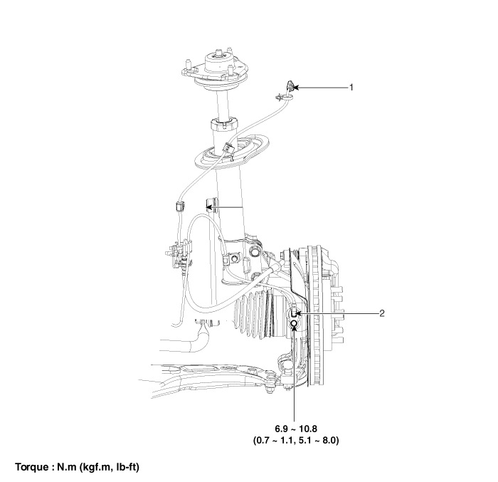

# Sensor de Velocidade da Roda Frontal — Componentes e localização

[Home](../../index.md) / [Manual de Serviço e Reparo](../sportage-482.md) / [Sistema de Freio](sportage-894.md) / [Sistema ESC (Controle Estável Eletrônico)](sportage-915.md) / Componentes e localização

## Diagrama

## Legenda

| Nº | Componente |
| --- | --- |
| 1 | Conector do sensor de velocidade da roda frontal |
| 2 | Sensor de velocidade da roda frontal |
