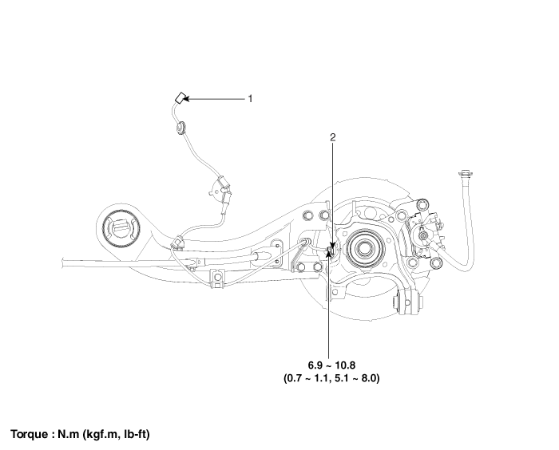

# Kia Sportage: Sensor de Velocidade dos Eixos Traseiros: Componentes e Localização dos Componentes

[Home](../../index.md) / [Manual de Serviço e Reparo do Kia Sportage SL](../sportage-482.md) / [Sistema de Freios](sportage-894.md) / [Sistema ESC (Controlador Estável Eletronicamente)](sportage-915.md) / Sensor de Velocidade dos Eixos Traseiros: Componentes e Localização dos Componentes

## Componentes

1. Conector do sensor de velocidade do eixo traseiro 2. Sensor de velocidade do eixo traseiro
