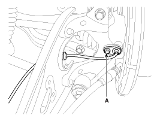
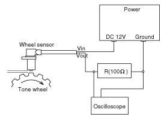
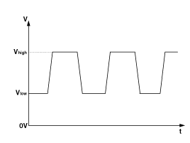

# Kia Sportage: Sensor de Velocidade dos Eixos Traseiros: Procedimentos de Reparo

[Home](../../index.md) / [Manual de Serviço e Reparo do Kia Sportage SL](../sportage-482.md) / [Sistema de Freio](sportage-894.md) / [Sistema ESC (Controle Estável Eletrônico)](sportage-915.md) / Procedimentos de Reparo do Sensor de Velocidade dos Eixos Traseiros

## Remoção

1. Remova a viga de fixação do sensor de velocidade do eixo traseiro (A).

   ```
   Torque de aperto:
   6,9 ~ 10,8 N.m (0,7 ~ 1,1 kgf.m, 5,1 ~ 8,0 lb-ft)
   ```

   

2. Remova o acabamento do lado do porta-malas e desconecte o conector do sensor de velocidade do eixo traseiro.

3. A instalação é o inverso da remoção.

## Inspeção

1. Medir a tensão de saída entre o terminal do sensor de velocidade do eixo e o chassi.

   > **Cuidado**
   >
   > - Para proteger o sensor de velocidade do eixo, ao medir a tensão de saída, um resistor de 100 ? deve ser usado conforme ilustrado.

   

2. Compare a mudança da tensão de saída do sensor de velocidade do eixo com a mudança normal da tensão de saída conforme mostrado abaixo.

   

   ```
   V_low : 0,59V ~ 0,84V
   V_high : 1,18V ~ 1,68V
   Frequência: 1 ~ 2,500Hz
   ```
