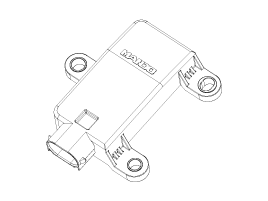
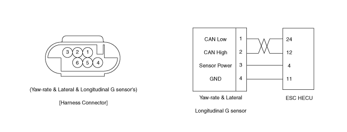

# Kia Sportage: Sensor de Yaw-rate e G Lateral: Descrição e Operação

[Home](../../index.md) / [Manual de Serviço e Reparo do Kia Sportage SL](../sportage-482.md) / [Sistema de Freios](sportage-894.md) / [Sistema ESC (Controle Estável Eletrônico)](sportage-915.md) / Sensor de Yaw-rate e G Lateral: Descrição e Operação

## Descrição

Quando o veículo estiver virando em relação a um eixo vertical, o sensor de yaw-rate detecta a taxa de yaw-rate eletronicamente pela mudança de vibração no furo do disco dentro do sensor de yaw-rate.

Se a velocidade de yaw atingir a velocidade específica após detectar o yaw do veículo, o controle ESC é reativado.

O sensor de G lateral detecta a G lateral do veículo. Um pequeno elemento dentro do sensor está fixado a um eixo articulável por G lateral.

A direção e a magnitude da G lateral aplicada ao veículo podem ser conhecidas com a mudança da capacidade eletrostática de acordo com a G lateral.

Especificação

| Descrição | Especificação | Observações |  |
| --- | --- | --- | --- |
| Tensão de operação | 10 ~ 16V |  |  |
| Sinal de saída | Interface CAN |  |  |
| Temperatura de operação | -40 ~ 85°C (-40 ~ 185°F) |  |  |
| Sensor de yaw-rate | Faixa de medição | -75 ~ 75°/seg |  |
| Frequência de resposta | 15 ~ 45Hz |  |  |
| Sensor de G lateral | Faixa de medição | -14,715 ~ +14,715g |  |
| Frequência de resposta | 50Hz ± 60% (-3dB) |  |  |

Diagrama Externo

