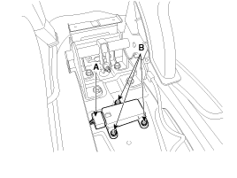

# Kia Sportage: Sensor de Yaw-rate e G Lateral: Procedimentos de Reparo

[Home](../../index.md) / [Manual de Serviço e Reparo do Kia Sportage SL](../sportage-482.md) / [Sistema de Freio](sportage-894.md) / [Sistema ESC (Control de Estabilidade Eletrônica)](sportage-915.md) / Procedimentos de Reparo do Sensor de Yaw-rate e G Lateral

## Remoção

1. Desligue o interruptor de ignição e desconecte o cabo negativo (-) da bateria.

2. Remova o capô do console do chão.

3. Desconecte o conectador do sensor de yaw rate & g lateral & g longitudinal (A).

   

4. Remova as varetas de fixação (B).

   ```
   Torque de aperto:
   7,9 ~ 10,8 N.m (0,8 ~ 1,1 kgf.m, 5,8 ~ 8,0 lb-ft)
   ```

5. A instalação é o contrário da remoção.
