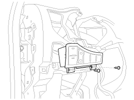
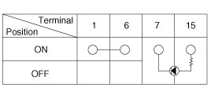

# Kia Sportage: DBC Switch: Procedimentos de Reparo

[Home](../../index.md) / [Manual de Serviço e Reparo do Kia Sportage SL](../sportage-482.md) / [Sistema de Freios](sportage-894.md) / [Sistema ESC (Controlador Estável Eletrônico)](sportage-915.md) / Procedimentos de Reparo do DBC Switch

## Inspeção

1. Desligue o interruptor de ignição e desconecte o cabo negativo (-) da bateria.

2. Remova a montagem do interruptor de lado do crash pad.

   

3. Verifique a continuidade entre os terminais do interruptor enquanto o DBC switch estiver acionado.

   
