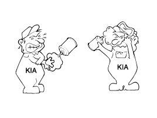
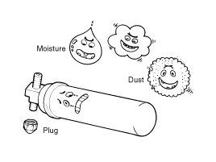
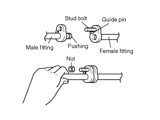

# Informações Gerais de Segurança e Cautela do Kia Sportage

[Home](../../index.md) / [Manual de Serviço e Reparo do Kia Sportage SL](../sportage-482.md) / [Aquecimento, Ventilação, Ar Condicionado](sportage-1181.md) / [Sistema de Ar Condicionado](sportage-1186.md) / Informações Gerais de Segurança e Cautela

## Instruções

### Quando Tratar o Refrigerante

1. O refrigerante líquido R-134a é altamente volátil. Uma gota no seu pulso pode causar congelamento localizado. Ao manipular o refrigerante, use luvas.

2. É prática comum usar óculos ou lentes de proteção para os olhos e luvas para proteger as mãos. Se o refrigerante pingar nos olhos, lave-os imediatamente com água limpa.

3. O recipiente de R-134a está sob pressão alta. Nunca deixe-o em lugar quente, e verifique se a temperatura de armazenamento está abaixo de 52°C (126°F).

4. Um detector de vazamento eletrônico deve ser usado para verificar a sistema de refrigerante para vazamento. Lembre-se de que o R-134a, ao entrar em contato com chama, produz clorina, um gás altamente tóxico.

5. Use apenas lubrificante recomendado para sistemas R-134a. Se lubrificantes diferentes do recomendado forem usados, pode ocorrer falha no sistema.

6. O lubrificante PAG absorve umidade do ar a uma taxa rápida, portanto, as seguintes precauções devem ser observadas:

   | – | Ao remover componentes de refrigerante do veículo, cubra-os imediatamente com uma tampa para prevenir a entrada de umidade. |
   | --- | --- |

   | – | Ao instalar componentes de refrigerante no veículo, não remova a tampa até o momento de conectar os componentes. |
   | --- | --- |

   | – | Conecte todas as tubulações e mangueiras de refrigerante sem demora para prevenir a entrada de umidade no sistema de ar condicionado. |
   | --- | --- |

   | – | Use apenas lubrificante do recipiente selado. |
   | --- | --- |

7. Se ocorrer uma descarga acidental no sistema, ventilar a área de trabalho antes de retomar o serviço.

   

### Quando Substituir Peças no Sistema de Ar Condicionado

1. Nunca abra ou desloque uma conexão antes de descarregar o sistema.

2. Cubra imediatamente as conexões abertas com uma tampa ou plugue para prevenir a entrada de umidade ou poeira.

3. Não remova as tampas de vedação de uma peça de substituição até que ela esteja pronta para ser instalada.

4. Antes de conectar uma conexão aberta, sempre instale um novo anel de vedação. Lubrifique a conexão e o anel com óleo de refrigerante antes de fazer a conexão.

   

### Quando Instalar Peças de Conexão

Flange com Pinhão Guiador

Verifique o novo anel de vedação para danos (use apenas o lubrificante especificado) e lubrifique com óleo de compressor. Ajuste o parafuso para a torque especificada.

| Tamanho | Torque de aperto [ N.m (kgf.m, lb.ft) ] |  |
| --- | --- | --- |
| Parafuso, parafuso |  |  |
| Parafuso(4T), Parafuso(4T) | Parafuso(8T), Parafuso(6T) |  |
| M6 | 4 - 6 (0.4 - 0.6, 2.9 - 4.3) | 8 - 12 (0.8 - 1.2, 5.7 – 8.6) |
| M8 | 9 - 14 (0.9 - 1.4, 6.5 - 10) | 20 - 30 (2.0 – 3.0, 14 – 21.6) |
| M10 | 19 - 28 (1.9 - 2.8, 13.7 - 20) | 45 - 60 (4.5 – 6.0, 32 – 43.3) |
| Tamanho | Flange parafuso, parafuso |  |
| Parafuso(4T), Parafuso(4T) | Parafuso(8T), Parafuso(6T) |  |
| M6 | 4 - 6 (0.4 - 0.6, 2.9 – 4.3) | 9 - 14 (0.9 – 1.4, 6.5 – 10.1) |

| M8 | 10 - 15 (1,0 - 1,5, 7 - 10) | 22 - 33 (2,2 – 3,3, 15,9 – 23,8) |
| M10 | 21 - 31 (2,1 - 3,1, 15 - 22) | 50 - 65 (5,0 - 6,5, 36,1 – 7,0) |

> **Nota**
>
> - T significa intensidade de tração, que é estampada na cabeça do parafuso apenas com o numeral.

Tratamento de tubos e conexões

As partes internas do sistema de refrigeração permanecerão em estado de estabilidade química desde que sejam utilizados refrigerantes puros e livres de umidade e óleo de refrigerante. Quantidades anormais de sujeira, umidade ou ar podem perturbar a estabilidade química e causar problemas ou danos sérios.

Os seguintes cuidados devem ser observados

1. Quando for necessário abrir o sistema de refrigeração, tenha tudo que será necessário para servir o sistema pronto, para que o sistema não fique aberto por um período maior do que o necessário.

2. Cap ou plube todas as linhas e conexões assim que forem abertas para prevenir a entrada de sujeira e umidade.

3. Todas as linhas e componentes em estoque devem ser capados ou selados até que estejam prontos para serem utilizados.

4. Nunca tente rebobinar linhas formadas para ajustá-las. Use a linha correta para a instalação que está sendo servida.

5. Todos os instrumentos, incluindo a manivela para dispensação de refrigerante, o manípulo do conjunto de medidores e as mangas de teste, devem ser mantidos limpos e secos.
