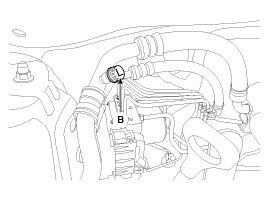
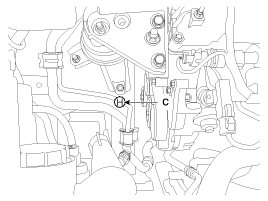
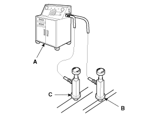
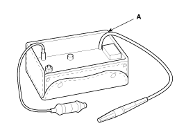

# Kia Sportage: Procedimentos de Reparo

[Início](../../index.md) / [Manual de Serviço e Reparo do Kia Sportage SL](../sportage-482.md) / [Aquecimento, Ventilação, Ar Condicionado](sportage-1181.md) / [Sistema de Ar Condicionado](sportage-1186.md) / Procedimentos de Reparo

## Serviços do Sistema de Refrigeração

Recuperação de Refrigerante

Utilize apenas equipamentos de serviço listados pela U.L. e certificados para atender aos requisitos da SAE J2210 para remover HFC-134a (R-134a) do sistema de ar condicionado.

> **Cuidado**
>
> - O vapor do refrigerante ou lubrificante do ar condicionado pode irritar os olhos, nariz ou garganta.
> - Seja cuidadoso ao conectar o equipamento de serviço.
> - Não respire refrigerante ou vapor.

Caso ocorra uma descarga acidental do sistema, ventilar a área de trabalho antes de retomar o serviço.

Informações adicionais sobre saúde e segurança podem ser obtidas dos fabricantes de refrigerantes e lubrificantes.

1. Conecte um sistema de recuperação/reciclagem/carga de refrigerante R-134a (A) ao porta-serviço de alta pressão (B) e ao porta-serviço de baixa pressão (C) conforme indicado, seguindo as instruções do fabricante do equipamento.

   

   

   

2. Medir a quantidade de óleo de refrigerante removido do sistema de ar condicionado após o processo de recuperação. Certifique-se de instalar a mesma quantidade de óleo de refrigerante novo no sistema de ar condicionado antes de recarregar.

Evacuação do Sistema

Utilize apenas equipamentos de serviço listados pela U.L. e certificados para atender aos requisitos da SAE J2210 para remover HFC-134a (R-134a) do sistema de ar condicionado.

> **Cuidado**
>
> - O vapor do refrigerante ou lubrificante do ar condicionado pode irritar os olhos, nariz ou garganta.
> - Seja cuidadoso ao conectar o equipamento de serviço.
> - Não respire refrigerante ou vapor.

Caso ocorra uma descarga acidental do sistema, ventilar a área de trabalho antes de retomar o serviço.

Informações adicionais sobre saúde e segurança podem ser obtidas dos fabricantes de refrigerantes e lubrificantes.

1. Quando o sistema de ar condicionado for aberto para o ar, como durante a instalação ou reparo, ele deve ser evacuado usando um sistema de recuperação/reciclagem/carga de refrigerante R-134a. (Se o sistema estiver aberto por vários dias, o seco-reservatório deve ser substituído e o sistema deve ser evacuado por várias horas.)

2. Conecte um sistema de recuperação/reciclagem/carga de refrigerante R-134a (A) ao porta-serviço de alta pressão (B) e ao porta-serviço de baixa pressão (C) conforme indicado, seguindo as instruções do fabricante do equipamento.

   

3. Se a baixa pressão não atingir mais de 93,3 kPa (700 mmHg, 27,6 in.Hg) em 10 minutos, provavelmente há uma fuga no sistema. Recarregue parcialmente o sistema e verifique para fuga (veja teste de fuga.).

4. Remova o válvula de baixa pressão do porta-serviço de baixa pressão.

> - Não respire refrigerante ou vapor.

Se ocorrer uma descarga acidental do sistema, ventilar a área de trabalho antes de retomar o serviço.

Informações adicionais sobre saúde e segurança podem ser obtidas dos fabricantes do refrigerante e lubrificante.

1. Conecte um sistema de recuperação/reciclagem/charging de R-134a (A) ao porta-serviço de pressão alta (B), conforme mostrado, seguindo as instruções do fabricante do equipamento.

   

2. Adicione a mesma quantidade de óleo de refrigerante novo ao sistema que foi removida durante a recuperação. Use apenas o óleo de refrigerante especificado. Carregue o sistema com 550 ± 25g (19,4 ± 0,88oz) de refrigerante R-134a. Não sobrecarregue o sistema, pois o compressor será danificado.

Teste de Vazamento de Refrigerante

Sempre realize um teste de vazamento com um detector de vazamento eletrônico quando se suspeitar de vazamento ou de refrigerante e quando realizar operações de serviço que envolvem desmontagem ou deslocação ou conexão de válvulas.

> **Nota**
>
> - Para usar o detector de vazamento corretamente, leia o manual fornecido pelo fabricante.

Se detectar um vazamento de gás, proceda da seguinte forma:

1. Verifique a torção das válvulas de conexão e, se estiver muito fraca, aperte até a torção correta. Verifique para vazamento com um detector de vazamento (A).

2. Se o vazamento continuar mesmo após a válvula ter sido apertada, descarregue o refrigerante do sistema, desconecte as válvulas e verifique as superfícies de contato para danos. Sempre substitua, mesmo que o dano seja leve.

3. Verifique o óleo do compressor e adicione óleo se necessário.

4. Carregue o sistema e reabra o teste de vazamento. Se não for encontrado vazamento, evacue e carregue o sistema novamente.

   
