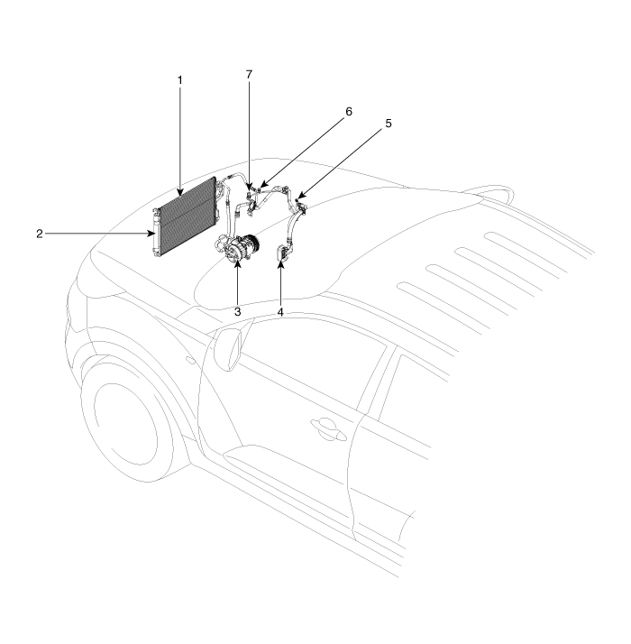
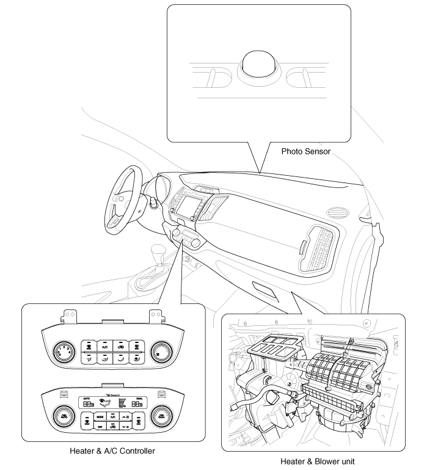

# Kia Sportage: Componentes e Localização dos Componentes

[Home](../../index.md) / [Manual de Serviço e Reparo do Kia Sportage SL](../sportage-482.md) / [Aquecimento, Ventilação, Ar Condicionado](sportage-1181.md) / [Sistema de Ar Condicionado](sportage-1186.md) / Componentes e Localização dos Componentes

## Índice de Localização dos Componentes

Motor

| 1. Condensador 2. Secador-lixo 3. Compressor 4. Valvula de Expansão | 5. Porta de Serviço (Alto) 6. Porta de Serviço (Baixo) 7. Transdutor de Pressão do Ar Condicionado |
| --- | --- |

## Interior

